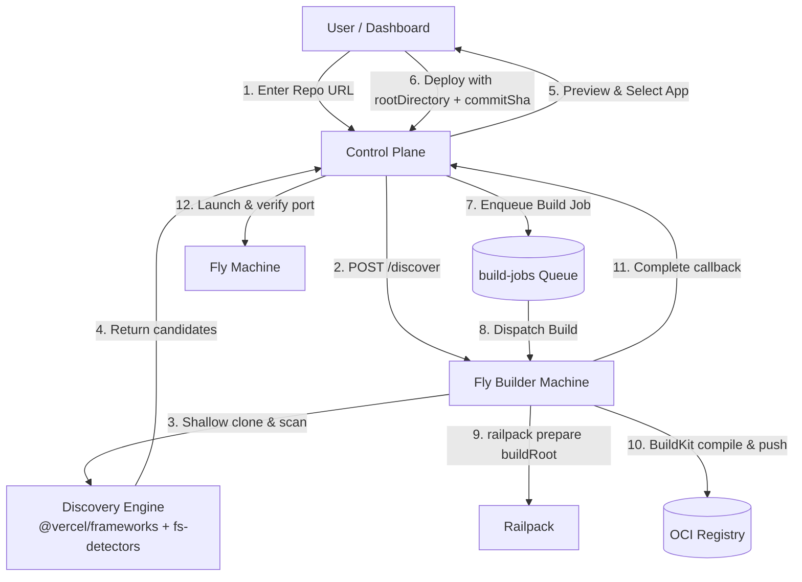

# Architecture — Cloud Hosting Platform

> **Status:** This document separates the **current** architecture (verified in source at commits `d6265a6`–`70a8c40`) from the **proposed target** architecture. Every proposed component is explicitly labeled.
> **Related documents:** [`prd.md`](./prd.md), [`api.md`](./api.md), [`db.md`](./db.md), [`plan.md`](./plan.md), [`todo.md`](./todo.md)

## 1. Current Architecture

### 1.1 Major components (implemented)

| Component | Implementation | Role |
| --- | --- | --- |
| Next.js app (vinext) | `app/**`, `components/**`, `stores/**` | Server-rendered dashboard UI (MUI v9); server components call `getSession()` |
| Better Auth | `lib/auth/index.ts`, `app/api/auth/[...all]/route.ts` | Email/password auth, sessions in Neon with 5-minute cookie cache (`cookieCache`) |
| Better Auth API Key plugin | `lib/auth/index.ts` (`apiKey()` plugin), `lib/db/schema.ts` (`apikey` table, migration `0004`) | Programmatic API key issuance and verification for the Storage API |
| Drizzle ORM + Cloudflare Hyperdrive + Neon | `lib/db/index.ts`, `lib/db/schema.ts`, `lib/db/product-schema.ts`, `lib/storage/schema.ts` | Authoritative PostgreSQL store via Hyperdrive connection pooling (`pg.Pool` scoped to request via `AsyncLocalStorage`); direct URL fallback for dev & migrations |
| Storage Service | `lib/storage/**`, `app/api/v1/storage/**` | Multi-tenant object storage backed by Cloudflare R2 (`cloud-storage` bucket); control-plane metadata in Neon; tiered L1/L2 auth cache |
| Cloudflare R2 | `STORAGE_BUCKET` binding (`cloud-storage`) | Object data plane for the Storage Service; key layout: `<tenantId>/<namespace>/<path>` |
| Cloudflare KV | `APP_KV` binding (`lib/kv.ts` via `TypedKvCache`) | Global read cache for API key authorization context, tenant info, and namespaces |
| Cloudflare Workers Rate Limiting | `cloudflare.config.ts` (`RL_API_*`, `RL_STORAGE_*`, `RL_STUDIO`) | Native rate limit bindings replacing Upstash Redis |
| Cloudflare Durable Objects | `TenantMeterDO`, `DeploymentStreamDO` | Atomic quota enforcement, SQLite outbox event batching, and real-time SSE log fan-out |
| Cloudflare Queue | `cloudflare.config.ts` (bindings `AUTH_JOBS`, `BUILD_JOBS`), `entrypoints/worker.ts` | Asynchronous build dispatch and auth background jobs |
| Cloudflare Worker | `entrypoints/worker.ts`, `cloudflare.config.ts`, `vite.config.ts` | Hosts control plane, queue consumer, cron handlers, `withDbScope` wrapper |
| MUI v9 (Material UI) | `components/**` | Production UI component library with emotion styling |
| TanStack Query | `components/**` | Client-side mutations and queries |
| Zustand | `stores/**` | Client-side state management |

### 1.2 Current architecture diagram

```mermaid
graph TD
  U[User Browser] -->|HTTPS| W[Cloudflare Worker (vinext)]
  subgraph CF[Cloudflare edge]
    W --> AUTH[Better Auth + CookieCache]
    W --> SSR[Server-rendered pages<br/>app/(app)/*]
    W --> SAPI[Storage API<br/>app/api/v1/storage/*]
    W --> RL[Cloudflare Rate Limiting<br/>RL_* bindings]
    SAPI --> CACHE[Tiered Auth Cache<br/>L1 Memory 30s + L2 APP_KV 60s]
    SAPI --> METER[TenantMeterDO<br/>Atomic Quotas & SQLite Outbox]
    SAPI --> R2[(cloud-storage<br/>R2 Bucket)]
    W --> STREAM[DeploymentStreamDO<br/>Live SSE Broker]
    W --> Q[(Cloudflare Queues<br/>build-jobs / auth-jobs)]
    AUTH --> HD[Hyperdrive Connection Pool<br/>Request-scoped via ALS]
    SSR --> HD
    CACHE -.->|Miss Only| HD
    METER -.->|Batched Flush| HD
    HD --> PG[(Neon Postgres<br/>Authoritative Store)]
  end
  SSR -->|getSession| AUTH
```

### 1.3 Data flow boundaries (current)

- The browser talks only to the Cloudflare Worker.
- Worker entrypoints (`fetch`, `queue`, `scheduled`) are wrapped with `withDbScope()` (`AsyncLocalStorage`), providing a shared, request-scoped `pg.Pool` connected through Cloudflare Hyperdrive to Neon.
- Database queries for API key authorization are cached in isolate memory (30s) and Cloudflare KV (60s), reducing database queries by >99% on storage hot paths.
- Revocations immediately store a revocation tombstone in memory and KV, preventing stale key reuse across all regions.
- Usage events are durably buffered in the `TenantMeterDO` SQLite outbox and asynchronously flushed in batches to Neon, avoiding synchronous multi-query writes on upload/download/delete requests.
- Log streaming uses `DeploymentStreamDO` to fan out real-time build logs via SSE, eliminating 3-second database polling.

### 1.4 Reliability properties (current)

- **Hyperdrive Request Isolation**: `pg.Pool` instances are scoped strictly to the incoming request via `withDbScope()`, preventing cross-request socket leaks and staying well within the Cloudflare Workers 6 concurrent outbound socket limit.
- **Fail-Safe Authorization**: Cache misses fall back to authoritative database lookups. Any KV failure defaults to an authoritative check; errors never grant unauthorized access.
- **Durable Metering Outbox**: Storage operations commit usage to local DO SQLite outbox. Flushes to Neon use idempotent `INSERT ... ON CONFLICT (event_id) DO NOTHING` to ensure zero double-counting during retries or temporary network partitions.

### 1.5 Automatic Project Discovery & Build Pipeline (implemented)

Cloud includes an automated repository discovery and container image build pipeline:

1. **Automatic Project Discovery Engine** (`lib/project-discovery/**`):
   - Modular engine powered by `@vercel/frameworks` (framework catalogs and metadata) and `@vercel/fs-detectors` (filesystem detection rules, lockfile inspection, package managers).
   - Custom deterministic detectors for non-JS ecosystems (Python, Go, Rust, PHP, Ruby, Elixir, Java, .NET).
   - Monorepo & workspace detection (pnpm, npm, Yarn, Turborepo, Nx, Lerna, Cargo, Go).
   - Candidate ranking and shared-package exclusion (filters `@repo/ui`, etc.).
   - Path validation ensuring zero directory escapes and normalized POSIX root paths.
2. **Build Architecture** (`builder/server.mjs`, `lib/build/**`):
   - Shared Fly.io builder machine (`cloud-builder`).
   - Isolated scratch workspace per build/discover task.
   - Pinned `commitSha` guarantee: discovery resolves head SHA; deployment builds the exact same commit.
   - Railpack zero-config planner & Docker BuildKit runner.
   - Automatic listening port auto-detection via container network socket sniffing (`/proc/net/tcp[6]`).



### 1.6 Storage Service (implemented)

The platform includes a production-grade multi-tenant object storage service:

**Data plane:** Cloudflare R2 bucket (`cloud-storage`, binding `STORAGE_BUCKET`).

**Control plane:** Neon PostgreSQL, using the `storage_*` table prefix (migration `0005`):
- `storage_tenants` — one row per user; `tenantId` is deterministic (`t_${userId.replace(/[^a-zA-Z0-9]/g,'').slice(0,24)}`)
- `storage_projects` — named namespaces (sub-buckets) per tenant
- `storage_api_keys` — legacy key registry (not used for auth; Better Auth `apikey` table is authoritative)
- `storage_usage_daily`, `storage_usage_events`, `storage_audit_log` — metering and audit tables

**Auth flow:**
1. Client sends `x-api-key: <key>` or `Authorization: Bearer <key>`.
2. `lib/storage/request-auth.ts` hashes the token with SHA-256 and checks the local isolate memory cache (`MEMORY_KEY_CACHE`, 30s TTL).
3. On L1 memory miss, it checks Cloudflare Workers KV (`TypedKvCache("storage:apikey", "v1")`, 60s TTL).
4. If cached, it checks KV for any revocation tombstone (`storage:apikey-revoked:v1:<hash>`); if a tombstone exists or the key is inactive, it immediately rejects with 401.
5. On L2 KV miss, it coalesces concurrent lookups via an in-flight promise map and performs a single authoritative database query against Neon through Hyperdrive.
6. The complete authorization context (API key ID, scopes, tenant details, project details) is cached in L1 and L2 KV. Subsequent requests incur 0 database hits.
7. Admin operations (`storage:admin`) and explicit force flags bypass cache to guarantee authoritative validation.
8. API key revocations write an instant revocation tombstone to isolate memory and KV, invalidating active tokens across all Cloudflare edge PoPs within seconds.

**Phase 2 & Phase 3 Core Data Plane & Metering:**
- **Durable Object Metering & Hard Quotas**: Each tenant has a dedicated SQLite-backed Cloudflare Durable Object (`TenantMeterDO` bound as `STORAGE_METER`). The DO provides single-threaded atomic byte reservations, preventing race conditions on concurrent uploads.
  - **Free Plan Allowances**: 512 MB storage limit (`536,870,912` bytes), 100,000 monthly Class A operations (PUT, COPY, DELETE, LIST), and 100,000 monthly Class B operations (GET, HEAD).
  - **Hard 402 Rejections**: Exceeding the 512 MB storage capacity or monthly operation caps immediately rejects requests with HTTP `402 Quota Exceeded`.
  - **Live Usage API**: `GET /api/v1/storage/usage` and `GET /api/v1/storage/tenants` inspect current byte counts, file count, and monthly ops.
- **Durable SQLite Outbox for Usage Persistence**:
  - Upload, download, and delete operations do not perform synchronous multi-query inserts into Neon.
  - Usage events are atomically written to SQLite inside `TenantMeterDO` and flushed asynchronously in batches to Neon using `INSERT ... ON CONFLICT (event_id) DO NOTHING`.
  - Daily aggregated totals use `INSERT ... ON CONFLICT DO UPDATE`, completely eliminating duplicate metering entries on retries.
- **Presigned URLs via Signed Tokens**: For uploads/downloads over several MB, clients call `POST /api/v1/storage/namespaces/:ns/presign` to receive an HMAC-SHA256 signed capability token. Third-party clients then upload directly via `PUT /api/v1/storage/presigned/:token` without requiring the tenant's master API key.
- **Server-Side File Copy**: `POST /api/v1/storage/namespaces/:ns/files/:path+` duplicates files and metadata within tenant namespaces without client round-trips, reserving destination quota beforehand.
- **Conditional Requests (ETag & Last-Modified)**: `GET` and `HEAD` endpoints evaluate `If-None-Match` and `If-Modified-Since`, returning `304 Not Modified` without payload transfer when matching.
- **Security & XSS Hardening**: HTML/SVG/XML uploads served from the control plane origin are forced to `Content-Type: application/octet-stream` and `Content-Disposition: attachment; filename="..."` with `X-Content-Type-Options: nosniff`.
- **Upload Size Protection**: Enforces an upfront 100 MB max object size via `Content-Length` validation (returning `413 VALIDATION_ERROR` before reading body streams).
- **Native Rate Limiting**: Enforced via Cloudflare Workers Rate Limiting bindings (`RL_STORAGE_READ`, `RL_STORAGE_WRITE`, `RL_STORAGE_ADMIN`, `RL_STORAGE_PRO_*`), returning `X-RateLimit-*` headers with 429 on abuse.
- **OpenAPI 3.1 Spec**: Exposed at `GET /api/v1/storage/openapi.json`.

**Object key layout:** `<tenantId>/<namespace>/<path>`

> **Note:** `lib/storage/` is entirely independent of `databases/`. The `databases/` directory is the self-hosted multi-tenant libSQL (`sqld`) service on Fly.io — it is not used by the Storage API in any way.

### 1.7 Production Optimization & Live Benchmark Results

Measured against the live deployment (`https://cloud.rsioex.workers.dev`) using PostgreSQL `pg_stat_statements` to measure actual database queries triggered per request:

```
BENCH storage GET (API key): n=200 stmts=2 perReq=0.01 p50=348ms p95=388ms
   1x select "id", "tenant_id", "project_id", "name", "key_hash", ... from "storage_api_keys"
   1x select "id", "name", "status", "plan", ... from "storage_tenants"
BENCH storage PUT (API key): n=40 stmts=0 perReq=0.00 p50=572ms p95=645ms
BENCH get-session (cookie):  n=100 stmts=2 perReq=0.02 p50=23ms  p95=37ms
   1x select "id", "expires_at", "token", ... from "session"
   1x select "id", "name", "email", ... from "user"
BENCH GET /api/v1/deployments: n=50 stmts=50 perReq=1.00 p50=105ms p95=124ms
   50x select "id", "user_id", "repo_url", ... from "deployments"
```

| Route / Workload | Baseline DB Ops / Req | Optimized DB Queries / Req | Reduction | Mechanism |
|---|---|---|---|---|
| **Storage API GET** | ~6 ops | **0.01 queries** | **>99%** | L1 memory + L2 KV auth context cache |
| **Storage API PUT** | ~6 ops | **0.00 queries** | **100% on hot path** | Auth cached + TenantMeterDO SQLite outbox batching |
| **`get-session`** | 2 ops | **0.02 queries** | **>98%** | Better Auth 5-minute `cookieCache` |
| **Deployments List** | 1–2 ops | **1.00 queries** | Optimal | Direct query through Hyperdrive pool |
| **SSE Log Streaming** | 1 query / 3s per client | **0 queries** | **100% polling eliminated** | `DeploymentStreamDO` live state & broadcast |

## 2. Proposed Target Architecture

### 2.1 Responsibilities split

- **Control plane** (this repo, deployed as a Cloudflare Worker): auth, dashboard, API, plans, subscriptions, payments, backups metadata, audit.
- **Runtime plane** (Fly.io): Fly Machines and Volumes. Managed exclusively by the control plane backend through the Fly Machines API using a server-side token. [Partially implemented: `lib/fly/client.ts`; volumes pending]
- **Storage plane** (Cloudflare R2): multi-tenant object storage. [**Implemented** — `cloud-storage` R2 bucket, `lib/storage/**`, `app/api/v1/storage/**`; control-plane metadata in Neon `storage_*` tables]
- **Backup plane** (Cloudflare R2): backup objects and artifacts. [Proposed]

### 2.2 Target architecture diagram

```mermaid
graph TD
  U[User Browser] -->|HTTPS| W[Cloudflare Worker (vinext)]
  subgraph CF[Cloudflare edge]
    W --> AUTH[Better Auth]
    W --> API[/api/v1/* controllers]
    W --> SSR[Server-rendered pages]
    AUTH --> KV[(AUTH_KV)]
    API --> PG[(Neon Postgres<br/>authoritative metadata)]
    API --> OUTBOX[(transactional outbox<br/>operations)]
    OUTBOX -->|publish| Q[(job Queues)]
    Q --> WQ[queue workers<br/>provision/lifecycle/backup]
    WQ --> PG
    WQ --> FLY[Fly Machines API<br/>machines + volumes]
    WQ --> R2[(R2 backups)]
    API --> FLY
    API --> R2
    WQ --> KV2[(KV cache: regions, plans, status)]
  end
```

- Legend: `PG` and `OUTBOX` are proposed tables in Neon; `FLY`, `R2`, `KV2`, and the job queues are proposed integrations.

### 2.3 Authentication and authorization flow (proposed)

1. `getSession()` validates the Better Auth cookie (DB + KV secondary storage).
2. API middleware injects `session.user`.
3. Resource handlers verify ownership (`app.userId === session.user.id`) before any DB or Fly call.
4. Sensitive operations write an audit event.

### 2.4 Application provisioning sequence (proposed)

1. `POST /api/v1/applications` validates body, enforces quota (DB transaction), creates `applications` row in `pending`.
2. Outbox row inserted; queue message published.
3. Worker: create Fly Machine via Fly API, store `fly_machine_id`, transition to `running`, emit audit event.
4. On failure: retry with backoff, then mark `failed` and record error.

**Current implementation:** `POST /api/v1/applications` writes the `applications` row, creates the Fly app and machine synchronously via `lib/fly/client.ts`, then stores the `machines` row and sets the app `running` (or `failed`). There is no quota check, outbox, or queue worker yet; failures attempt Fly cleanup.

### 2.5 Lifecycle flows (proposed)

- **Start/stop/restart/redeploy:** same outbox pattern; idempotency keyed per operation.
- **Update:** `PATCH` applies safe fields only (name, runtime, region) with a 409 guard if an operation is pending.
- **Delete:** mark `deleting` → worker stops machine, destroys volumes, archives rows → `deleted`.

**Current implementation:** `PATCH` merges runtime/region into the existing Fly machine config and updates the DB synchronously; `DELETE` destroys the machine and app synchronously, then soft-deletes the row. Start/stop/restart/redeploy, volumes, outbox, and workers are not implemented.

### 2.6 Payment and subscription lifecycle (proposed)

1. User initiates bKash payment with an idempotency key stored in Postgres.
2. bKash callback records raw event; never finalizes state from the body.
3. A server-side verification call to bKash reconciles status; on success the subscription activates inside a DB transaction.
4. Scheduled reconciliation resyncs `subscriptions` with provider state.

### 2.7 Queue processing (proposed)

- Queues: `provisioning`, `lifecycle`, `backups` (or one queue with typed jobs like `AuthJob`).
- Consumers tolerate duplicate delivery via unique `idempotency_key` on `outbox`/`operations` rows.
- Retry/backoff per queue; failed jobs go to a dead-letter queue with alerting.

### 2.8 Backup and restore (proposed)

1. Backup job snapshots eligible data (e.g., volume snapshot or DB dump) and writes encrypted objects to R2.
2. `backups` rows record object key, size, checksum, retention window.
3. Restore downloads, verifies checksum, applies to the target machine, and runs validation before marking success.

### 2.9 Cache design (proposed)

- KV caches only non-authoritative, easily-regenerable data: region lists, plan catalog, status summaries.
- Never KV-only for payment/subscription/quota enforcement.
- Invalidation: version keys (`plans:v3`) and short TTLs; authoritative reads always hit Postgres.

### 2.10 Rate limiting and abuse prevention (proposed)

- Per-user token-bucket on create/start/stop/backup/payment endpoints; global caps on unauthenticated auth endpoints.
- Idempotency keys prevent double-charge and double-provision.

### 2.11 Observability (proposed)

- Structured logs on worker and queue consumer; audit events table for sensitive actions; health endpoint; error telemetry.

### 2.12 Secrets (current + proposed)

- Current secrets: `DATABASE_URL`, `BETTER_AUTH_SECRET`, `BETTER_AUTH_URL` (Worker secret bindings in `cloudflare.config.ts`). R2 bucket is bound via `STORAGE_BUCKET` (R2 binding — no credentials needed; uses binding auth).
- Proposed additions: `FLY_API_TOKEN` (least-privilege), `BKASH_*` merchant keys. Rotate via Worker secret rotation.

### 2.13 Deployment environments and migration (proposed)

- Local (`next dev`, in-memory KV fallback) / preview (`CLOUDFLARE_PREVIEW_BUILD=true`, no queue trigger) / production.
- DB migrations applied via Drizzle Kit with backward-compatible, incremental migrations.

### 2.14 Reliability and disaster recovery (proposed)

- Reconciliation jobs resync Fly machine state and bKash subscriptions from source-of-truth.
- R2 object retention + periodic restore drills.

### 2.15 Cost control and multi-tenant isolation (proposed)

- Quota enforcement inside transactions; per-app resource limits mapped from plan entitlements; strict ownership checks preventing cross-tenant access.
