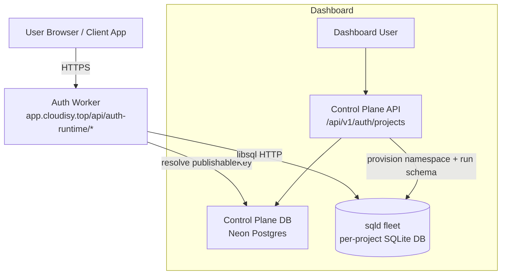
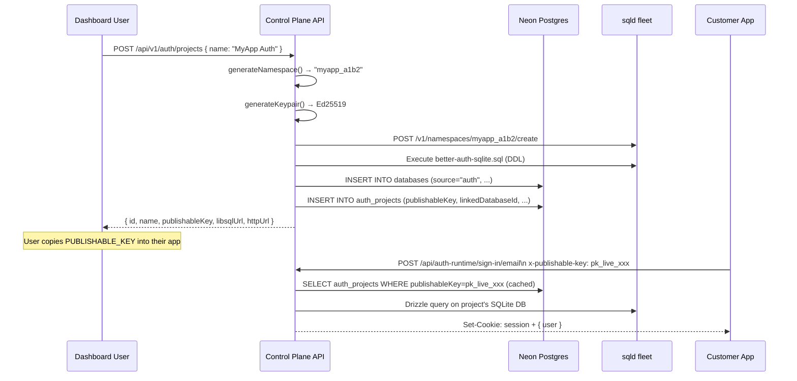

# Auth Service — Implementation Plan

> **Status:** Planning — not yet implemented.
> **Related:** [`architecture.md`](../architecture.md), [`lib/databases/service.ts`](../lib/databases/service.ts), [`lib/db/product-schema.ts`](../lib/db/product-schema.ts)

---

## Overview

We are building a **managed Better Auth service** — similar in spirit to what Neon Auth does for Postgres, but over our own **SQLite / libSQL** stack. When a user creates an "Auth Project" from the dashboard:

1. A dedicated **libSQL namespace** is provisioned on our `sqld` fleet (exactly as databases work today).
2. The control plane **auto-runs** a pre-generated Better Auth SQLite migration into that namespace so it arrives ready with the correct schema.
3. The user sees **both** a new Database entry *and* a new Auth Project entry in the dashboard — identical to Neon's UX where identity lives inside your database.
4. A **shared auth runtime** (a single vinext/Cloudflare Worker endpoint at e.g. `auth.cloudisy.top`) proxies all sign-in/sign-up traffic to the correct per-project SQLite database, identified by a `publishableKey`.

---

## Architecture

### Key design decisions (inspired by Neon Auth)

| Decision | Rationale |
|---|---|
| **Database-per-project (SQLite file per Auth Project)** | Full isolation; auth state stays inside the user's database; no cross-contamination. |
| **Shared stateless auth runtime** | We don't spin up per-project servers. One Worker handles all projects; routes to the correct SQLite DB at request time using the publishable key. |
| **Better Auth as the auth engine** | Open-source, drizzle-native, CLI-driven schema generation. |
| **Pre-generated migration SQL** | Run `npx @better-auth/cli generate` once to produce the canonical SQLite schema; store that SQL file; replay it on every new project provisioning — no runtime CLI dependency. |
| **Email + password only (Phase 1)** | Simplest surface to get to production; OAuth providers added in Phase 2. |

### High-level component diagram



---

## Directory Layout

```
auth/
├── plan.md                        ← this file
├── schema/
│   └── better-auth-sqlite.sql     ← pre-generated canonical SQLite DDL (committed)
└── README.md                      ← usage guide (to be written after impl)
```

New files created across the monorepo:

```
lib/
└── auth-projects/
    ├── service.ts          ← AuthProjectService (create / list / get / delete)
    ├── client.ts           ← browser-side fetch helpers
    ├── schema-runner.ts    ← applies better-auth-sqlite.sql to a new SQLite namespace
    └── runtime.ts          ← per-project Better Auth instance factory (server-side)

lib/db/
└── product-schema.ts       ← ADD: auth_projects table

lib/validators/
└── auth-project.ts         ← Zod schema: createAuthProjectSchema

app/
├── (app)/
│   └── auth/
│       └── page.tsx        ← Auth Projects dashboard page
└── api/
    ├── v1/
    │   └── auth/
    │       └── projects/
    │           ├── route.ts           ← GET list / POST create
    │           └── [id]/
    │               └── route.ts       ← GET detail / DELETE
    └── auth-runtime/
        └── [...all]/
            └── route.ts    ← Shared auth runtime catch-all proxy

components/
└── auth-projects/
    ├── auth-projects-page.tsx
    ├── create-auth-project-dialog.tsx
    └── connect-auth-project-dialog.tsx

components/shell/
└── sidebar.tsx             ← ADD "Auth" nav entry (ShieldCheck icon)
```

---

## Phase 1 — Implementation Steps

### Step 1 — Generate & commit the canonical Better Auth SQLite schema

**Goal:** Produce `auth/schema/better-auth-sqlite.sql` once, commit it. Never run the CLI at runtime.

```bash
# Run locally / in a scratch environment with Node:
npx @better-auth/cli generate --dialect sqlite --output ./auth/schema/better-auth-sqlite.sql
```

The generated DDL will include the following tables (email/password only):
- `user` — id, name, email, emailVerified, image, createdAt, updatedAt
- `session` — id, userId, expiresAt, ipAddress, userAgent, token, createdAt, updatedAt
- `account` — id, accountId, providerId, userId, password, createdAt, updatedAt
- `verification` — id, identifier, value, expiresAt, createdAt, updatedAt

> **Important:** The SQL file is the **single source of truth** for the auth schema. Any future schema change (e.g., adding OAuth) requires re-generating and re-running migration on existing project databases.

---

### Step 2 — Control-plane database schema (Neon Postgres)

Add to `lib/db/product-schema.ts`:

```ts
export const authProjects = pgTable(
  "auth_projects",
  {
    id:              uuid("id").primaryKey().defaultRandom(),
    userId:          text("user_id").notNull().references(() => user.id, { onDelete: "cascade" }),
    name:            text("name").notNull(),
    // The sqld namespace that holds the auth SQLite DB (same naming scheme as databases)
    namespace:       text("namespace").notNull().unique(),
    // Ed25519 keypair for JWT auth to the sqld namespace (same as databases)
    publicKey:       text("public_key").notNull(),
    privateKey:      text("private_key").notNull(),
    // Pre-minted RW token for the auth runtime to connect to its own SQLite DB
    defaultToken:    text("default_token").notNull(),
    // libSQL URLs
    primaryHost:     text("primary_host").notNull(),
    httpUrl:         text("http_url").notNull(),
    libsqlUrl:       text("libsql_url").notNull(),
    // Publishable key the client app sends to identify its project (safe for browser)
    publishableKey:  text("publishable_key").notNull().unique(),
    // Secret used by the auth runtime to sign sessions (never exposed to users)
    authSecret:      text("auth_secret").notNull(),
    // FK to the linked databases row (shown on the Databases page as well)
    linkedDatabaseId: uuid("linked_database_id").references(() => databases.id),
    status:          text("status").notNull().default("provisioning"),
    createdAt:       timestamp("created_at", { withTimezone: true }).defaultNow().notNull(),
    updatedAt:       timestamp("updated_at", { withTimezone: true })
                       .defaultNow()
                       .$onUpdate(() => new Date())
                       .notNull(),
    deletedAt:       timestamp("deleted_at", { withTimezone: true }),
  },
  (table) => [
    index("auth_projects_user_idx").on(table.userId),
    index("auth_projects_publishable_key_idx").on(table.publishableKey),
  ]
);
```

Run a Drizzle migration after adding this table:
```bash
npx drizzle-kit generate
npx drizzle-kit migrate
```

---

### Step 3 — Auth Project Service (`lib/auth-projects/service.ts`)

The `AuthProjectService` mirrors `DatabaseService`. It reuses `generateKeypair()`, `createToken()`, `generateNamespace()`, `createSqldNamespace()`, and `deleteSqldNamespace()` from `lib/databases/service.ts` (move those to a shared `lib/databases/sqld.ts` utility).

#### `create(userId, input)` flow

```
1.  generateNamespace(input.name)                        → "myauth_a1b2c3d4"
2.  generateKeypair()                                    → Ed25519 { publicKey, privateKey }
3.  createSqldNamespace(namespace, publicKey)
4.  createToken(privateKey, namespace, { scope: "rw" }) → defaultToken
5.  crypto.randomBytes(32).toString("hex")              → authSecret
6.  `pk_live_${crypto.randomBytes(20).toString("hex")}` → publishableKey
7.  applyAuthSchema(libsqlUrl, defaultToken)             ← runs DDL from SQL file
8.  INSERT INTO databases (source="auth", ...)           → linkedDatabase
9.  INSERT INTO auth_projects (linkedDatabaseId, ...)
10. Return AuthProjectRecord (status = "ready")
```

#### `applyAuthSchema` (`lib/auth-projects/schema-runner.ts`)

```ts
import { createClient } from "@libsql/client";

// Imported as a raw string at build time (Vite ?raw import or esbuild loader: "text")
import SCHEMA_SQL from "../../auth/schema/better-auth-sqlite.sql?raw";

export async function applyAuthSchema(url: string, authToken: string): Promise<void> {
  const client = createClient({ url, authToken });
  const statements = SCHEMA_SQL
    .split(";")
    .map((s) => s.trim())
    .filter(Boolean);
  for (const sql of statements) {
    await client.execute(sql);
  }
}
```

> **Note:** In the Cloudflare Worker environment we cannot read from the filesystem at runtime. The SQL must be **imported as a raw string literal** via Vite's `?raw` import so it's bundled into the Worker.

---

### Step 4 — API routes

#### `app/api/v1/auth/projects/route.ts`

| Method | Behaviour |
|--------|-----------|
| `GET`  | List user's auth projects from Postgres |
| `POST` | Create a new auth project — full `create()` flow |

#### `app/api/v1/auth/projects/[id]/route.ts`

| Method   | Behaviour |
|----------|-----------|
| `GET`    | Fetch single project detail + live stats from sqld |
| `DELETE` | Soft-delete Postgres records + `deleteSqldNamespace()` |

All routes follow the existing pattern: `requireUser()` → `authProjectService.*()` → `jsonOk()` / `errorResponse()`.

Rate limits: 120 req/min on list, **5 req/min** on create (provisioning is expensive), 60 req/min on detail/delete.

---

### Step 5 — Auth Runtime (`lib/auth-projects/runtime.ts`)

A **shared Better Auth instance factory**. Given a `publishableKey`, it:

1. Looks up the `auth_projects` row in Postgres (cached in KV/in-memory for 60s).
2. Creates a `@libsql/client` pointed at the project's SQLite namespace using `defaultToken`.
3. Wraps it with Drizzle (sqlite dialect).
4. Instantiates `betterAuth({ database: drizzleAdapter(db, { provider: "sqlite" }), secret: project.authSecret, emailAndPassword: { enabled: true } })`.
5. Caches the instance per isolate lifetime.
6. Returns the handler.

```ts
// lib/auth-projects/runtime.ts
const instanceCache = new Map<string, ReturnType<typeof betterAuth>>();

export async function getAuthForProject(publishableKey: string) {
  if (instanceCache.has(publishableKey)) return instanceCache.get(publishableKey)!;

  const project = await authProjectService.getByPublishableKey(publishableKey);
  const client = createClient({ url: project.libsqlUrl, authToken: project.defaultToken });
  const db = drizzle(client);

  const auth = betterAuth({
    database: drizzleAdapter(db, { provider: "sqlite" }),
    secret: project.authSecret,
    emailAndPassword: { enabled: true },
  });

  instanceCache.set(publishableKey, auth);
  return auth;
}
```

> **Warning:** The in-memory `instanceCache` is per-Worker isolate. It is rebuilt on cold starts. For production, cache the project config lookup in Cloudflare KV to avoid a Postgres RTT on every cold start.

---

### Step 6 — Auth runtime route handler

```
app/api/auth-runtime/[...all]/route.ts
```

```ts
import type { NextRequest } from "next/server";
import { getAuthForProject } from "@/lib/auth-projects/runtime";

async function handler(request: NextRequest) {
  const pk = request.headers.get("x-publishable-key");
  if (!pk) return new Response("Missing x-publishable-key header", { status: 400 });
  try {
    const auth = await getAuthForProject(pk);
    return auth.handler(request);
  } catch (err) {
    return new Response("Auth project not found or error", { status: 404 });
  }
}

export const GET = handler;
export const POST = handler;
```

Client apps call this endpoint as their Better Auth `baseURL`, e.g.:
```ts
// In the customer's app
import { createAuthClient } from "better-auth/client";
export const authClient = createAuthClient({
  baseURL: "https://app.cloudisy.top/api/auth-runtime",
  fetchOptions: {
    headers: { "x-publishable-key": process.env.NEXT_PUBLIC_AUTH_PUBLISHABLE_KEY },
  },
});
```

---

### Step 7 — Dashboard UI

#### Sidebar update (`components/shell/sidebar.tsx`)

Add to `PRIMARY_NAV` **between** Databases and Storage:

```ts
{ href: "/auth", label: "Auth", icon: ShieldCheck },
```

(The `ShieldCheck` icon is already imported in `sidebar.tsx`.)

#### `app/(app)/auth/page.tsx`

```tsx
import { AuthProjectsPage } from "@/components/auth-projects/auth-projects-page";
export default function AuthPage() {
  return <AuthProjectsPage />;
}
```

#### `components/auth-projects/auth-projects-page.tsx`

Mirrors `DatabasesPage` layout:
- Stats bar: total projects, engine (`libSQL / SQLite`), runtime (`Better Auth v1`).
- Search/filter row.
- Project cards: name, namespace, publishable key, status, created at, action buttons.
- **Create Auth Project** button → `CreateAuthProjectDialog`.
- **Connect** button → `ConnectAuthProjectDialog`.
- **Delete** via `ConfirmDeleteDialog`.

#### `CreateAuthProjectDialog`
- Single required field: **Project Name**.
- On submit: `POST /api/v1/auth/projects`.
- On success: append to list; optionally open Connect dialog.
- Shows a loading state since provisioning + schema migration can take 1–3s.

#### `ConnectAuthProjectDialog`
Shows:
```env
# .env.local
NEXT_PUBLIC_AUTH_URL=https://app.cloudisy.top/api/auth-runtime
NEXT_PUBLIC_AUTH_PUBLISHABLE_KEY=pk_live_...

# Database URL (linked SQLite DB — open in Studio to inspect users/sessions)
DATABASE_URL=libsql://myauth_a1b2c3d4_cdb.cloudisy.top
```
And a quick-start code snippet:
```ts
import { createAuthClient } from "better-auth/client";
export const authClient = createAuthClient({
  baseURL: process.env.NEXT_PUBLIC_AUTH_URL,
  fetchOptions: {
    headers: { "x-publishable-key": process.env.NEXT_PUBLIC_AUTH_PUBLISHABLE_KEY },
  },
});
// Sign up
await authClient.signUp.email({ email, password, name });
// Sign in
await authClient.signIn.email({ email, password });
```

---

### Step 8 — What the user sees after creating an Auth Project

1. **Auth page** (`/auth`): New project card appears with publishable key, libsql URL, copy buttons.
2. **Databases page** (`/databases`): The linked SQLite database also appears (tagged / labelled as `auth`-linked) so users can open it in Studio and inspect `user`, `session`, and `account` tables directly.
   - Implementation: `databaseService.create()` accepts an optional `source` field. Auth project creation calls it with `source: "auth"`.
   - The Databases page can show a `🔐 Auth` badge on those rows to distinguish them.

---

## Full Data Flow Sequence



---

## File-by-file Implementation Checklist

| File | Action | Notes |
|------|--------|-------|
| `auth/schema/better-auth-sqlite.sql` | **CREATE** | Generated once via `@better-auth/cli generate` |
| `lib/databases/sqld.ts` | **EXTRACT** | Move `generateKeypair`, `createToken`, `generateNamespace`, `createSqldNamespace`, `deleteSqldNamespace`, `getSqldNamespaceStats` from `service.ts` |
| `lib/databases/service.ts` | **MODIFY** | Import utilities from `sqld.ts`; add optional `source` field to `create()` |
| `lib/db/product-schema.ts` | **MODIFY** | Add `authProjects` table |
| `lib/validators/auth-project.ts` | **CREATE** | `createAuthProjectSchema = z.object({ name: z.string().min(1).max(64) })` |
| `lib/auth-projects/service.ts` | **CREATE** | Full `AuthProjectService` class |
| `lib/auth-projects/client.ts` | **CREATE** | `listAuthProjects()`, `createAuthProject()`, `deleteAuthProject()` |
| `lib/auth-projects/schema-runner.ts` | **CREATE** | `applyAuthSchema(url, token)` |
| `lib/auth-projects/runtime.ts` | **CREATE** | `getAuthForProject(publishableKey)` factory + cache |
| `app/api/v1/auth/projects/route.ts` | **CREATE** | GET + POST |
| `app/api/v1/auth/projects/[id]/route.ts` | **CREATE** | GET + DELETE |
| `app/api/auth-runtime/[...all]/route.ts` | **CREATE** | Shared runtime proxy |
| `app/(app)/auth/page.tsx` | **CREATE** | Dashboard page |
| `components/auth-projects/auth-projects-page.tsx` | **CREATE** | List UI |
| `components/auth-projects/create-auth-project-dialog.tsx` | **CREATE** | Create dialog |
| `components/auth-projects/connect-auth-project-dialog.tsx` | **CREATE** | Connect/SDK dialog |
| `components/shell/sidebar.tsx` | **MODIFY** | Add Auth nav item |
| Drizzle migration | **RUN** | `drizzle-kit generate && drizzle-kit migrate` |

---

## Out of Scope (Phase 1)

- OAuth / social providers (Google, GitHub) — Phase 2
- Custom domain routing (`auth.myapp.com` → their project) — Phase 2
- MFA / passkeys / magic links — Phase 3
- Auth project branching — Phase 3
- SDK packages (`@cloud/auth`) — Phase 2
- Usage metering for auth (sign-in counts, MAU) — Phase 2
- Auth project settings page (allowed origins, email templates) — Phase 2

---

## Security Considerations

- Each project's `authSecret` is generated server-side, stored in Postgres, **never exposed to dashboard users**.
- The `publishableKey` (`pk_live_...`) is safe to embed in client-side code — it only identifies the project.
- The `defaultToken` (Ed25519 JWT for sqld access) is **never sent to the browser**; it's used only by the server-side auth runtime.
- Rate limit `POST /api/v1/auth/projects` to **5 req/min** per user (provisioning is expensive).
- Rate limit `/api/auth-runtime/*` per `publishableKey` to prevent brute-force on hosted sign-in endpoints.
- The auth runtime must validate the `x-publishable-key` on every request; a missing or unknown key returns HTTP 400/404 immediately.
