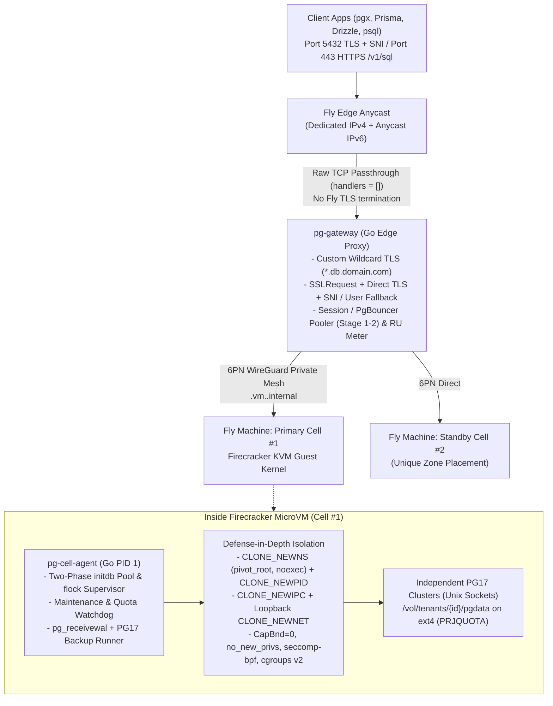

# Go-Native Multi-Tenant Serverless PostgreSQL Platform: Hardened System Design & Master Plan

> **Stack:** **100% Go (`golang`)**, **PostgreSQL 17**, **Fly.io Machines (Firecracker KVM MicroVMs + `ext4` Volumes + `6PN`)**, **Cloudflare R2**, **Cloudflare Queues (HTTP Pull Consumer)**, and **PostgreSQL-Native Physical Standby (Pro Tier)**  
> **Audit Compliance:** Fully aligned with [issue.md](file:///workspaces/cloud/experimental-db/issue.md) and the Principal Engineer corrections in [resolution-register.md](file:///workspaces/cloud/experimental-db/resolution-register.md).  
> **Governing Engineering Rule:** *Never introduce a custom optimization into the durability path until the standard PostgreSQL implementation works, survives failure testing, and can be independently restored.*

---

## 1. Executive Architecture & Design Principles

### Business & Technical Goal
Deliver a multi-tenant, **Pay-Per-Million-Requests (Request Units)** + storage serverless PostgreSQL 17 platform that eliminates both the high idle VM floor of 1-VM-per-tenant platforms and the dangerous coupling of single-postmaster multi-tenancy (`CREATE DATABASE` inside one shared Postgres process).

### Why Process-Per-Tenant on Shared Firecracker Compute Cells (`ext4`)
1. **Why NOT 1 Fly Machine VM per Tenant:**
   - **Fly Machines API Rate Limits:** Fly throttles machine mutations (`Create`/`Start`/`Stop`/`Delete`) to **1 req/sec base (3 req/sec burst)** per action/machine/app. Waking or provisioning hundreds of tenant VMs concurrently hits `HTTP 429` throttling walls.
   - **Stopped Storage Floor:** Fly charges **$0.15/GB-month** even for stopped Machine root filesystems and attached Volumes.
   - **Pay-Per-Request Margin Collapse:** A tenant running 1 query every 3 minutes keeps a dedicated VM awake 24/7 while paying pennies in request fees.
2. **Why NOT 500 Tenants Inside 1 Shared `postgres` Postmaster:**
   - **Global XID Wraparound Contagion:** All databases in one postmaster share a single 32-bit `XID` counter (`datfrozenxid`). One tenant holding a long transaction blocks `VACUUM` across all 499 neighbors.
   - **Cluster-Wide `pg_wal` Coupling:** PostgreSQL WAL is cluster-wide, making per-tenant physical backup (`pg_basebackup`) and PITR impossible without slow logical `pg_dump` index rebuilds.
   - **Crash & Buffer Blast Radius:** Any C-extension crash or OOM kills the postmaster for all 500 tenants.
3. **Our Architecture — Process-Per-Tenant on Shared Firecracker Cells (`pg-cell-agent`):**
   - Each **Compute Cell** is a Firecracker KVM MicroVM running a dedicated guest Linux kernel and our Go PID 1 daemon (`pg-cell-agent`).
   - Each tenant owns an **independent PostgreSQL 17 cluster** (`PGDATA` directory on `ext4`, unique 64-bit `system_identifier`, dedicated `pg_wal`, isolated `XID` space), listening strictly on a **Unix Domain Socket** (`/run/pg/{tenant_id}/.s.PGSQL.5432`) inside a loopback-only network namespace.
   - Tenant wake-up and scale-to-zero happen at the **OS process level inside the Cell VM**—requiring **zero Fly Machines API calls**.
   - **Correctness Before Optimization:** Stages 0–2 rely exclusively on PostgreSQL-native primitives (`initdb`, `ext4` + project quotas, `pg_basebackup`, `pg_verifybackup`, `pg_combinebackup`, `pg_receivewal`, **real PostgreSQL Physical Standbys**, and **PgBouncer / Session Pooling**). Custom optimizations (scale-to-zero, custom transaction pooler, Deep Freeze evacuation, and any future WAL Sink R&D) are introduced strictly in **Stage 3** after core durability is proven.

---

## 2. Fly.io Infrastructure Architecture (Machines, Volumes, Networking, Gateway)



### A. Fly Machines (Firecracker KVM MicroVMs), Runtime `/init` & Defense-in-Depth Isolation
Because Fly Machines run inside hardware-virtualized **Firecracker KVM MicroVMs**, each Machine boots its own guest Linux kernel with `root` capabilities inside the VM, **but Fly injects its own `/init` binary as PID 1**:
- **Fly `/init` & Process Supervision (`PR_SET_CHILD_SUBREAPER`):**
  - Fly's injected `/init` cannot be replaced by `systemd` or custom PID 1 supervisors. Therefore, `pg-cell-agent` runs under `/init` and **must call `unix.Prctl(unix.PR_SET_CHILD_SUBREAPER, 1, 0, 0, 0)` on startup** so reparented PostgreSQL backends and helper jobs (`initdb`, `pg_basebackup`, `pg_combinebackup`) reparent to `pg-cell-agent` rather than Fly's `/init` (preventing `wait4()` `ECHILD` races and zombie leaks).
  - **Shutdown Signal & Timeout Override (`fly.cell.toml`):** Fly defaults to `kill_signal = "SIGINT"` and a **5-second `kill_timeout`** before terminating the Firecracker VM—too brief to flush and stop dozens of PostgreSQL clusters during a deploy. Configure `kill_signal = "SIGTERM"` and `kill_timeout = "300s"`, and run a 16-goroutine parallel drain pool on `SIGTERM`/`SIGINT` in `pg-cell-agent` so all active clusters checkpoint and shut down cleanly in `<15s`.
- **Defense-in-Depth OS Isolation & Zero-Module Fallbacks (`internal/cell/envprobe`):**
  `cgroups v2` restricts resource consumption but does **not** stop filesystem traversal, `/proc` snooping, or outbound SSRF over `6PN`—and Fly's stock guest kernel (`fly-kernel`) may omit optional controllers or kernel modules. Every tenant `postgres` process runs inside:
  1. **Linux Namespaces:** `CLONE_NEWPID` (cannot view sibling PIDs), `CLONE_NEWIPC` (isolated shared memory), `CLONE_NEWNS` + `pivot_root` chroot (exposing only minimal PG17 binaries and `PGDATA`, hiding host `/sys/fs/cgroup` and sibling tenant dirs), and **loopback-only `CLONE_NEWNET`** (zero outbound TCP/`6PN` network access; communicates exclusively via bind-mounted Unix socket `/run/pg/{id}/.s.PGSQL.5432`).
  2. **Mounts, Capabilities & Syscalls:** Tenant directories mounted `nosuid,nodev,noexec`, `0700` owned by dedicated per-tenant UID (`10000+slot`); drop all Linux capabilities (`CapBnd = 0`, `PR_SET_NO_NEW_PRIVS = 1`); attach strict **`seccomp-bpf`** allowlist blocking `ptrace`, `bpf`, `mount`, `unshare`, and raw sockets.
  3. **`cgroups v2` + Mandatory Fallback Guardrails:** Enforce `memory.max`, `memory.oom.group = 1`, `pids.max = 64`, `cpu.max`, `io.max` (with 20% RAM `memory.low` reserved for OS + `pg-cell-agent`). On boot, `envprobe` checks delegated `cgroup v2` controllers and always enforces module-free guardrails: `oom_score_adj = -900` on `pg-cell-agent`, `oom_score_adj = +500` on tenant `postgres` processes, `RLIMIT_NPROC`/`RLIMIT_NOFILE` via `SysProcAttr`, and a **1-second `/proc/<pid>/statm` + `/proc/<pid>/io` poller** terminating runaway tenants cleanly.
- **Failure Domain Boundary:** A single Cell VM remains one shared kernel/hardware failure domain. Host-level failure and kernel crash recovery are verified independently via Cross-Cell Failover tests.

### B. Fly Machine Sizing, `/dev/shm` Isolation, Memory Math & Rate Limits
- **Compute Cell Capacity & Swap Shock Absorber:** Sized empirically during Stage 0/1 benchmarks (`performance-2x` 8 GB or `performance-4x` 16 GB), configured with top-level **`swap_size_mb = 2048`** in `fly.cell.toml` as an emergency buffer against transient allocation spikes.
- **Shared Memory (`/dev/shm`) Exhaustion & Per-Tenant `tmpfs`:** Fly scales `/dev/shm` to ~50% of VM RAM (Docker `--shm-size` does not apply on Fly). Because Postgres allocates POSIX DSM segments (`dynamic_shared_memory_type = posix`) in `/dev/shm`, an OOM-killed cluster can leak segments on a shared `/dev/shm`. Inside each tenant's `CLONE_NEWNS` mount namespace, `pg-cell-agent` mounts a **private per-tenant `tmpfs` at `/dev/shm` (`size=64m,mode=1777,nosuid,nodev,noexec`)** so stopping or killing a tenant automatically reclaims 100% of its shared memory. Set `max_parallel_workers_per_gather = 0` on shared Cells.
- **Verified Low-Memory Baseline:** With `shared_buffers = 16MB`, `max_connections = 15`, `work_mem = 4MB`, an idle/light PG17 cluster uses ~35–50 MB RSS.
- **Admission Control:** Reserve 25% of Cell RAM for Linux OS, `pg-cell-agent`, and Page Cache; bound active running processes by summing worst-case RSS + `work_mem`/`maintenance_work_mem` budgets rather than assuming fixed static counts.
- **Official Fly Machines API Rate Limits & Mitigation:**
  - Mutations (`Create`, `Start`, `Stop`, `Update`, `Delete`): **1 req/s base, 3 req/s burst** per action/machine/app.
  - Reads (`GET`): **5 req/s base, 10 req/s burst**.
  - **Architectural Mitigation:** Tenant wake/sleep happens locally inside running Cells (`0` Fly API calls). Control Plane wraps macro fleet scaling in a token-bucket rate limiter respecting `Retry-After`.

### C. Fly Volumes (`/vol` vs Ephemeral Rootfs `/` & Kernel-Adaptive Quotas)
- **Ephemeral Rootfs (`/`) vs. Persistent Volume (`/vol`):** Fly unpacks container images onto a small ephemeral rootfs (`/`). Writing `/tmp`, WAL buffers, `pg_basebackup` tars, or `pg_combinebackup` staging to `/` causes `ENOSPC` crashes. Configure **`TMPDIR=/vol/tmp`** globally; store `/vol/pool`, `/vol/staging`, `/vol/tenants`, and `/vol/.cell_ballast` strictly on `/vol`, and mount Unix sockets on a small dedicated `tmpfs` (`/run/pg`, `size=16m`).
- **Stage 0 Empirical Verification (No Unverified Defaults):** Before locking production sizing, Stage 0 verifies on live Fly hardware via `envprobe`: actual `ext4` mount flags (whether `CONFIG_QUOTA` / `prjquota` and `CONFIG_BLK_DEV_LOOP` `/dev/loop*` exist in Fly's guest kernel), `pg_test_fsync` latency, `fio` IOPS, persistence across Machine replacement, snapshot restore duration, and online `fly volumes extend` behavior. Volume sizes (e.g., 20 GB dev, 80–200 GB prod) are selected per workload/cost model—not treated as one universal hardcoded 80 GB constant.
- **Irreversible Resize Constraint (`Cannot Shrink`):** Volumes cannot shrink once extended. Admission control caps Cell utilization at **75%**, leaving headroom for WAL bursts, `pg_combinebackup` staging, and `.cell_ballast`, while promoting large tenants (`>5 GB`) onto Dedicated Cells.
- **Adaptive Hard Disk Quotas (`PRJQUOTA` + Zero-Module Fallback):**
  - *If `prjquota` is enabled:* Assign each `/vol/tenants/{id}` a unique `project_id` (`chattr +P -p <id>`) with hard limits via `quotactl` (`EDQUOT`).
  - *If `prjquota` and `/dev/loop` are omitted in Fly's guest kernel:* Enforce `setrlimit(RLIMIT_FSIZE, 1GB)` + PG bounds (`temp_file_limit = '256MB'`, `max_wal_size = '256MB'`, `max_slot_wal_keep_size = '256MB'`, `wal_keep_size = '64MB'`, `statement_timeout = '10s'`) + the **1-second `/proc/<pid>/io` `write_bytes` watcher**, flipping a tenant `default_transaction_read_only = on` and running `pg_terminate_backend()` within 1s of crossing its quota (bounding overshoot to `<25 MB` with zero kernel modules required).
- **Secondary DR:** Enable daily Fly Volume snapshots (`snapshot_retention = 7`) alongside Cloudflare R2.

### D. Fly Private Networking (`6PN`) & Raw TCP Gateway Routing
- **Raw TCP Passthrough (`handlers = []`):** Fly's `pg_tls` handler terminates TLS at Fly Proxy before our router can inspect SNI. Instead, `pg-gateway` uses Dedicated IPv4 (`$2/mo`) + Anycast IPv6 with **`handlers = []`** on Port `5432` so Go handles custom wildcard TLS (`*.db.domain.com` via DNS-01 ACME), legacy 8-byte `SSLRequest`, PG17 `sslnegotiation=direct`, and fallback `StartupMessage` routing (`user=<tenant_id>.<role>` or `options=-c endpoint=<tenant_id>`) when SNI is absent.
- **Direct Private `6PN` Routing:** Gateways dial target Cells directly over WireGuard `6PN` via `<machine_id>.vm.<cell-app>.internal:7432` (mTLS), avoiding round-robin `.internal` DNS pitfalls.

---

## 3. Cloudflare R2 Storage Engine & End-to-End Backup Validation

### A. Bucket Key Layout
```text
s3://serverless-pg-r2/
└── tenants/
    └── {tenant_id}/
        ├── manifest.json                          # Authoritative state, epoch, verified backup chains, min/max LSN
        └── epoch_{000001}/
            ├── base/{backup_id}/
            │   ├── base.tar.zst
            │   └── backup_manifest                # SHA-256 checksums for every file
            ├── incr/{backup_id}/
            │   ├── incr.tar.zst                   # PG17 --incremental block delta
            │   └── backup_manifest
            └── wal/
                ├── {timeline}_{wal_seg_name}.zst  # Immutable physical WAL segments
                └── {timeline}.history             # Required for cross-failover PITR
```

### B. Empirically Verified R2 Operations & Backup Chain Validation
- **Stage 0 Empirical Verification:** Test Cloudflare R2 conditional headers (`If-None-Match: "*"` on single-PUT and `CompleteMultipartUpload`, `If-Match: "<etag>"` on `manifest.json`) directly against live R2 endpoints in Stage 0 before depending on them as fencing primitives. Always backstop R2 metadata state with Control Plane HA Postgres transactional locks.
- **Backup Validity Gate (Upload `200 OK` Is Not Enough):** A backup is only marked valid/publishable after verifying:
  1. Complete parent backup-chain dependencies (`base` + ordered `incr` links).
  2. Unbroken WAL segment continuity (`min_wal_seg .. end_lsn`) + all timeline `.history` files.
  3. Local/staging **`pg_verifybackup`** SHA-256 manifest verification.
  4. Envelope DEK decryption key recovery test (verified unwrap with Control Plane KMS/KEK).
  5. R2 Bucket Lifecycle Rule aborting incomplete multipart uploads after 24 hours.
  6. Automated weekly clean-room restore drills onto fresh Cells running `pg_amcheck`.

---

## 4. Cloudflare Queues & Reliable Event Pipeline (Go HTTP Pull Consumer)

### A. Integration Pattern: HTTP Pull Consumer in Go
`pg-control-plane` consumes from Cloudflare Queues using the **HTTP Pull Consumer API** (`POST /accounts/{id}/queues/{id}/messages/pull` and `/ack` with `lease_id` via `github.com/cloudflare/cloudflare-go/v7`).

### B. Queue Topologies & Idempotent Usage Persistence
1. **`billing-usage-queue`:** Receives 15-second batched usage windows from Gateways. Gateways persist batches to a local disk-backed `bbolt` WAL before HTTP `sendBatch` (assigning deterministic `idempotency_key = sha256(gateway_id + tenant_id + window_start)`). Control Plane inserts into `usage_ledger` via `INSERT ... ON CONFLICT (idempotency_key) DO NOTHING` before Queue `Ack`.
2. **`lifecycle-freeze-queue`:** Schedules backup compaction, expired R2 retention cleanup (preserving base/WAL dependencies), and Stage 3 Deep Freeze evictions.
3. **`control-reconcile-queue`:** Drives asynchronous provisioning rollback, orphaned directory/R2 GC, and migration cleanup.

---

## 5. PostgreSQL 17 Engine Lifecycle, Backups, PITR & Maintenance

### A. Transactional Two-Phase `initdb` Pool (Guaranteed Unique `system_identifier`)
1. **Two-Phase Pool Staging:** Background worker (`nice -n 19`) initializes clusters into `/vol/pool/staging/{uuid}` -> runs `initdb --auth=scram-sha-256 --encoding=UTF8` -> verifies `pg_controldata` (`Database cluster state: shut down`, extracts `Database system identifier`) -> writes `pool_meta.json` -> `fsync()` -> atomically renames to `/vol/pool/ready/{uuid}`.
2. **Crash Cleanup:** On `pg-cell-agent` boot, delete all `/vol/pool/staging/*` and purge any `/vol/pool/ready/*` failing `pg_controldata` checks.
3. **Transactional Claim:** `pg-cell-agent` locks and renames a ready cluster to `/vol/tenants/claiming/{tenant_id}`, registers `(tenant_id, system_identifier, cell_id)` in Control Plane DB enforcing **`UNIQUE (system_identifier)`**, re-verifies `pg_controldata`, and atomically moves into `/vol/tenants/{tenant_id}/pgdata`.

### B. Process Lifecycle & Gateway-Controlled Drain Protocol
- **Single-Primary Lock:** Exclusive non-blocking `unix.Flock(LOCK_EX | LOCK_NB)` on `PGDATA/agent.lock` held per running cluster; on `pg-cell-agent` restart, live `/proc` PIDs are re-adopted seamlessly while stale `postmaster.pid`/sockets are cleaned only when no live PID holds `agent.lock`.
- **Gateway-Controlled Drain Protocol (No `pg_listening_channels()` Fallacy):**
  1. Gateway tracks all active transactions and pinned sessions (`LISTEN`, `TEMP TABLE`, session `SET`, advisory locks).
  2. When eligible (0 pinned sessions, idle >= threshold), `pg-cell-agent` initiates drain -> Gateway transitions tenant to `DRAINING` and **stops admitting new transactions** (holding new arrivals in a bounded queue).
  3. Gateway waits for active transactions to reach `ReadyForQuery` (`'Z'`) and closes pooled backend connections.
  4. `pg-cell-agent` verifies `pg_prepared_xacts == 0` and no active background/COPY/replication workers -> flushes WAL -> runs `pg_ctl stop -m smart` (escalating to `-m fast` only at deadline) -> verifies **`pg_controldata` reports `Database cluster state: shut down`** and final WAL archived -> marks `STOPPED`. Any requests buffered at Gateway trigger immediate wake-up.

### C. Dedicated Maintenance & Anti-Wraparound Scheduler
Pre-sleep `VACUUM` is strictly an optimization, never the sole wraparound defense:
- Polls `age(datfrozenxid)`, `mxid_age(datminmxid)`, dead tuple ratios, `pg_prepared_xacts` age, and slot lag every 5m and on every wake-up.
- Sets `autovacuum_naptime = '15s'` and forces a `maintenance_lock` (blocking scale-to-zero) to run `VACUUM (FREEZE)` whenever `age(datfrozenxid) > 100M` or `mxid_age > 100M` or dead tuples > 25%.

### D. Validated PG17 Backup, Incremental & PITR Workflow
- Enable `summarize_wal = on` and `wal_summary_keep_time = '48h'`.
- **Backup Flow:** Check `pg_available_wal_summaries()` for unbroken LSN continuity before running `--incremental`; fall back to a full base backup if any summary gap exists. Stage unpacked/tar output, run **`pg_verifybackup`**, verify DEK wrap, and upload to R2.
- **Restore / PITR Flow:** Reserve `>= 2.2x` target size free on Cell -> download & unpack backup chain (`base` + `incr_1..N`) -> run **`pg_combinebackup -o /restore/out ...`** -> run **`pg_verifybackup /restore/out`** -> place `recovery.signal` + `restore_command` (fetching `.wal.zst` and `.history` from R2) up to `recovery_target_time` / `recovery_target_lsn`.

### E. PostgreSQL Security & Multi-Layer Disk Defense
- **Strict Extension Allowlist (`supautils` + OS Defense):** No `SUPERUSER`. Explicitly allowlist only vetted, version-locked extensions (`uuid-ossp`, `pgcrypto`, `pg_trgm`, `citext`, `btree_gin`, `btree_gist`, `hstore`, `vector`, `pg_stat_statements`). Arbitrary custom `.so` `LOAD`, `COPY ... PROGRAM`, and untrusted languages (`plpythonu`, `plperlu`) are blocked at both PG and OS (`noexec`, `CLONE_NEWNS`) levels.
- **Multi-Layer Disk Exhaustion Defense:** `ext4` `PRJQUOTA` (`EDQUOT`) per tenant + `temp_file_limit` + `statement_timeout` + `max_slot_wal_keep_size` + 2 GB `.cell_ballast` emergency space + Cell-level admission block (75%) and emergency read-only protection (92%).

---

## 6. Two-Tier WAL Durability, Write-Boundary Fencing & Failover

### A. PostgreSQL-Native Physical Replication Tiers (Stages 0–2)
| Tier | Implementation | Scoped Durability SLA | Commit Overhead |
| :--- | :--- | :--- | :--- |
| **Standard Tier (Async)** | `pg_receivewal` + `archive_command` -> R2 every 5s and on drain. | **Async (`RPO ≤ 5s` on abrupt host failure)** | **0 ms** |
| **Pro Tier (Sync Standby)** | **Real PostgreSQL 17 Physical Standby** in a separate Fly zone (`--volume-requires-unique-zone`), durable physical slot, `synchronous_standby_names = 'FIRST 1 (pg_standby_z2)'`, `synchronous_commit = on`. | **`RPO = 0` strictly scoped** to single primary failure while standby is `sync` in `pg_stat_replication` and has flushed the commit LSN *(excludes multi-zone failure, simultaneous primary+standby loss, or forced un-quorum failover)*. | **~1–3 ms** intra-region `6PN` RTT + standby `fsync` |

> **Note on Custom WAL Sink:** A custom multi-tenant Go WAL Sink is **not** used in Stages 0–2. It remains deferred post-Stage-3 R&D requiring full PostgreSQL physical replication protocol parity (`IDENTIFY_SYSTEM`, timeline `.history`, `write`/`flush`/`apply` LSNs, slot persistence, quorum changes) and chaos proof against the native Postgres standby reference.

### B. Write-Boundary Epoch Fencing & Hysteresis Failover
- **Pro Sync Tier Fencing:** Control Plane atomically advances `epoch` (`Epoch E -> E+1`) and fences/promotes the synchronous standby *first*, immediately blocking the old primary at the PostgreSQL `COMMIT` boundary (`synchronous_standby_names` cannot be satisfied).
- **Standard Async Tier Fencing:** `pg-cell-agent` runs a monotonic timer (`CLOCK_MONOTONIC` + Linux `softdog`) that executes `SIGKILL` against tenant `postgres` at **8.0s** without Control Plane lease renewal, while the Control Plane enforces a mandatory **12.0s safety window** (`8s watchdog + 4s margin`) before promoting `Epoch E+1` elsewhere.
- **Failover Hysteresis:** Require **3 consecutive 1s failures** across Gateway + Control Plane probers + Control Plane distributed lock (`SELECT ... FOR UPDATE`) before triggering failover. Returning old primaries are quarantined and purged.

---

## 7. Wire Gateway, Pooling Compatibility & 4-Way Metering Separation

### A. Connection Pooling & Wire Protocol (`Stages 1–2` vs `Stage 3`)
- **Stages 1–2 (Foundation):** Use **Session Pooling** or battle-tested **PgBouncer (1.21+)** behind `pg-gateway` (`Raw TCP Passthrough` + SNI/SCRAM binding + rate/packet limits). Custom Go transaction-pool prepared-statement virtualization is **not** a Stage 1 blocker.
- **Stage 3 (Optimization):** Introduce custom Go `pgproto3` transaction pooling & Extended Query virtualization (`Parse`/`Bind`/`Describe`/`Execute`/`Close`/`Sync`/`Flush`, unnamed `""` statements/portals, pipeline mode, DDL invalidation, `CancelRequest`, and Session Pinning for `TEMP TABLE`/`SET`/advisory locks/`LISTEN`/`2PC`) only after passing 100% of **Benchmark Group E** (Prisma, Drizzle, `pgx`, `sqlx`, JDBC, `node-postgres`, `psql`).

### B. 4-Way Separation: Metering, Cost Accounting, Billing & Enforcement
1. **Usage Metering (Protocol Events):** Counts `CommandComplete` (`'C'`), post-dispatch `ErrorResponse` (`'E'`), `CopyData` bytes, and query wall duration. Gateway internal wake/failover retries never double-bill; batches persist to Gateway `bbolt` WAL before Cloudflare Queues (`ON CONFLICT (idempotency_key) DO NOTHING`).
2. **Infrastructure Cost Accounting (Internal FinOps):** Tracks `cgroups v2` `cpu.stat`, `io.stat`, RSS, `pg_stat_bgwriter`, and `pg_stat_database` (`blks_hit` vs `blks_read`, `temp_bytes`) per tenant to measure real COGS (never blaming an innocent individual query for background `autovacuum`/`checkpoint` I/O).
3. **Customer Billing (RU Pricing Heuristic):** Treats the RU formula strictly as a predictable customer pricing heuristic calibrated against Stage 1–2 COGS benchmarks, separate from raw kernel telemetry.
4. **Abuse & Resource Enforcement:** Enforces `cgroups v2` throttling, `statement_timeout`, `temp_file_limit`, connection limits, and automatic Large-Tenant promotion (>5 GB or sustained high CPU) to Dedicated Cells.

---

## 8. Complete Go Monorepo Architecture

```text
experimental-db/
├── go.mod
├── cmd/
│   ├── pg-gateway/            # Raw TCP SNI Proxy (5432), Auth/Rate Limits, Pool Bridge, RU bbolt Batcher
│   ├── pg-cell-agent/         # Cell PID 1: Two-phase initdb pool, flock, namespaces/cgroups, PRJQUOTA, backups
│   └── pg-control-plane/      # 3-node HA REST API, Epoch/Lease Authority, Queue Pull Consumers, Scheduler
├── internal/
│   ├── wire/                  # pgproto3 framing, SSLRequest/DirectTLS, Stage 3 Extended Query virtualizer
│   ├── metering/              # Protocol event meter, bbolt WAL, Cloudflare Queue batch sender
│   ├── cell/
│   │   ├── envprobe/          # Boot probe for cgroups v2, prjquota, /dev/loop, /dev/shm & /vol limits
│   │   ├── pool/              # Two-phase staging/ready initdb pool & pg_controldata verifier
│   │   ├── supervisor/        # Process FSM, PR_SET_CHILD_SUBREAPER, flock, /proc re-adoption, softdog
│   │   ├── isolation/         # Namespaces (private /dev/shm tmpfs), seccomp-bpf, cgroups v2 + fallbacks
│   │   ├── maintenance/       # datfrozenxid / multixact monitor & forced VACUUM FREEZE scheduler
│   │   └── backup/            # PG17 pg_basebackup (--incremental), pg_verifybackup, pg_combinebackup, pg_receivewal
│   ├── storage/
│   │   └── r2/                # R2 SDK client, conditional headers, envelope DEK/KEK crypto, GC
│   ├── queue/                 # cloudflare-go/v7 HTTP Pull/Ack consumers & producers
│   └── control/
│       ├── epoch/             # HA Postgres CAS epoch & write-lease authority
│       ├── scheduler/         # Capacity-aware bin-packer, live physical migration, reconciler
│       └── failover/          # 3x1s hysteresis prober, promotion locks, standby/R2 recovery
├── deploy/
│   ├── Dockerfile.cell        # Debian Bookworm + PG17 + allowlisted extensions + supautils + PgBouncer + agent
│   ├── Dockerfile.gateway     # Distroless/Alpine + pg-gateway
│   └── fly/                   # fly.gateway.toml, fly.cell.toml (SIGTERM/300s/swap), fly.standby.toml, fly.control.toml
└── tests/
    ├── stage0_verify/         # Fly volume/prjquota/fsync, R2 conditional, PG17 incremental & standby proofs
    ├── benchmarks/            # Benchmark Groups A-E (Provisioning, Scale-to-Zero, Isolation, Durability, ORMs)
    └── chaos/                 # Kill-9 primary/agent/standby, iptables partition, disk/OOM/fork bombs
```

---

## 9. Validation & Benchmark Gate Matrix (Required Before Production Claims)

Per [issue.md](file:///workspaces/cloud/experimental-db/issue.md#L780-L904), no latency, cost-multiplier, or `RPO=0` claims are made until verified on real Fly.io Firecracker hardware:
- **Group A (Provisioning):** 100 & 1,000 concurrent provisions; `pg_controldata` uniqueness; crash mid-`initdb` recovery.
- **Group B (Scale-to-Zero — Stage 3):** Warm/cold startup & first-query p50/p95/p99; 500 concurrent wake-ups; drain vs `LISTEN`/locks/`2PC`/late-arrival chaos tests (0 `ECONNRESET`).
- **Group C (Multi-Tenant Isolation):** 100 active + 1,000 dormant DBs; OOM, CPU, PID/FD, network SSRF, and disk exhaustion attacks in Tenant A while Tenant B runs `pgbench`.
- **Group D (Durability & Chaos):** `kill -9` primary mid-commit, `kill -9` Cell post-commit ACK, standby disconnection, `iptables` partition split-brain, and clean-room R2 + PITR timeline switches.
- **Group E (Compatibility):** Real integration suites for **Prisma, Drizzle, `pgx`, `sqlx`, JDBC, `node-postgres`, `psql`** (migrations, Extended Query, `COPY`, prepared statements, rollbacks, `CancelRequest`, `LISTEN/NOTIFY`).

---

## 10. 4-Stage Sequenced Implementation Roadmap

### Stage 0 — Prove the Foundation (Production Blockers)
- [ ] **0.1 Fly.io Runtime & `ext4` Empirical Verification:** Test `ext4` mount options (`prjquota` / `/dev/loop` vs 1s `/proc/<pid>/io` fallback), `cgroup v2` controllers, `PR_SET_CHILD_SUBREAPER` under Fly `/init`, private `/dev/shm` tmpfs namespaces, `SIGTERM` `300s` drain, `pg_test_fsync`, `fio` IOPS, Machine replacement volume persistence, snapshot restore, and `6PN` latency.
- [ ] **0.2 R2 Conditional API Proof:** Empirically validate Cloudflare R2 `If-None-Match: "*"` (single-PUT + `CompleteMultipartUpload`) and `If-Match` manifest CAS.
- [ ] **0.3 Independent `initdb` Pool & Lifecycle:** Implement two-phase `/vol/pool/staging` -> `/vol/pool/ready` + `pg_controldata` check + `flock` + agent `/proc` re-adoption.
- [ ] **0.4 Defense-in-Depth OS Isolation:** Implement UID + namespaces (`NS`/`PID`/`IPC`/loopback `NET`) + `seccomp-bpf` + `cgroups v2` + extension allowlist (`supautils`) and verify via penetration/OOM/SSRF tests.
- [ ] **0.5 PG17 Native Backup, Incremental & Physical Standby Proof:** Validate `pg_basebackup` (`--incremental` + `summarize_wal`), `pg_verifybackup`, `pg_combinebackup`, `pg_receivewal`, and real PostgreSQL 17 synchronous physical standby failover & PITR across timeline switches.

### Stage 1 — Reliable Single-Cell Platform
- [ ] **1.1 Provisioning & Reconciliation:** Transactional `UNIQUE (system_identifier)` Control Plane API (`Idempotency-Key`), rollback, and `control-reconcile-queue`.
- [ ] **1.2 Gateway & Proven Pooling:** `pg-gateway` (`Raw TCP Passthrough` `handlers = []`, TLS/SNI/SCRAM binding, rate limits) paired with **Session Pooling / PgBouncer 1.21+** passing Benchmark Group E.
- [ ] **1.3 Quotas, Admission Control & Maintenance:** Hard `ext4` `PRJQUOTA` enforcement, `.cell_ballast`, Cell RAM/CPU/disk admission limits, and continuous `datfrozenxid`/`VACUUM FREEZE` scheduler.
- [ ] **1.4 Monitoring, Alerting & Idempotent Billing Ledger:** Prometheus/Alertmanager rules (all 22 metrics & 15 alerts), `bbolt` Gateway WAL -> Cloudflare Queues HTTP Pull Consumer -> `usage_ledger`.

### Stage 2 — Multi-Cell Availability
- [ ] **2.1 WAL Durability Tiers:** Standard Async (`RPO ≤ 5s`) and Pro Sync Physical Standby (`RPO = 0` scoped SLA across unique Fly zones).
- [ ] **2.2 Write-Boundary Epoch Fencing & Failover:** Standby pre-fence (Pro) + `8s` `softdog` watchdog / `12s` Control Plane safety window (Async) + `3x1s` hysteresis failover.
- [ ] **2.3 Live Migration & Regional DR:** Physical replication live migration (`pg_promote()`), weekly clean-room R2 restore drills (`pg_amcheck`), and GameDay chaos validation (Groups A, C, D).

### Stage 3 — Cost & Performance Optimization
- [ ] **3.1 Cooperative Scale-to-Zero:** Gateway-Controlled Drain Protocol (`DRAINING` -> active txn drain -> `pg_ctl stop -m smart` -> `pg_controldata` check), gated by Benchmark Group B.
- [ ] **3.2 Custom Transaction Pooling & Prepared Statement Virtualization:** Full `pgproto3` Extended Query state machine & session pinning, gated by 100% pass on Benchmark Group E.
- [ ] **3.3 Deep Freeze R2 Tiering, Large-Tenant Promotion & FinOps Calibration:** Automated idle-DB R2 evacuation, COGS-calibrated RU pricing weights, HTTP `/v1/sql` endpoint, and optional post-Stage-3 WAL Sink R&D.
