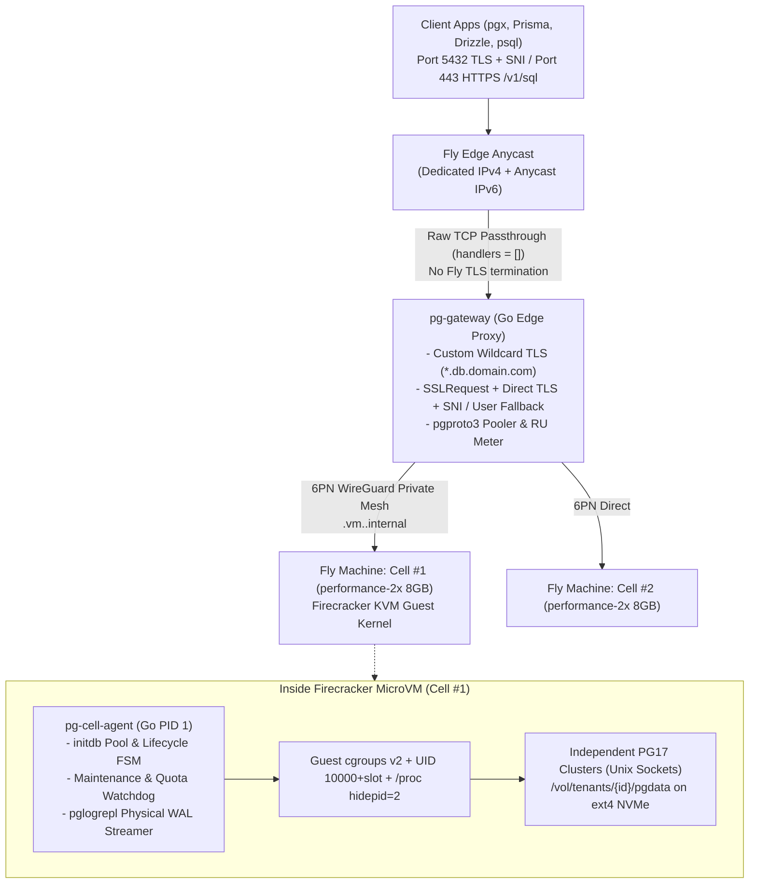
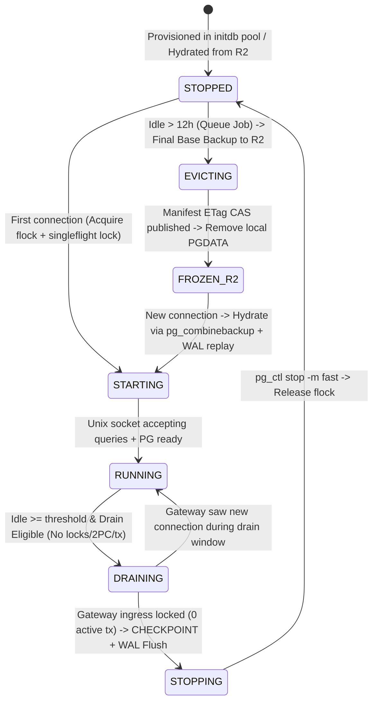

# Go-Native Multi-Tenant Serverless PostgreSQL Platform: Hardened System Design & Master Plan

> **Stack:** **100% Go (`golang`)**, **PostgreSQL 17**, **Fly.io Machines (Firecracker KVM MicroVMs + `ext4` Volumes + `6PN`)**, **Cloudflare R2**, **Cloudflare Queues (HTTP Pull Consumer)**, and **3-Node Physical WAL Sink**  
> **Audit Compliance:** Fully incorporates every P0, P1, and P2 finding from [issue.md](file:///workspaces/cloud/experimental-db/issue.md) and [issue_resolution.md](file:///workspaces/cloud/experimental-db/issue_resolution.md). Zero unverified latency, `RPO=0`, or cost-multiplier marketing claims; every performance or durability target is gated by automated benchmarks and chaos tests.

---

## 1. Executive Architecture & Design Principles

### Business & Technical Goal
Deliver a multi-tenant, **Pay-Per-Million-Requests (Request Units)** + storage serverless PostgreSQL 17 platform that eliminates both the high idle VM floor of 1-VM-per-tenant platforms (e.g., Neon) and the catastrophic coupling of single-postmaster multi-tenancy (`CREATE DATABASE` inside one shared Postgres process).

### Why Process-Per-Tenant on Shared Firecracker Compute Cells (`ext4`)
1. **Why NOT 1 Fly Machine VM per Tenant:**
   - **Fly Machines API Rate Limits:** Fly throttles machine mutations (`Create`/`Start`/`Stop`/`Delete`) to **1 req/sec base (3 req/sec burst)** per action/machine/app. Waking or provisioning hundreds of tenant VMs concurrently hits `HTTP 429` throttling walls.
   - **Stopped Storage Floor:** Fly charges **$0.15/GB-month** even for stopped Machine root filesystems and attached Volumes.
   - **Pay-Per-Request Margin Collapse:** A tenant running 1 query every 3 minutes keeps a dedicated VM awake 24/7 while paying pennies in request fees.
2. **Why NOT 500 Tenants Inside 1 Shared `postgres` Postmaster:**
   - **Global XID Wraparound Contagion:** All databases in one postmaster share a single 32-bit `XID` counter (`datfrozenxid`). One tenant holding a long transaction blocks `VACUUM` across all 499 neighbors.
   - **Cluster-Wide `pg_wal` Coupling:** PostgreSQL WAL is cluster-wide, making per-tenant physical backup (`pg_basebackup`) and PITR impossible without slow logical `pg_dump` index rebuilds.
   - **Crash & Buffer Blast Radius:** Any C-extension crash or OOM kills the postmaster for all 500 tenants.
3. **Our Architecture — Process-Per-Tenant on Shared Firecracker Cells (`pg-cell-agent`):**
   - Each **Compute Cell** is a Firecracker KVM MicroVM running a guest Linux kernel and our Go PID 1 daemon (`pg-cell-agent`).
   - Each tenant owns an **independent PostgreSQL 17 cluster** (`PGDATA` directory on `ext4`, unique 64-bit `system_identifier`, dedicated `pg_wal`, isolated `XID` space), listening strictly on a **Unix Domain Socket** (`/run/pg/{tenant_id}/.s.PGSQL.5432`).
   - Tenant wake-up and scale-to-zero happen at the **OS process level inside the Cell VM**—requiring **zero Fly Machines API calls**.
   - **Strict Separation of Proven Primitives vs. Future Optimizations:** Stages 1–5 use strictly proven PostgreSQL-native primitives (`initdb`, `ext4`, `pg_basebackup`, `pg_combinebackup`, `pglogrepl` Physical mode, `cgroups v2`, `pgproto3`). Unverified filesystem hacks (`XFS FICLONE`, `FIEMAP` extent scraping) are permanently excluded from the production path.

---

## 2. Fly.io Infrastructure Architecture (Machines, Volumes, Networking, Gateway)



### A. Fly Machines (Firecracker KVM MicroVMs) & Guest Isolation
Because Fly Machines run inside hardware-virtualized **Firecracker KVM MicroVMs**, each Machine boots its own guest Linux kernel with `root` capabilities inside the VM:
- **Supported Guest Primitives (Verified):** Full `cgroups v2` hierarchy management, `unshare` (PID/mount/user namespaces), `mount -o hidepid=2` on `/proc`, `seccomp-bpf` filters, and `flock` work natively inside the Fly Machine guest without touching host-level isolation.
- **Per-Tenant OS Isolation Envelope:**
  - Dedicated non-root Linux UID (`10000 + slot_id`) per active tenant process; `0700` permissions on `/vol/tenants/{tenant_id}/`.
  - `/proc` mounted with `hidepid=2` so tenant subprocesses cannot inspect sibling process arguments or environment variables.
  - **`cgroups v2` Enforcement (`/sys/fs/cgroup/pgtenants/{tenant_id}/`):**
    - `memory.max` + `memory.oom.group = 1`: Guarantees OOM kills are strictly contained to the offending tenant's cgroup, never touching `pg-cell-agent` or neighboring tenants.
    - `pids.max = 64` (prevents fork bombs / connection process leaks), `cpu.max` (fair baseline + burst cap), `io.max` (IOPS/throughput ceiling).
    - **20% System Memory Reservation:** `memory.low` reserved for OS kernel, Linux page cache stability, and `pg-cell-agent`.

### B. Fly Machine Sizing, Memory Math & Rate Limits
- **Target Compute Cell SKU:** `performance-2x` (**8 GB RAM**, 2 dedicated vCPUs, ~$62/mo billed per second).
- **Verified PostgreSQL 17 Low-Memory Footprint:** With `shared_buffers = 16MB`, `max_connections = 15`, `work_mem = 4MB`, and minimal background workers, a single idle/light PG17 cluster consumes **~35–50 MB RSS** (~18–22 MB shared segment + ~12–15 MB background workers + ~3–5 MB per backend).
- **Safe Admission Capacity per 8 GB Cell:**
  - Reserve **2.0 GB** for Linux OS, `pg-cell-agent`, and Page Cache headroom.
  - Remaining **6.0 GB** supports a hard admission cap of **80–100 simultaneously active `postgres` processes** (allowing headroom for active `work_mem` sorts/hashes and `maintenance_work_mem` during `VACUUM`).
  - **Stopped Tenant Density:** Hundreds of warm/stopped tenant clusters reside on the Cell's `ext4` volume consuming **0 MB RAM** and waking via local OS process spawn without touching the Fly API.
- **Official Fly Machines API Rate Limits & Mitigation:**
  - Mutations (`Create`, `Start`, `Stop`, `Update`, `Delete`): **1 req/s base, 3 req/s burst** per action/machine/app.
  - Reads (`GET`): **5 req/s base, 10 req/s burst**.
  - **Architectural Mitigation:** Tenant provisioning, sleep, and wake-up execute **100% locally inside running Cells** (`0` Fly API calls). The Control Plane calls Fly Machines API *only* for macro fleet scaling (adding/removing Cell VMs or promoting Dedicated tier VMs), wrapped in a token-bucket rate limiter with exponential backoff on `HTTP 429`.

### C. Fly Volumes (`ext4` Constraints, Sizing & Snapshots)
- **Filesystem Reality:** Fly Volumes are automatically formatted and mounted as **`ext4`**. Standard Fly Firecracker kernels do not expose XFS or Btrfs reflink support. Our architecture builds exclusively on `ext4`.
- **Irreversible Resize Constraint (`Cannot Shrink`):** Fly Volumes support online expansion (`fly volumes extend` / API `POST /volumes/{id}/extend`), **but cannot be shrunk**.
  - **Preventing Stranded Volume Cost:** Instead of unbounded volume growth, Cells use fixed **80 GB NVMe Volume caps** (`$12/mo` per Cell). Admission control rejects new placements above **75% disk utilization** (`60 GB`), reserving **20 GB** for WAL bursts, `pg_combinebackup` 2x restore staging, and emergency ballast. Inactive tenants (>12h idle) are evicted to R2 and large tenants (>5 GB) are promoted to Dedicated Cells/Machines.
- **Fly Volume Snapshots (Secondary DR):** Enable Fly's built-in daily off-host snapshots with `snapshot_retention = 7` in `fly.toml` (`$0.08/GB-mo`, first 10 GB free) as a secondary disaster-recovery layer behind Cloudflare R2.

### D. Fly Private Networking (`6PN`) & Raw TCP Gateway Routing
- **Why NOT Fly `pg_tls` Handler:** Fly's built-in `pg_tls` handler terminates TLS at Fly Proxy, which strips the SNI context needed by a multi-tenant router before our Go code can inspect it and forces reliance on Fly-managed edge certs for a single app.
- **Our Gateway Setup (`Raw TCP Passthrough`):**
  - Allocate a **Dedicated IPv4** (`fly ips allocate-v4 --dedicated`, `$2/mo`) + free **Anycast IPv6** for `pg-gateway`.
  - Configure `fly.toml` with **`handlers = []`** on Port `5432`:
    ```toml
    [[services]]
      protocol = "tcp"
      internal_port = 5432
      [[services.ports]]
        port = 5432
        # Empty handlers = Raw Layer-4 TCP Passthrough to pg-gateway
    ```
  - `pg-gateway` handles custom wildcard TLS (`*.db.domain.com` via DNS-01 ACME), inspecting both legacy 8-byte `SSLRequest` (`00 00 00 08 04 d2 16 2f` -> reply `'S'`) and PG17 `sslnegotiation=direct` (`ClientHello` first) to extract TLS **SNI**.
  - **Non-SNI Client Fallback:** If an older client omits TLS SNI, `pg-gateway` peeks the post-TLS `StartupMessage` and extracts the tenant ID from `user=<tenant_id>.<role>` or `options=-c endpoint=<tenant_id>` before routing.
- **Direct Private `6PN` Routing:** Gateways dial target Compute Cells directly over Fly's WireGuard-encrypted `6PN` IPv6 mesh using immutable Machine DNS: `<machine_id>.vm.<cell-app>.internal:7432` (mTLS authenticated), bypassing public proxies and avoiding round-robin `.internal` DNS pitfalls.

---

## 3. Cloudflare R2 Storage Engine & Storage-Level Fencing

### A. Bucket Key Layout
```text
s3://serverless-pg-r2/
└── tenants/
    └── {tenant_id}/
        ├── manifest.json                          # Authoritative state, current epoch, latest backup chain, min/max LSN
        └── epoch_{000001}/
            ├── base/{backup_id}/
            │   ├── base.tar.zst                   # PG17 pg_basebackup tar stream
            │   └── backup_manifest                # SHA-256 checksums for every file
            ├── incr/{backup_id}/
            │   ├── incr.tar.zst                   # PG17 --incremental block-level delta
            │   └── backup_manifest
            └── wal/
                └── {timeline}_{wal_seg_name}.zst  # Immutable physical WAL segments
```

### B. Storage-Level Split-Brain Fencing via R2 Conditional Operations
Even if a partitioned Compute Cell loses contact with the Control Plane, **Cloudflare R2 enforces epoch fencing directly at the storage boundary**:
1. **Immutable WAL & Backup Writes (`If-None-Match: *`):**
   - Every WAL segment and backup object upload uses `If-None-Match: "*"`.
   - For multi-part uploads (`base.tar.zst` / `incr.tar.zst`), R2 evaluates `If-None-Match: "*"` atomically during **`CompleteMultipartUpload`** (note: R2 ignores conditions sent only on `CreateMultipartUpload`). Any duplicate or colliding upload returns **`412 PreconditionFailed`** and R2 automatically aborts the upload.
2. **Optimistic CAS Manifest Updates (`If-Match: "<etag>"`):**
   - Updating `/tenants/{tenant_id}/manifest.json` requires passing the expected ETag via `If-Match`.
   - When a Cell fails over (`Epoch 1 -> Epoch 2`), the new Cell immediately advances `manifest.json` (`epoch: 2`, `If-Match: <old_etag>`).
   - If the old zombie Cell (`Epoch 1`) later attempts to freeze/commit a backup or update `manifest.json`, R2 atomically rejects the write with `412 PreconditionFailed`.

### C. Cost & Reliability Controls
- **R2 Cost Reality:** Storage `$0.015/GB-month`, Egress **$0.00**, Class A (`PUT`/`POST`/`LIST`) `$4.50/1M`, Class B (`GET`/`HEAD`) `$0.36/1M`.
- **Avoiding Small-File Class A Bloat:**
  - `archive_timeout` only rotates WAL when `pg_current_wal_lsn()` has actually advanced since the last archive (0 writes = 0 R2 `PUT`s).
  - Active small WAL segments (<16 MB) are written to the 3-node WAL Sink and flushed to R2 on 16 MB segment boundaries or scale-to-zero drain.
- **Integrity & Encryption:** Envelope encryption per tenant (DEK encrypted by Control Plane KMS/KEK) before `zstd` upload; SHA-256 verification against PG17 `backup_manifest` before publishing `manifest.json` (atomic two-phase publish: upload payload + manifest -> verify -> update tenant pointer).
- **Automated Periodic Restore Drills:** Control Plane schedules weekly automated restore tests of random tenant snapshots onto a verification Cell running `pg_amcheck`.

---

## 4. Cloudflare Queues & Reliable Event Pipeline (Go HTTP Pull Consumer)

### A. Integration Pattern: HTTP Pull Consumer in Go
Because `pg-control-plane` and `pg-cell-agent` run as persistent Go services on Fly.io (outside Cloudflare Workers), they consume Cloudflare Queues via the **HTTP Pull Consumer API** using `github.com/cloudflare/cloudflare-go/v7`:
- **Pull:** `POST /accounts/{account_id}/queues/{queue_id}/messages/pull` (`BatchSize <= 100`, `VisibilityTimeoutMs = 30000`).
- **Ack / Explicit Retry:** `POST /accounts/{account_id}/queues/{queue_id}/messages/ack` passing each message's `lease_id` (`Retry: false` on commit, `Retry: true` on transient failure; DLQ configured after 5–10 attempts).
- **Limits Respected:** Max message size **128 KB** (billed in **64 KB** operation chunks at `$0.40/1M` ops -> ~$1.20/1M standard 3-op messages); max **5,000 msg/sec** per queue; max backlog **25 GB**; max delay **24 hours**.

### B. Queue Topologies & Idempotent Usage Persistence
1. **`billing-usage-queue`:**
   - **Why Never 1 Message Per SQL Query:** At `$1.20/1M` Queue messages, pushing 1 message per query costs more than the query revenue.
   - **In-Memory + Local Disk WAL Aggregation:** Each `pg-gateway` maintains atomic in-memory counters per tenant. Every **15 seconds**, it packs up to 500 tenants' RU summaries into a **single <64 KB JSON batch**, persists it to a local `bbolt` WAL file on the Gateway first (so Gateway crashes never lose un-pushed usage), assigns a deterministic `idempotency_key = sha256(gateway_id + tenant_id + window_start_unix)`, and calls `sendBatch` to Cloudflare Queues.
   - **Consumer Deduplication:** Control Plane pulls batches and executes `INSERT INTO usage_ledger (...) ON CONFLICT (idempotency_key) DO NOTHING` inside a transaction before calling Queue `Ack`.
2. **`lifecycle-freeze-queue`:**
   - Receives delayed/scheduled jobs for tenants idle > 12h (`DeepFreezeTenant`), PG17 incremental backup compaction (`CompactBackupChain`), and R2 garbage collection (`GCExpiredEpochs`).
3. **`control-reconcile-queue`:**
   - Handles asynchronous cleanup of failed `initdb`/provisioning attempts, orphaned `PGDATA` directories, and multi-step Cell rebalancing workflows.

---

## 5. PostgreSQL 17 Engine Lifecycle, Backups, PITR & Maintenance

### A. Pre-Initialized `initdb` Cluster Pool (Unique `system_identifier`)
- A low-priority background goroutine (`nice -n 19`, capped cgroup CPU) maintains `N = 20` clean, stopped PostgreSQL 17 clusters in `/vol/pool/cluster_{uuid}/` on the Cell's `ext4` volume via `initdb --auth=scram-sha-256 --encoding=UTF8`.
- **Zero Identity Collisions:** Every cluster receives its own unique 64-bit `system_identifier` from `initdb` and clean timeline `1`.
- **Fast Claim:** Provisioning claims a directory via atomic `os.Rename()` into `/vol/tenants/{tenant_id}/pgdata`, writes tenant-specific `postgresql.conf` / `pg_hba.conf`, sets UID `10000+slot` ownership (`0700`), boots briefly or applies credentials on first start, and replenishes the pool asynchronously.

### B. Process Lifecycle, Cooperative Drain & Scale-to-Zero State Machine

- **Single-Primary Enforcement:** `pg-cell-agent` acquires an exclusive non-blocking `unix.Flock(LOCK_EX | LOCK_NB)` on `PGDATA/agent.lock` before spawning `postgres`, making dual-primary execution against the same `PGDATA` mathematically impossible.
- **Boot Hygiene & Agent Restart Survival:** On startup (or Cell agent restart), `pg-cell-agent` scans running `/proc` PIDs + `agent.lock` files to re-adopt live tenant processes seamlessly, and cleans orphaned `postmaster.pid` / `.s.PGSQL.5432` files only when no live PID holds the lock.
- **Strict Drain Eligibility Checks:** Before entering `DRAINING`, `pg-cell-agent` queries the tenant DB and **blocks scale-to-zero** if any of these exist:
  1. Active queries or `idle in transaction` sessions (`pg_stat_activity`).
  2. Session-level advisory locks (`pg_locks WHERE locktype = 'advisory'`).
  3. Unresolved Two-Phase Commit prepared transactions (`pg_prepared_xacts`).
  4. Active `LISTEN` channels (`pg_listening_channels()`) or active `COPY` / replication streams.
- **Forced Shutdown Safety:** When stopping, `pg-cell-agent` runs `CHECKPOINT` + `pg_switch_wal()`, waits for WAL archival confirmation (within a 15s deadline), and issues `pg_ctl stop -m fast` (never `SIGKILL` unless completely hung beyond emergency timeout, in which case next boot performs standard crash recovery).

### C. Dedicated Maintenance & Anti-Wraparound Scheduler
Pre-sleep `VACUUM` is treated strictly as an optimization, not a safety mechanism. `pg-cell-agent` includes a continuous maintenance scheduler:
- Inspects `age(datfrozenxid)`, `mxid_age(datminmxid)`, and `n_dead_tup` every 5 minutes on active DBs and on every wake-up.
- **Hard Guardrails:** If `age(datfrozenxid) > 100_000_000` (50% of `autovacuum_freeze_max_age`), `mxid_age > 100_000_000`, or dead tuple bloat exceeds 20%, the scheduler sets a `maintenance_lock` (blocking scale-to-zero), executes `VACUUM (FREEZE, INDEX_CLEANUP AUTO)`, and clears the lock only after freeze completes.
- Databases remaining in `FROZEN_R2` for months preserve their `datfrozenxid` freeze baseline before eviction (`VACUUM FREEZE` prior to final Deep Freeze backup).

### D. PostgreSQL 17 Native Backups, Incremental Chains & PITR
- **Configuration:** Enable `summarize_wal = on` (`wal_summary_keep_time = '6h'`) and `wal_level = replica`.
- **Full & Incremental Backups:** `pg_basebackup -D - -Ft -Z zstd --checkpoint=fast --manifest=yes` for initial/weekly full backups; `pg_basebackup --incremental=<prev_manifest>` for daily/pre-freeze incremental backups (transferring only modified 8 KB blocks).
- **Restore & PITR:** Restores use `pg_combinebackup` (admitted only if Cell disk has `>= 2.2x` target DB size free) followed by `recovery.signal` with `restore_command` fetching `.wal.zst` segments from R2 up to `recovery_target_time` or `recovery_target_lsn`.

### E. PostgreSQL Security & Storage Quota Enforcement
- **No `SUPERUSER` for Tenants:** Tenants receive a restricted owner role (`app_owner`). `supautils` in `shared_preload_libraries` permits whitelisted extensions (`vector`, `pg_stat_statements`, `uuid-ossp`, `pg_trgm`, `citext`, `btree_gin`) while blocking `COPY ... PROGRAM`, `LOAD`, untrusted languages (`plpythonu`, `plperlu`), `pg_read_file`, and protected GUCs (`shared_preload_libraries`, `archive_command`, `data_directory`).
- **Disk Quota & Cell Exhaustion Guard:**
  - Every 30s, `pg-cell-agent` inspects per-tenant directory size + WAL/temp growth. If a tenant exceeds its paid storage quota, `pg-cell-agent` flips `ALTER DATABASE ... SET default_transaction_read_only = on` and terminates runaway inserts.
  - At **80% Cell volume usage**: Stop admitting new tenants; trigger `lifecycle-freeze-queue` evictions. At **90%**: Block non-essential restores and alert. At **95%**: Emergency shrink of a pre-allocated **2 GB `/vol/.cell_ballast`** file so active databases can still write WAL to `CHECKPOINT`, `VACUUM`, or `DROP` tables without corrupting `ext4`.

---

## 6. Two-Tier WAL Durability, Epoch Fencing & Cross-Cell Failover

### A. Explicit Two-Tier Durability Model
| Tier | Protocol & Infrastructure | Honest Durability SLA | Commit Overhead |
| :--- | :--- | :--- | :--- |
| **Standard Tier (Default)** | `pglogrepl` (`PhysicalReplication` mode) over local Unix socket -> `zstd` compress -> async upload to R2 every **5s** and synchronously on scale-to-zero drain. | **Async (`RPO ≤ 5s` on total host loss; RPO=0 on clean stop)** | **0 ms** |
| **Pro Tier (Sync Quorum)** | `synchronous_standby_names = 'pg_cell_sync'`. `pg-cell-agent` streams `XLogData` over `6PN` to a **3-node Go WAL Sink Cluster** deployed across **3 distinct Fly physical hosts/zones** (`--volume-requires-unique-zone`). `StandbyStatusUpdate{WALFlushPosition}` is sent back to Postgres **only after 2/3 WAL Sink nodes `fsync()`** the frame to NVMe. | **Synchronous Quorum (`RPO = 0` for up to 1 simultaneous host/zone failure; verified via Group D kill tests)** | **~1–3 ms** intra-region `6PN` RTT + NVMe `fsync` |

### B. Epoch Fencing & Cross-Cell Failover State Machine
1. **Strongly Consistent Epoch Authority:** Control Plane stores `(tenant_id, epoch, primary_cell_id, lease_expires_at)` in a 3-node HA PostgreSQL cluster (Patroni/Raft or Fly Managed HA Postgres).
2. **10-Second Write Leases:** Each running tenant holds a 10s Write Lease renewed every 3s by `pg-cell-agent`. If the Control Plane is unreachable or lease renewal fails past 10s, `pg-cell-agent` self-fences within 500ms by setting `default_transaction_read_only = on` and shutting down `postgres`.
3. **Write-Boundary Fencing:** Both the **3-node WAL Sink** and **Cloudflare R2** reject any WAL frame or manifest update whose `epoch < current_epoch`.
4. **Failover with Hysteresis:**
   - Gateway + Control Plane require **3 consecutive 500ms health check failures** (1.5s hysteresis) to avoid false-positive failovers during transient GC/network blips.
   - Control Plane atomically increments `epoch` (`CAS: WHERE epoch = $old`), acquires a per-tenant promotion lock, selects a healthy Cell #2, restores the latest R2 backup + replays committed WAL frames from the 3-node WAL Sink (`epoch` validated), and updates routing.
5. **Zero-Downtime Live Migration (Heavy Tenant Promotion / Cell Rebalancing):**
   - For tenants crossing sustained CPU/storage thresholds (e.g., >5 GB or sustained >50% of 1 vCPU), Control Plane provisions a Dedicated Cell/Machine, initializes from R2, streams live physical WAL from `Cell #1` via `6PN`, waits until lag `< 64 KB`, issues a brief Gateway drain/fence (<100ms), increments `epoch`, runs `pg_promote()`, and switches routing.

---

## 7. Wire Protocol Gateway (`pgproto3`), Session Compatibility & RU Metering

### A. Protocol Handling & Extended Query Virtualization (`internal/wire`)
- **Gateway Security & Abuse Protection:**
  - Per-IP connection rate limiting, SCRAM authentication failure throttling, max startup packet size (8 KB), max wire message size cap (64 MB), idle auth handshake timeout (5s), and TLS 1.2/1.3 enforcement.
  - Tenant identification is bound cryptographically to `SNI` + authenticated `SCRAM-SHA-256` user verifier (never trusting unverified headers).
- **Full Extended Query State Machine:**
  - Uses `github.com/jackc/pgx/v5/pgproto3` (`Backend` facing client, `Frontend` facing Cell socket).
  - Maintains a per-client **Virtual Prepared Statement Map** (`stmtName -> {Query, ParamOIDs}`) and per-backend **Prepared Cache**.
  - Handles **named and unnamed (`""`) prepared statements**, unnamed portals, `Parse`, `Bind`, `Describe`, `Execute`, `Close`, `Sync`, `Flush`, pipeline mode, `DEALLOCATE ALL`, `DISCARD ALL`, and automatic re-prepare on DDL schema invalidation (`cached plan must not change result type`).
- **Automatic Session Pinning Fallback:**
  - While normal queries multiplex cleanly in **transaction pooling mode**, if a session executes `CREATE TEMP TABLE`, session-level `SET` (not `SET LOCAL`), `pg_advisory_lock`, `PREPARE TRANSACTION`, or `LISTEN`, the Gateway automatically **pins** that client to its dedicated backend connection until `DISCARD ALL` or disconnect (bounded by per-tenant `max_pinned_sessions`).
- **ORM Cancellation:** Intercepts PostgreSQL `CancelRequest` (`16-byte` key/PID) and routes it to the exact backend Cell/PID holding the active query.

### B. Cheat-Proof Request Unit (RU) Metering
- **Statement Counting:** Counts **outgoing backend `pgproto3.CommandComplete` (`'C'`) + `ErrorResponse` (`'E'`)** frames (catching multi-statement `SELECT 1; SELECT 2;` pipelining in a single `'Q'` packet).
- **Resource Weighting (No Loss-Making Queries):**
  $$\text{Query RUs} = \max\left(1,\; \text{Statements}\right) + \left\lfloor\frac{\text{WirePayloadBytes}}{32\text{ KB}}\right\rfloor + \left\lfloor\frac{\text{QueryExecMs}}{5\text{ ms}}\right\rfloor$$
  - Standard OLTP lookup (`<5ms`, `<32KB`) = **1 RU**.
  - Unindexed 500ms table scan or 5MB `DataRow` export scales linearly with actual compute/bandwidth consumed.
  - Background `autovacuum` / `checkpoint` CPU inside `cgroups` is tracked separately for Cell capacity monitoring and **never misattributed** to innocent individual queries; instead, periodic reconciliation against `pg_stat_statements` verifies billing accuracy.

---

## 8. Complete Go Monorepo Architecture

```text
experimental-db/
├── go.mod
├── cmd/
│   ├── pg-gateway/            # Edge TCP/TLS SNI Proxy (5432), HTTP/WS /v1/sql (443), RU Batcher
│   ├── pg-cell-agent/         # Compute Cell PID 1: initdb pool, cgroups v2, pglogrepl, pg_basebackup
│   ├── pg-wal-sink/           # 3-Node Physical WAL Quorum Sink (Pro Tier RPO=0 over 6PN)
│   └── pg-control-plane/      # REST API, HA Metadata Store, Queue Consumers, Cell Scheduler & Failover
├── internal/
│   ├── wire/                  # pgproto3 proxy, SSLRequest/DirectTLS, Extended Query virtualizer, Pinning
│   ├── metering/              # RU calculator, bbolt Gateway crash-safe WAL, Cloudflare Queue batch sender
│   ├── cell/
│   │   ├── pool/              # Background initdb cluster pool & atomic os.Rename provisioning
│   │   ├── supervisor/        # Process FSM, flock, stale PID/socket cleanup, drain eligibility checks
│   │   ├── isolation/         # Linux cgroups v2 (memory.max, oom.group, pids.max, cpu/io), UID, hidepid
│   │   ├── maintenance/       # datfrozenxid / multixact monitor & forced VACUUM FREEZE scheduler
│   │   ├── backup/            # PG17 pg_basebackup (full + --incremental) & pg_combinebackup runner
│   │   └── wal/               # pglogrepl PhysicalReplication receiver, async R2 & sync WAL Sink clients
│   ├── storage/
│   │   └── r2/                # S3/R2 SDK client with If-None-Match / If-Match ETag fencing & envelope crypto
│   ├── queue/                 # cloudflare-go/v7 HTTP pull/ack consumer & producer wrappers
│   └── control/
│       ├── epoch/             # Strongly consistent Epoch CAS & 10s Write Lease authority
│       ├── scheduler/         # Least-loaded Cell bin-packing, capacity admission, live promotion
│       └── failover/          # Health hysteresis (3x500ms), promotion locks, R2 + WAL Sink recovery
├── deploy/
│   ├── Dockerfile.cell        # Debian Bookworm + PostgreSQL 17 + pgvector + supautils + pg-cell-agent
│   ├── Dockerfile.gateway     # Distroless/Alpine + pg-gateway
│   ├── Dockerfile.walsink     # Distroless/Alpine + pg-wal-sink
│   └── fly/                   # fly.gateway.toml, fly.cell.toml, fly.walsink.toml, fly.control.toml
└── tests/
    ├── benchmarks/            # Automated Benchmark Groups A-E (Go + pgbench + ORM harnesses)
    └── chaos/                 # Kill-9 Cell, WAL Sink quorum loss, split-brain & R2 fence tests
```

---

## 9. Validation & Benchmark Gate Matrix (Required Before Production Claims)

Per [issue.md](file:///workspaces/cloud/experimental-db/issue.md#L780-L851), no latency, cost-multiplier, or `RPO=0` claims are finalized until automated test suites pass all 5 benchmark groups on Fly.io Firecracker hardware:

| Benchmark Group | Required Scenarios | Objective Acceptance Gate |
| :--- | :--- | :--- |
| **A: Provisioning** | 100 & 1,000 concurrent DB creations; interrupted `initdb`; agent restart recovery. | 100% unique `system_identifier` via `pg_controldata`; 0 orphaned dirs after agent restart. |
| **B: Scale-to-Zero** | Warm stop/wake latency (p50/p95/p99); cold R2 restore latency; 500 concurrent wake-ups; wake during drain; shutdown blocked by active txn/lock. | 0 `ECONNRESET` errors across 1,000 randomized drain/wake races; 100% singleflight deduplication. |
| **C: Multi-Tenant Isolation** | 100 active + 1,000 sleeping DBs on 1 Cell; Tenant A runs OOM bomb, CPU bomb, FD/PID bomb, disk-full loop while Tenant B runs `pgbench`. | Tenant A cgroup OOM-killed cleanly; Tenant B p99 latency & availability unaffected; `pg-cell-agent` survives. |
| **D: Durability & Chaos** | `kill -9` PG mid-txn; `kill -9` Cell VM right after commit ACK; kill 1 & 2 WAL Sink nodes; network partition zombie Cell (`Epoch 1` vs `Epoch 2`); PITR to timestamp. | **Pro Tier:** 0 lost client-ACKed commits on single host/zone failure. Zombie Cell fenced with `412 PreconditionFailed` on R2 & rejected at WAL Sink. |
| **E: Compatibility** | Real test apps in **Prisma, Drizzle ORM, Go `pgx/v5`, Rust `sqlx`, JDBC, `node-postgres`, `psql`**: migrations, Extended Query, `COPY`, prepared statements, rollbacks, `CancelRequest`, `LISTEN/NOTIFY`. | 100% pass rate across all 7 drivers/ORMs without disabling prepared statements. |

---

## 10. 12-Step Sequenced Implementation Roadmap

Strictly following the dependency order in [issue.md](file:///workspaces/cloud/experimental-db/issue.md#L860-L874):

1. **Step 1 — Independent PostgreSQL Cluster Lifecycle:** `go.mod`, `internal/cell/pool` (`initdb` cluster pool, unique `system_identifier`), `internal/cell/supervisor` (`flock`, stale PID/socket cleanup, clean start/stop FSM).
2. **Step 2 — Secure Process & OS Isolation:** `internal/cell/isolation` (per-tenant UID, `0700` dirs, `/proc hidepid=2`, `cgroups v2` `memory.max` / `oom.group=1` / `pids.max` / `cpu.max` / `io.max`, `supautils` config).
3. **Step 3 — Reliable Wire Protocol Gateway:** `cmd/pg-gateway` (`Raw TCP Passthrough` `handlers = []`, `SSLRequest` + Direct TLS + SNI + non-SNI fallback, SCRAM auth, rate limiting, `CancelRequest`).
4. **Step 4 — Connection Pooling & Session Compatibility:** `internal/wire` (`pgproto3` full Extended Query virtualization, unnamed statements/portals, DDL invalidation, automatic Session Pinning for temp tables/locks/`LISTEN`), validated against Benchmark Group E.
5. **Step 5 — Persistent Local Storage & Disk Quotas:** Cell `ext4` volume layout, 80%/90%/95% disk exhaustion guard, `.cell_ballast` reservation, per-tenant read-only enforcement.
6. **Step 6 — PostgreSQL-Native Physical Backup:** `internal/cell/backup` & `internal/storage/r2` (PG17 `pg_basebackup` full + `--incremental`, `backup_manifest` SHA-256 verification, envelope encryption, atomic R2 publication).
7. **Step 7 — WAL Archiving & PITR:** `internal/cell/wal` (`pglogrepl` Physical mode, LSN-gated R2 archiving, `pg_combinebackup` + `restore_command` PITR verification).
8. **Step 8 — Cooperative Drain & Maintenance Scheduler:** Two-phase Gateway drain handshake, drain eligibility guards (`pg_locks`, `pg_prepared_xacts`), `internal/cell/maintenance` (`datfrozenxid` / `VACUUM FREEZE` scheduler).
9. **Step 9 — Accurate RU Metering & Billing Pipeline:** `internal/metering` (`CommandComplete` + bytes + exec time, local `bbolt` crash-safe WAL, 15s batched push to Cloudflare Queues, idempotent HTTP Pull Consumer in Control Plane).
10. **Step 10 — Control Plane, Write Leases & Capacity Scheduler:** `cmd/pg-control-plane` (HA metadata store, atomic `epoch` CAS, 10s Write Leases, bin-packing Cell scheduler, idempotent API).
11. **Step 11 — Multi-Cell Sync WAL Quorum & Auto-Failover:** `cmd/pg-wal-sink` (3-node Fly zone-isolated quorum), `internal/control/failover` (hysteresis checks, R2 `If-Match` manifest fencing, live migration/promotion), verified via Benchmark Groups A–D.
12. **Step 12 — Advanced Cold Storage & Cost Optimization:** Deep Freeze 12h auto-eviction (`lifecycle-freeze-queue`), HTTP `/v1/sql` + WebSocket serverless driver endpoint, and optional lazy chunk hydration evaluation for >10 GB tenants after Stage 11 passes all gates.
