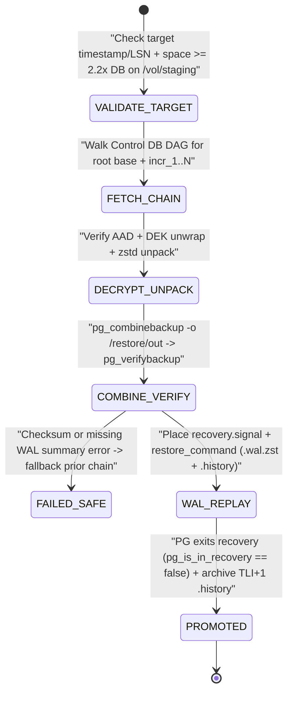
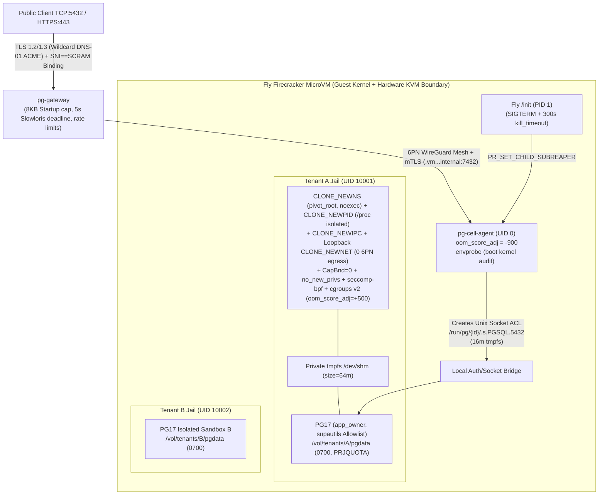
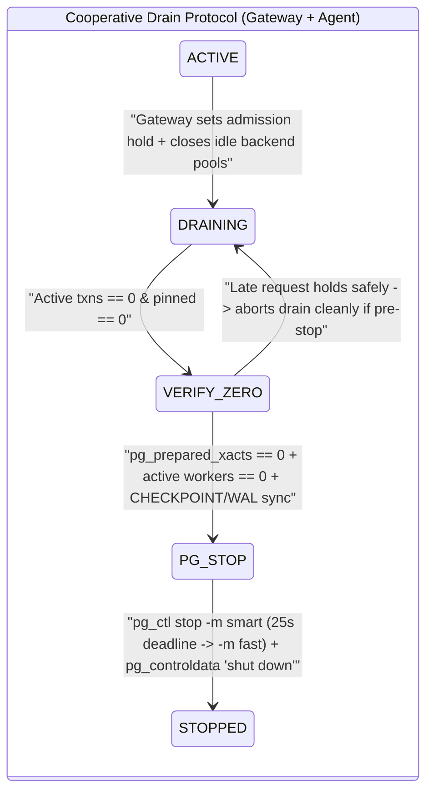
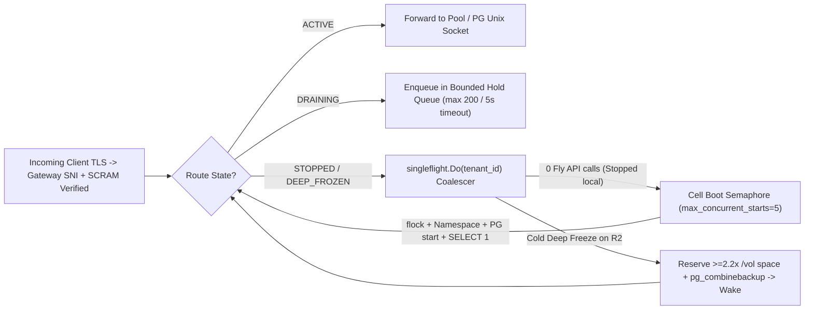
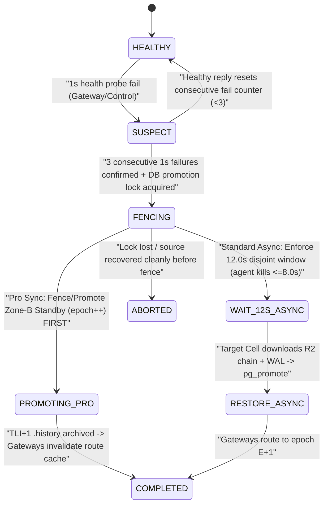
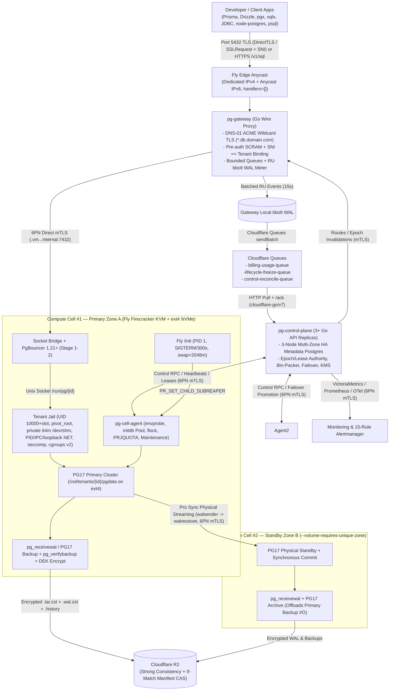

# Go-Native Multi-Tenant Serverless PostgreSQL Platform: System Design Research & Architecture Remediation Specification

> **Document Scope:** Research, Architecture Remediation & Pre-Implementation Verification Blueprint (**Zero Application Code / Zero Live Deployments**)  
> **Companion Risk Register (Deliverables 1 & 2):** [resolution-register.md](file:///workspaces/cloud/experimental-db/resolution-register.md) / [issue_resolution.md](file:///workspaces/cloud/experimental-db/issue_resolution.md)  
> **Source Audit:** [issue.md](file:///workspaces/cloud/experimental-db/issue.md)  
> **Primary Target Stack:** **Go (`golang`)**, **PostgreSQL 17**, **Fly.io Machines (Firecracker KVM + `ext4` Volumes + `6PN`)**, **Cloudflare R2**, **Cloudflare Queues (HTTP Pull Consumer)**, and **PostgreSQL-Native Physical Standby (Pro Tier)**

---

## 0. Deliverable Traceability & Navigation Index

Every finding in this specification explicitly labels whether it is an **[Established / Documented Fact]** (with primary documentation cited in Section 12), a **[Proposed Design]** (engineered recommendation + ADR), or an **[Unverified Assumption / PoC Required]** (explicitly gated by Section 11 experiments before production approval).

| Required Deliverable / Assignment Section | Location |
| :--- | :--- |
| **1. Issue Remediation Matrix (All 41 Risks)** | [resolution-register.md — Deliverable 1](file:///workspaces/cloud/experimental-db/resolution-register.md#L10-L65) |
| **2. Detailed Technical Research (All 41 Risks × 16 Fields)** | [resolution-register.md — Deliverable 2 (`RISK-01`..`RISK-41`)](file:///workspaces/cloud/experimental-db/resolution-register.md#L68) |
| **3. Revised Architecture Specification** | `plan.md` Sections 1–9 & Section 10.A (Component Boundaries & Interfaces) |
| **4. Architecture Diagrams (System, Data Flow, Lifecycle, Backup, Replication, Failover)** | `plan.md` Sections 1, 2, 3, 4, 6, 7 & 10.A–10.B (Mermaid + 12 End-to-End Flows) |
| **5. Failure Mode & Effects Analysis (FMEA)** | `plan.md` Section 9.E (25-Scenario FMEA Matrix) & Section 3.E (Durability Failure Matrix) |
| **6. Security Threat Model** | `plan.md` Section 4 (Research Area 3.D + STRIDE Matrix, Attack Surfaces & Mitigations) |
| **7. Performance & Capacity Model** | `plan.md` Section 6.A–6.B (Explicit Assumptions, Memory Math & Fly SKU Limits) |
| **8. Durability & Recovery Specification** | `plan.md` Section 2 (Backup/R2/PITR) & Section 3 (WAL, JetStream Evaluation, Commit ACK, Scoped `RPO=0`/RTO) |
| **9. Cost & Unit Economics Model** | `plan.md` Section 8.B–8.D (Verified Fly & R2 Pricing + Workload Archetype Economics) |
| **10. Unresolved Questions Register** | `plan.md` Section 12.B (`UQR-01` through `UQR-12`) |
| **11. Architecture Decision Records (ADRs)** | `plan.md` Section 12.C (`ADR-001` through `ADR-012`) |
| **12. Final Architecture Review & Viability Verdict** | `plan.md` Section 12.D–12.E (Conflicts, New Risks, Evidence Gates & Go/No-Go Review) |

---

## 1. PostgreSQL Cluster Lifecycle, Identity & Process Supervision (Research Area 3.A)

### 1.A Template Cloning (`XFS FICLONE`) vs. Independent `initdb`

**[Documented Fact — PostgreSQL Internals]** Every PostgreSQL data directory (`PGDATA`) embeds a unique 64-bit unsigned integer `system_identifier` inside `$PGDATA/global/pg_control` generated during `initdb` from timestamp + PID entropy (`src/bin/initdb/initdb.c`, `src/include/catalog/pg_control.h`). Additionally, every 16 MB WAL segment stamps `xlp_sysid` inside `XLogLongPageHeaderData`. During physical streaming replication (`IDENTIFY_SYSTEM`), archive recovery (`restore_command`), or backup verification (`pg_verifybackup`), PostgreSQL asserts `ControlFile->system_identifier == wal_header.xlp_sysid`.

Cloning an already-initialized `PGDATA` via copy or `XFS FICLONE` is **unsafe for production multi-tenant clusters** unless identity is rebuilt safely:
1. Two clusters sharing an identical `system_identifier` break backup/WAL lineage attribution cleanly—a misrouted WAL file from Tenant A replays onto Tenant B without `xlp_sysid` rejection if both came from the same template!
2. Even running `pg_resetwal` post-clone only updates `pg_control` after initializing an unvalidated blank WAL segment (`000000010000000000000001`), cannot safely reset clusters containing un-checkpointed state, and leaves template filesystem/extension assumptions brittle—and Fly.io Volumes provide **`ext4`**, not `XFS FICLONE` (`RISK-13`).

### 1.B Production Database Provider Comparison

| Platform / Pattern | Provisioning Mechanism | Tenant Boundary | Key Architectural Trade-Off |
| :--- | :--- | :--- | :--- |
| **AWS RDS / Supabase Single-Tenant** | Provision dedicated EC2/VM + EBS + fresh `initdb` per instance | Dedicated OS/VM + hypervisor | Cleanest identity isolation; high slow cold boot (~minutes) & idle cost floor |
| **Neon** | Storage-compute split: tenantless blank image + Safekeeper/Pageserver timeline UUIDs | Custom Rust Pageserver/Safekeeper + VM compute | Zero-copy branching; requires rebuilding PG storage/SMGR layer completely |
| **Patroni / CloudNativePG** | K8s pod + persistent PVC + `initdb` / `pg_basebackup` | K8s container pod + PVC | Battle-tested PG-native identity; pod/PVC churn slower than process-level pools |
| **Our Design: Pre-Warmed Two-Phase `initdb` Pool** | Background `initdb` staging pool (`pg_controldata` verified) + DB `UNIQUE(system_identifier)` lock on Fly `ext4` Cells | Independent `PGDATA` (`10000+slot` UID jail) per cluster | `<15ms` fast claim latency **with** 100% authentic PG17 `initdb` identity; requires ~45 MB/ready slot headroom (`ADR-001`) |

### 1.C Cluster Lifecycle State Machine

```mermaid
stateDiagram-v2
    [*] --> POOL_STAGING: "Background nice -n 19 initdb (--data-checksums)"
    POOL_STAGING --> POOL_READY: "pg_controldata == shut down + fsync + os.Rename"
    POOL_STAGING --> [*]: "Boot orphan purge"

    POOL_READY --> CLAIMING: "Provision mutex lock + os.Rename"
    CLAIMING --> STOPPED: "Control DB UNIQUE(system_identifier) commit + PGDATA move"
    CLAIMING --> [*]: "Rollback on crash/conflict via control-reconcile-queue"

    STOPPED --> STARTING: "Wake RPC (singleflight + max_concurrent_starts<=5)"
    STOPPED --> DEEP_FROZEN: "Stage 3 R2 eviction after inactivity window"
    DEEP_FROZEN --> STOPPED: "R2 restore + pg_combinebackup + pg_verifybackup"

    STARTING --> RECOVERY: "Unclean shutdown / WAL replay needed"
    RECOVERY --> ACTIVE: "SELECT 1 + SCRAM ready"
    STARTING --> ACTIVE: "agent.lock(flock) + SELECT 1 ready"
    STARTING --> CRASH_LOOP: ">3 failures/60s"

    ACTIVE --> DRAINING: "Idle >= threshold & 0 pinned sessions & 0 maintenance_lock"
    DRAINING --> STOPPED: "pg_prepared_xacts==0 + pg_ctl -m smart + pg_controldata shut down"
    DRAINING --> ACTIVE: "New txn arrives / drain aborted"

    ACTIVE --> MAINTENANCE_LOCKED: "age(datfrozenxid)>100M / mxid>100M"
    MAINTENANCE_LOCKED --> ACTIVE: "VACUUM (FREEZE) complete"

    ACTIVE --> MIGRATING: "Physical standby synced (<64KB lag)"
    MIGRATING --> FENCED_QUARANTINE: "Source fenced + epoch++"

    ACTIVE --> FENCED_QUARANTINE: "Watchdog 8s / Epoch mismatch"
    STOPPED --> SOFT_DELETED: "User DELETE (7-day grace; auth revoked)"
    ACTIVE --> SOFT_DELETED: "Stop + User DELETE"
    FENCED_QUARANTINE --> PURGED: "Forensic drain + reclaim"
    SOFT_DELETED --> PURGED: "Day 7 crypto-shred DEK + async R2 GC"
```



### 1.D Safe Provisioning, Process Lifecycle & Fly `/init` Compatibility

1. **Fly `/init` Runtime & Signal Mechanics (`RISK-06`, `RISK-29`):** **[Documented Fact]** Fly Firecracker microVMs always boot Fly's injected `/init` as PID 1 (custom `systemd`/`s6` cannot replace PID 1) and default to `kill_signal = "SIGINT"` with a 5-second `kill_timeout`. `pg-cell-agent` MUST:
   - Execute `unix.Prctl(unix.PR_SET_CHILD_SUBREAPER, 1, 0, 0, 0)` on startup so reparented `postgres` children/helpers re-attach to `pg-cell-agent` instead of `/init`, avoiding `wait4()` `ECHILD` races and zombie accumulation.
   - Override `fly.cell.toml` with `kill_signal = "SIGTERM"` and `kill_timeout = "300s"`, running a 16-goroutine parallel drain pool on VM shutdown to checkpoint and cleanly stop all active clusters in `<15s`.
2. **Mutual Exclusion & Crash Recovery (`flock` + `/proc` Re-Adoption):**
   - `pg-cell-agent` acquires `unix.Flock(LOCK_EX | LOCK_NB)` on `/vol/tenants/{id}/agent.lock` (`0600` owned by root *outside* tenant `CLONE_NEWNS` visibility) prior to launching `postgres`.
   - On agent crash + restart, running `postgres` instances survive undisturbed; `pg-cell-agent` scans `postmaster.pid` + `/proc/*/comm` + `agent.lock` to re-adopt live clusters seamlessly. Stale `postmaster.pid` or `/run/pg/{id}/.s.PGSQL.5432` files are removed **only** after `flock` succeeds and `/proc/<pid>` is verified dead.
3. **PostgreSQL Major Version Upgrades (`PG 17 -> PG 18`) Compatibility:** **[Proposed Design]** Physical WAL replication (`RISK-20`) strictly requires matching major PG versions on source and target Cells. Major upgrades use a separate Control Plane **Logical Replication Upgrade Workflow** (`PG 17` source publication -> new `PG 18` Cell slot `CREATE SUBSCRIPTION` -> sequence synchronization -> brief `DRAINING` cutover + `epoch++` + `pg_upgrade` fallback for offline stopped clusters with snapshot rollback).

### 1.E Lifecycle Invariants (Non-Negotiable)
- **LI-1:** Zero pooled clusters enter `/vol/pool/ready/` without passing `pg_controldata` `"shut down"` verification and `fsync()`.
- **LI-2:** Zero tenants share a `system_identifier` (enforced by Control DB `UNIQUE (system_identifier)` prior to directory promotion).
- **LI-3:** At most one OS process tree can ever hold `LOCK_EX` on a tenant's `PGDATA` at any instant (`agent.lock` + `postmaster.pid`).
- **LI-4:** No cluster is marked cleanly `STOPPED` for backup/eviction until `pg_controldata` confirms `Database cluster state: shut down`.

---

## 2. Backup, Restore & Storage Durability Specification (Research Area 3.B & Deliverable 8 Part 1)

### 2.A Why `FIEMAP` Physical Delta Scraping Cannot Provide Valid PostgreSQL Backups

**[Documented Fact — Linux Kernel & PostgreSQL Internals]** Scanning Linux `FS_IOC_FIEMAP` extents to collect "changed blocks" against an initialized template violates both Linux VFS and PostgreSQL persistence guarantees:
1. **`FIEMAP_EXTENT_DELALLOC` (`0x00000004`) & `FIEMAP_EXTENT_UNKNOWN`:** Per [Linux Kernel `fiemap.txt`](https://docs.kernel.org/filesystems/fiemap.html), filesystems using delayed allocation leave newly written page-cache blocks without physical disk extents yet; omitting `FIEMAP_FLAG_SYNC` skips dirty data invisibly.
2. **Torn 8 KB PostgreSQL Pages Outside `pg_backup_start()`/`pg_backup_stop()`:** Even with `FIEMAP_FLAG_SYNC`, Linux writes 4 KB VFS pages while PostgreSQL modifies 8 KB buffer pages concurrently. Reading an updated extent mid-write outside PostgreSQL's documented [Continuous Archiving Low-Level API](https://www.postgresql.org/docs/current/continuous-archiving.html#BACKUP-LOWLEVEL-BASE-BACKUP) captures half-old/half-new bytes *without* a `backup_label` redo-checkpoint anchor, leaving WAL replay unable to heal fractured pages (`PANIC: corrupted page`).
3. **Partial Shared Extents, Deletions, Truncations & Sparse Holes:** XFS/Btrfs CoW shares arbitrary block intervals inside a file (`FIEMAP_EXTENT_SHARED`). Scanning changed extents alone fails to capture relation file truncations (`VACUUM` shrink), unlinked relation OIDs (`DROP TABLE`/`CLUSTER`), `_fsm`/`_vm` forks, sparse zero-extents (`FALLOC_FL_PUNCH_HOLE`), or POSIX permissions/ownership.
4. **Infrastructure Mismatch:** Fly.io Volumes format local NVMe devices as **`ext4`**—which does not support XFS `FICLONE` directory cloning (`RISK-13`).

### 2.B Backup Architecture Comparison

| Method | PostgreSQL Native Support | Consistency & Recovery Guarantee | R2 Storage & Bandwidth Efficiency | Fly `ext4` Fit & Verdict |
| :--- | :--- | :--- | :--- | :--- |
| **1. PG17 Native `pg_basebackup` (`--incremental` + `pg_receivewal`)** | 100% Native (`PG 17`) | Verified `backup_label` + `pg_verifybackup` SHA-256 + `pg_combinebackup` + continuous WAL/PITR | High (`80–95%` delta reduction via `summarize_wal = on` [Assumed workload savings]) | **ADOPTED (`ADR-002`)** — Full PG17 alignment, `ext4` native |
| **2. Filesystem Snapshots / XFS Reflinks** | Native *only* if filesystem supports CoW snapshots & quiesced `pg_backup_start()` / atomic block snap | Safe *only* for atomic whole-volume snap (breaks across async file-by-file `FIEMAP`) | Dependent on Fly snapshot `$0.08/GB-mo` at whole-Cell granularity (noisy across multi-tenant Cells) | Used solely as secondary Cell-level DR (`snapshot_retention = 7`); unfit for per-tenant R2 PITR |
| **3. Hybrid Physical + Logical (`pg_dump`)** | Native | Physical for PITR; `pg_dump` lacks block-level LSN timeline PITR | Lower storage for schema-only exports | Supplement only (logical export API / major PG upgrades) |

### 2.C Complete PG17 + Cloudflare R2 Backup Architecture & Integrity Model

**[Documented Fact — Cloudflare R2 & PostgreSQL 17]**
- **Cloudflare R2 (`https://developers.cloudflare.com/r2/`):** Globally strong read-after-write consistency; atomic conditional evaluation (`If-None-Match: "*"`, `If-Match`) supported on both `PutObject` and `CompleteMultipartUpload` (returning `412 PreconditionFailed` to concurrent losers and auto-aborting losing multipart upload IDs; conditional headers on `CreateMultipartUpload` are ignored, and failed `412` + uploaded parts incur Class A billing).
- **PostgreSQL 17 (`https://www.postgresql.org/docs/17/app-pgcombinebackup.html`):** Background WAL summarizer (`summarize_wal = on`, `wal_summary_keep_time = '48h'`, `wal_level = replica`) writes block deltas in `pg_wal/summaries/`. `pg_basebackup --incremental=<prev_manifest>` outputs incremental relation blocks; `pg_combinebackup` synthesizes unpacked restored directories; `pg_verifybackup` checks every file checksum against `backup_manifest`.

**R2 Prefix Layout & Metadata Schema (`tenants/{tenant_id}/manifest.json`):**
```json
{
  "schema_version": 2,
  "tenant_id": "tn_01J...",
  "system_identifier": "7389120491827364512",
  "owner_epoch": 4,
  "dek_key_id": "kek_v3_dek_8912",
  "encryption": "AES-256-GCM-AAD",
  "chains": [
    {
      "backup_id": "bk_base_01",
      "parent_id": null,
      "type": "FULL",
      "timeline_id": 1,
      "start_lsn": "0/2000028",
      "end_lsn": "0/3000100",
      "min_wal_seg": "000000010000000000000002",
      "max_wal_seg": "000000010000000000000003",
      "manifest_sha256": "...",
      "verified_by_pg_verifybackup": true,
      "dek_unwrap_tested": true,
      "status": "VERIFIED"
    }
  ],
  "timelines": [{"tli": 1, "history_key": null}, {"tli": 2, "history_key": "epoch_000004/wal/00000002.history.enc"}],
  "pitr_earliest_time": "2026-11-01T00:00:00Z",
  "pitr_latest_time": "2026-11-15T08:30:05Z"
}
```

### 2.D Restore Sequence, Recovery State Machine & WAL GC Policy



**WAL Retention & Dependency-Aware Garbage Collection Policy:**
1. **Strict DAG Reference Counting (No Blind Bucket TTL):** Never configure a blind R2 age-expiration rule on backup/WAL prefixes! A `FULL` backup $B_0$ and all WAL segments from $B_0.\text{min\_wal\_seg}$ forward remain pinned if **either** (a) any child `INCR` backup $B_k$ depending on $B_0$ sits within the tenant's PITR retention window (`7–30 days`), **or** (b) $B_0$ is the active floor base backup.
2. **24-Hour Multipart Orphan Rule:** Configure an R2 Bucket Lifecycle rule strictly for `AbortIncompleteMultipartUpload(DaysAfterInitiation = 1)` plus immediate `AbortMultipartUpload` calls on Go error paths (`RISK-15`).
3. **2-Step Deletion Guard:** Expired chains move `ACTIVE -> EXPIRED` in Control DB (`backups` table) cleanly before async `lifecycle-freeze-queue` worker deletes unreferenced R2 objects.

### 2.E Safe vs. Unsafe Backup Optimizations & Justified RPO/RTO

| Practice | Classification | Reasoning |
| :--- | :--- | :--- |
| Staging backup checks via `pg_verifybackup` + DEK unwrap pre-publish | **SAFE / MANDATORY** | Catches bit-rot, torn transfers, or wrapped key loss *before* marking backup `VERIFIED` |
| Automatic full-backup fallback on `pg_available_wal_summaries()` gaps | **SAFE / MANDATORY** | Eliminates PG17 `--incremental` failure after crash/summary expiration (`RISK-02`) |
| `zstd` fast compression of `pg_basebackup` + WAL streams before AES-256-GCM | **SAFE** | Preserves exact byte stream integrity while cutting R2 footprint (~2–4x) |
| Skipping `.history` file archival or using `if-modified` blind age TTL | **UNSAFE** | Breaks cross-failover timeline recovery permanently (`RISK-16`) |
| Claiming `FIEMAP` delta / async R2 puts equal `RPO=0` | **UNSAFE** | Torn pages (`FIEMAP`) & async flush gaps drop committed transactions (`RISK-02`, `RISK-03`) |

**Justifiable RPO / RTO Envelope (`EXP-D4`, `EXP-D5` calibrate exact RTO):**
- **Standard Async Tier:** **`RPO <= 5 seconds`** (measured from local PG `COMMIT` to flushed `.wal.zst` object committed in R2; `RPO = 0` on clean cooperative sleep). **Unverified RTO Target:** ~15s–120s+ depending on database size (`>=12.0s` fencing barrier + R2 download + `pg_combinebackup` + WAL replay).
- **Pro Sync Tier:** **`RPO = 0` Strictly Scoped** (`Section 3.F`). **Unverified RTO Target:** ~4s–10s (`3×1s` hysteresis + standby `pg_promote()` + Gateway epoch update—to be measured empirically in Stage 2).

---

## 3. WAL Replication, NATS JetStream Evaluation & Durability Model (Research Area 3.C & Deliverable 8 Part 2)

### 3.A Physical vs. Logical Replication & PostgreSQL `walsender`/`walreceiver`

**[Documented Fact — PostgreSQL 17 Replication Protocol (`protocol-replication.html`)]**
- **Logical Replication (`replication=database`, `pgoutput`):** Decodes committed DML changes for specific tables inside *one* database. **Cannot** replicate DDL (`CREATE TABLE`, `ALTER TABLE`), sequences (`nextval()`), large objects, roles, or cross-database physical cluster state reliably, making it unsuitable for automated transparent HA failover (`RISK-03`, `RISK-20`).
- **Physical Streaming Replication (`replication=true`):** Streams raw block-level WAL (`XLogData`) byte-for-byte across the entire cluster (`PGDATA` + all databases + DDL + sequences). Handshake: `IDENTIFY_SYSTEM` (`systemid`, `timeline`, `xlogpos`) -> `TIMELINE_HISTORY` (fetches `.history`) -> `START_REPLICATION [PHYSICAL] LSN [TIMELINE tli]` -> `CopyBothResponse`. Standby feeds back `StandbyStatusUpdate` (`write_lsn`, `flush_lsn`, `apply_lsn`). Under `synchronous_commit = on` and `synchronous_standby_names = 'FIRST 1 (...)'`, primary commit calls `SyncRepWaitForLSN`, sleeping after local WAL `fsync` until the designated `sync` standby replies with `flush_lsn >= commit_lsn` (`replay_lsn` for `remote_apply`).

### 3.B Can NATS JetStream Participate in Synchronous PG Durability or Replace a Sync Standby?

**[Documented Fact — NATS JetStream (`https://docs.nats.io/nats-concepts/jetstream`)]**
- NATS JetStream uses Raft consensus (`R=3` quorum 2, `R=5` quorum 3) with `FileStorage` providing linearizable message order across replicated nodes and explicit consumer ACK loops (`at-least-once`).
- **Critical Gap #1 (Persistence Sync Semantics):** Per NATS JetStream architecture, in clustered `R=3` Raft mode JetStream prioritizes quorum network replication to disk buffers rather than synchronous blocking `fsync()` on every individual publish by default (`sync_always` must be forced cleanly alongside isolated multi-zone host placement, adding heavy tail latency).
- **Critical Gap #2 (Protocol & Recovery Mismatch):** Even with synchronous Raft `fsync` across zones, **JetStream cannot replace PostgreSQL's synchronous physical standby (`RISK-04`)**:
  1. JetStream has zero awareness of PG `system_identifier`, `IDENTIFY_SYSTEM`, 16 MB WAL segment splitting (`XLogLongPageHeaderData`), timeline `.history` branches across failovers, or durable replication slots (`restart_lsn`).
  2. PostgreSQL `SyncRepWaitForLSN` validates live `StandbyStatusUpdate` replies per LSN cleanly inside `walsender`; a generic JetStream bridge runs asynchronously outside PG shared memory unless a stateful Go custom `walreceiver` proxy translates LSNs, buffers uncommitted partial records, handles out-of-order redeliveries idempotently, persists crash-safe slot state locally, and survives quorum reconfigurations identically to PG.
  3. On primary failure, a JetStream WAL log contains **no warm replayed `PGDATA`**—failover still forces cold R2 download + userspace WAL reconstruction + crash recovery (slow RTO vs seconds on warm physical standby!).

**Architectural Verdict (`ADR-003`, `ADR-004`):** Exclude NATS JetStream completely from PostgreSQL WAL commit durability. Use **real PostgreSQL 17 Physical Standbys** (`synchronous_standby_names`) across unique Fly zones for Pro `RPO=0` synchronous durability, and **Cloudflare Queues (HTTP Pull)** strictly for async usage metering (`billing-usage-queue`) and control/cleanup jobs (`lifecycle-freeze-queue`, `control-reconcile-queue`).

### 3.C Durability Tiers Defined Formally

1. **Local Durability:** WAL record written and `fdatasync()`ed to primary Cell's local NVMe `ext4` volume (`/vol/tenants/{id}/pgdata/pg_wal`). Survives `postgres` backend/Cell OS restart, **lost** if physical host NVMe dies permanently before remote replication.
2. **Remote Async Durability (`Standard Tier`):** Local durability *plus* asynchronous physical streaming via `pg_receivewal` -> zstd -> AES-256-GCM upload to Cloudflare R2 every `<=5s` and on clean sleep drain (`RPO <= 5s` on abrupt hardware death).
3. **Quorum / Sync Standby Durability (`Pro Tier`):** Local durability on Zone-A Primary *plus* synchronous `fdatasync()` to a separate-zone Zone-B PG17 Physical Standby (`flush_lsn >= commit_lsn`) confirmed via `StandbyStatusUpdate` **before** `COMMIT` returns `'C'` to client (`synchronous_commit = on`). Standby also runs async `pg_receivewal` -> R2 backups cleanly isolating backup I/O off Primary!

### 3.D Commit Acknowledgment Sequences

```mermaid
sequenceDiagram
    autonumber
    participant Client
    participant GW as pg-gateway
    participant Pri as PG17 Primary (Zone A)
    participant SB as PG17 Physical Standby (Zone B)
    participant R2 as Cloudflare R2

    Note over Client,R2: Pro Sync Tier (synchronous_commit = on, sync_standby = Zone B)
    Client->>GW: COMMIT
    GW->>Pri: COMMIT
    Pri->>Pri: Write WAL + fdatasync() local NVMe
    Pri->>SB: XLogData (LSN_c) over 6PN mTLS
    SB->>SB: walreceiver write + fdatasync() Zone B NVMe
    SB-->>Pri: StandbyStatusUpdate (flush_lsn >= LSN_c)
    Pri-->>GW: CommandComplete ('C') [ONLY AFTER flush_lsn ACK]
    GW-->>Client: COMMIT OK
    SB-->>R2: Async pg_receivewal (.wal.zst + .history) every 5s

    Note over Client,R2: Standard Async Tier (synchronous_standby_names = '')
    Client->>GW: COMMIT
    GW->>Pri: COMMIT
    Pri->>Pri: Write WAL + fdatasync() local NVMe
    Pri-->>GW: CommandComplete ('C') [0ms remote wait; RPO <= 5s]
    GW-->>Client: COMMIT OK
    Pri-->>R2: Async pg_receivewal -> R2 batch <= 5s
```

### 3.E Durability Failure Matrix (10 Failure Modes)

| Failure Scenario | Standard Tier (Async) Outcome | Pro Tier (Sync Standby) Outcome | Recovery Behavior |
| :--- | :--- | :--- | :--- |
| **1. `kill -9` Primary postmaster mid-transaction (before `COMMIT` ACK)** | Transaction rolled back cleanly | Transaction rolled back cleanly | Local `PGDATA` crash WAL replay (`REDO`/`UNDO` uncommitted XID) |
| **2. `kill -9` Primary Cell VM immediately *after* `COMMIT` ACK** | **Committed data within last `<=5s` NOT yet pushed to R2 may be LOST** (`RPO <= 5s`) | **Zero ACKed data lost (`RPO = 0`)** (`flush_lsn` already `fsync`ed on Zone B standby) | Standard: restore R2 + latest `.wal.zst`; Pro: promote Zone B standby (`pg_promote()`) |
| **3. Zone B Standby crashes / disconnects (`6PN` split)** | Unaffected (`no standby`) | Primary `COMMIT` **blocks cleanly** (`CP` safety!) rather than dropping sync guarantee (`timeout` / alert at 10s) | Primary holds WAL up to `max_slot_wal_keep_size` (`256MB`), replacement standby syncs or operator/policy intervenes (`UQR-04`) |
| **4. Replication slot disconnected indefinitely** | `pg_receivewal` slot capped at `256MB` (`max_slot_wal_keep_size`) | Primary standby slot capped -> prevents Cell `ENOSPC` panic (`RISK-17`); triggers critical alert (`RISK-40`) | If slot exceeds `256MB` keep size and invalidates, replacement standby initializes fresh `pg_basebackup` from primary/R2 |
| **5. Timeline switch mid-backup (`TLI 1 -> TLI 2`)** | Archiver uploads `00000002.history` before resuming `TLI 2` segments | New Primary generates & uploads `00000002.history` to R2; new standby follows `TLI 2` | Both active standby & PITR trace `.history` cleanly (`RISK-16`) |
| **6. Network partition isolates Primary while stale Client connected** | Primary self-kills via `CLOCK_MONOTONIC` / `softdog` at **`8.0s`**; Control Plane promotes at **`>=12.0s`** | Standby promoted/fenced **first** (`epoch++`); isolated Primary's `COMMIT` stalls forever on `SyncRepWaitForLSN` | Returning Primary fails epoch handshake -> **`FENCED_QUARANTINE`** |
| **7. R2 temporarily unavailable (`503` for 30 min)** | Local Cell spools WAL up to reserve watermark (alert >50%); ongoing writes stay locally durable | Sync `RPO=0` continues unaffected between Zone A & Zone B NVMe; R2 backlog drains cleanly upon recovery | Alert fires (`RISK-40`); if buffer nears saturation, Pro stays protected via standby NVMe while Standard throttles |
| **8. Corrupted WAL tail or partial trailing record on disk** | Fails crash recovery / pauses cleanly at last valid CRC checkpoint; falls back to R2 validated chain | Standby ignores partial un-flushed tail cleanly (`valid CRC` boundary); intact flushed state promotes | Zero silent corruption skip (`RISK-41`) |
| **9. Primary + Zone B Standby simultaneous physical destruction** | Restores latest R2 base + archived WAL (`RPO <= 5s` excluding multi-region loss) | **`RPO=0` EXCLUDED** -> recovers from R2 archived WAL (`RPO <= 5s` prior to dual destruction) | Explicitly documented outside single-fault `RPO=0` boundary (`Section 3.F`) |
| **10. Operator `DROP TABLE` / application bug** | Replicated faithfully (logical human error is NOT prevented by HA standby!) | Replicated faithfully to Standby immediately | Solved via immutable R2 **PITR Clone** (`Section 2.D`) prior to mistake timestamp |

### 3.F Exact Conditions Required for `RPO=0` (and Explicit Exclusions)
**`RPO=0` holds ONLY when ALL five conditions hold simultaneously:**
1. Database is provisioned on **Pro Sync Tier** with a verified healthy PG17 Physical Standby placed in a **distinct failure zone** (`--volume-requires-unique-zone`).
2. `synchronous_standby_names` is non-empty and `synchronous_commit` is `on` (or `remote_apply`).
3. Primary `pg_stat_replication` shows the standby in **`sync_state = 'sync'`** (verified automatically by Control Plane; no degraded async silent fallback enabled).
4. Failure mode is **at most single-fault** (one Primary `postgres`, Cell VM, NVMe volume, or host zone fails) and Primary had already returned `CommandComplete ('C')` to the client.
5. Client checks `COMMIT` return status honestly (`08006` in-flight disconnect during `COMMIT` has *unknown* commit status—may succeed or roll back cleanly on recovery).

**Explicitly EXCLUDED from `RPO=0`:** Simultaneous destruction of both Primary and Sync Standby zones; correlated region-wide R2 + Compute destruction; PostgreSQL/kernel storage firmware bugs corrupting silent disk pages identically; operator forcing emergency failover after manually disabling `synchronous_standby_names`; Standard Async Tier commits.

---

## 4. Multi-Tenant Isolation & Security Threat Model (Research Area 3.D & Deliverable 6)

### 4.A Isolation Architecture Comparison

| Model | Kernel / HW Boundary | Cold / Wake Speed | Density & Idle Cost (per Fly Pricing) | Shared Attack Surface & Verdict |
| :--- | :--- | :--- | :--- | :--- |
| **1. Multiple PG Processes (Shared Cell, Unhardened)** | Shared Linux UID/root + cgroups only | `<1s` local spawn | Very high density (~80–100 active) | Critical risk: `/proc`, `/vol`, `/dev/shm` leak, `6PN` SSRF (`Rejected`) |
| **2. Container-per-Tenant (`Docker`/`containerd` nested)** | Shared guest kernel inside Cell VM | `~0.5–2s` | Moderate (daemon + overlayfs bloat inside Firecracker) | Nested container runtime clashes with Fly `/init`; `seccomp` + namespaces achieve stronger isolation without daemon overhead |
| **3. Hardened Process Sandbox Inside Firecracker (`Our Standard Shared Cell`)** | Firecracker VM per Cell + per-tenant UID, `pivot_root`, `PID/IPC/NS/netns`, `CapBnd=0`, `seccomp`, `cgroups v2` | `<1s` local spawn (`0` Fly API calls) | **Dense (~80 active / 500 dormant per 8 GB Cell)** | Shared guest kernel CVE risk remains; blocked from SSRF, `/proc`, sibling files, `/dev/shm` (`ADOPTED Free/Standard Tier`) |
| **4. 1 Firecracker MicroVM per Tenant (`Dedicated Tier`)** | Dedicated KVM hardware hypervisor & guest kernel per tenant | `~2–10s` VM start (`10 writes/min` API cap!) | Low (`$33–$132+/mo` + `$0.15/GB-mo` even stopped) | Strongest hardware boundary; supports `PostGIS` / custom extensions (`ADOPTED Pro/Enterprise Dedicated Tier`) |

### 4.B Multi-Tenant Cell Isolation Boundary Diagram



### 4.C Attack-Surface Analysis & Security Invariants

**PostgreSQL Surface Hardening (`RISK-10`, `RISK-22`):**
- Zero `SUPERUSER` granted to tenants (`app_owner` lacks `SUPERUSER`, `BYPASSRLS`, `CREATEDB`, `CREATEROLE` bypasses, `pg_execute_server_program`, `pg_read_server_files`, `pg_write_server_files`).
- **`COPY ... PROGRAM`**, **`LOAD '/path'`** (`dynamic_library_path = '$libdir'` + `noexec` mounts), and **untrusted PLs** (`plpython3u`, `plperlu`, `pltclu`, `C` UDFs) disabled/excluded cleanly from Cell container binaries.
- **`supautils` + Version-Locked Extension Allowlist:** Strictly permits `uuid-ossp`, `pgcrypto`, `pg_trgm`, `citext`, `btree_gin`, `btree_gist`, `hstore`, `vector` (`pgvector`), `pg_stat_statements` on Shared Cells; `supautils` treats PG hooks solely as inner defense backed up by OS sandbox!
- **Credential Hygiene:** `pg-cell-agent` connects locally via Linux kernel **`peer` (`SO_PEERCRED`)** over Unix sockets (no static admin password stored anywhere). Customer passwords enforce **`SCRAM-SHA-256`** and pass via `0600` ephemeral root pipe/FD (never CLI args or `environ`).

**Cryptographic Key Hierarchy & Deletion (`RISK-23`, `RISK-24`):**
- **Transit:** Client <-> `pg-gateway` (`TLS 1.2/1.3`, SNI cryptographically verified against SCRAM `tenant_id` match); `pg-gateway` <-> `pg-cell-agent` <-> Standby (`WireGuard 6PN` + mutual TLS `<30d` rotated certs).
- **At Rest & Deletion:** Fly encrypts NVMe volumes transparently; R2 archives use client-side **Envelope Encryption (`AES-256-GCM` with `AAD = tenant_id|epoch|object_key`)** where each tenant's 256-bit `DEK` is wrapped by a 90-day-rotated Control Plane KMS `KEK`. Hard delete destroys `DEK` (**instant crypto-shredding**) prior to async R2 sweep.

### 4.D Security Threat Model (Deliverable 6 — STRIDE Analysis)

| STRIDE Threat | Attack Vector / Escape Scenario | Mitigation & Trust Boundary | Residual Risk |
| :--- | :--- | :--- | :--- |
| **Spoofing** | Attacker uses SNI `victim.db.domain.com` + valid creds for `attacker`, or replays `CancelRequest` | Gateway validates `SNI_tenant_id == SCRAM_tenant_id`; `CancelRequest` uses 32-bit `crypto/rand` secrets | DNS-01 ACME token custody risk (isolated strictly to Control Plane TLS cert job) |
| **Tampering** | Stale isolated Cell mutates R2 `manifest.json` or swaps backup ciphertext across tenant prefixes | `epoch` monotonicity checked in `If-Match` CAS + Control DB; `AES-256-GCM` AAD binds `tenant_id|epoch|key` | KMS KEK total loss compromises availability cleanly (never silently corrupts integrity) |
| **Repudiation** | Operator or attacker deletes tenant/rotates keys or disputes billable query runs | Immutable append-only Control DB `audit_events` + `usage_ledger` keyed by `sha256(idempotency_key)` | Root host/Control DB superuser compromises could erase DB-resident logs (mitigate via R2 write-once log sink) |
| **Info Disclosure** | C-extension bug / SQL probes `/proc/*/environ`, sibling `/vol/tenants/*`, `/dev/shm`, `6PN` metadata (`fdaa::3`), or log leaks SQL PII | `CLONE_NEWPID` (`/proc` isolated), `CLONE_NEWNS` + `pivot_root` (`0700` UID), private `64m` `/dev/shm`, loopback `CLONE_NEWNET`, `0` secrets in env/logs | Zero-day **Linux kernel** info-leak/Spectre within shared Cell guest kernel (`Dedicated KVM Tier` mitigates completely) |
| **Denial of Service** | 2 GB `StartupMessage` length bomb, 10k Slowloris sockets, fork bomb, OOM `/dev/shm` bomb, `generate_series` disk fill | Gateway `8 KB` header cap + `5s` deadline + rate limits; `pids.max=64`, `memory.oom.group=1`, private `/dev/shm`, `PRJQUOTA`/1s `/proc` watcher + `.cell_ballast` | Correlated Cell kernel panic temporarily affects <=80–100 co-located tenants until Cross-Cell failover completes (`RISK-05`) |
| **Elevation of Privilege** | `COPY PROGRAM`, `LOAD`, `ALTER SYSTEM`, symlink in `PGDATA`, dirty GUC injection into `pg-cell-agent` | Non-superuser `app_owner` + `supautils` + `0600` root config + `noexec` + `CapBnd=0` + `no_new_privs` + `seccomp-bpf` + sanitized agent inputs | Unpatched zero-day Linux kernel priv-esc inside shared guest VM (`kernel updates + Dedicated Tier`) |

**Security Invariants:**
- **SI-1:** No tenant OS process on a shared Cell can open a non-loopback network socket (`ENETUNREACH`).
- **SI-2:** No tenant role possesses `SUPERUSER` or OS execution capability (`noexec`, `CapBnd = 0`).
- **SI-3:** TLS SNI tenant identity, authenticated SCRAM identity, and routed Unix socket path MUST match 1:1.
- **SI-4:** Zero tenant plaintext data leaves any Fly VM onto R2 without per-tenant AES-256-GCM DEK encryption.

---

## 5. PostgreSQL Wire-Protocol Gateway & Connection Pooling (Research Area 3.E)

### 5.A PostgreSQL Frontend/Backend Protocol Completeness & Edge Cases

**[Documented Fact — PostgreSQL Frontend/Backend Protocol (`protocol-flow.html`)]**
PostgreSQL wire multiplexing is **not** stateless HTTP routing. A stateful transaction-mode proxy must accurately model:
1. **Simple Query (`'Q'`) vs. Extended Query (`'P'`/`'B'`/`'D'`/`'E'`/`'H'`/`'C'`/`'S'`):** Simple queries execute inline and emit `'C'` (or `'I'` empty, `'E'` error) per embedded semicolon statement, ending cleanly with `'Z'` (`ReadyForQuery` carrying `'I'` Idle, `'T'` InTransaction, or `'E'` FailedTransaction). Extended Query splits preparation (`Parse`), parameter binding (`Bind`), metadata (`Describe`), execution (`Execute`), flushing (`Flush` mid-batch without sync!), cleanup (`Close`), and transaction error boundaries (`Sync`).
2. **Unnamed Statement & Portal (`""`) Semantics + Pipelining:** Drivers routinely send `Parse("") -> Bind("", "") -> Describe('P', "") -> Execute("", max_rows)` pipelined without waiting for server replies. `Parse("")` replaces prior unnamed statements immediately unless a bound portal exists; `Execute` with `max_rows > 0` returns `PortalSuspended ('s')`, leaving a live backend cursor pinned until drained or closed!
3. **Error Recovery Drain Until `Sync ('S')`:** When *any* Extended Query frame throws an error, the backend skips all remaining queued pipelined messages until the next `Sync ('S')`, then emits `ErrorResponse` + `ReadyForQuery('E')` (rolled back state if inside txn). A naive multiplexer loses client/backend message synchronization permanently.
4. **Session-Bound State Requiring Backend Pinning:** `CREATE TEMP TABLE`, `DECLARE ... CURSOR`, `SET <guc>` (without `LOCAL`), `pg_advisory_lock()`, `LISTEN`, `PREPARE TRANSACTION` (`2PC`), and `COPY IN`/`COPY OUT` (`'d'`/`'c'`/`'f'`) mutate connection-local process state and **cannot switch backends cleanly between transactions**.
5. **`DEALLOCATE`, `DISCARD ALL`, DDL Invalidation & `CancelRequest`:** `ALTER TABLE`/`DROP TABLE` invalidates server plans invisibly until next `Bind`/`Execute` fails (`0A000` cached plan must not change result type); `CancelRequest` arrives on a **brand-new TCP connection** with `(BackendPID, SecretKey)` requiring translation to the exact backend holding that client's active transaction!

### 5.B Connection Pooling Strategy Comparison

| Strategy | Protocol / ORM Compatibility | Max Client Fan-In Density | Implementation Risk | Lifecycle Verdict |
| :--- | :--- | :--- | :--- | :--- |
| **1. Pure Session Pooling** | **100%** (Supports `TEMP`, `LISTEN`, `COPY`, pipelines, prepared stmts natively) | Bounded strictly by PG `max_connections = 15` (`max 1,200/Cell`) | Low (Zero statement virtualization state machine bugs) | **ADOPTED (`Direct Endpoint` + Stages 1–2 safe fallback)** |
| **2. Transaction Pooling (`PgBouncer 1.21+`)** | **~98%** (Supports protocol-level prepared statements via `max_prepared_statements > 0`) | Very high (`200+` waiting clients -> `10–15` backends) | Low–Moderate (Proven C codebase; blocks `LISTEN`/session `SET` cleanly via Direct endpoint) | **ADOPTED (`Stages 1–2 Pooled Endpoint`, `ADR-009`)** |
| **3. Statement Pooling** | **Poor** (Breaks multi-statement `BEGIN ... COMMIT` transactions completely!) | Highest theoretical reuse | Breaks Prisma/ORM transactions fundamentally | **REJECTED permanently** |
| **4. Custom Go Protocol-Aware Multiplexer (`pgproto3` + Auto-Pinning)** | Target **100%** (Auto-pins session state on `TEMP`/`LISTEN`/`SET`) | Very high + single endpoint UX | High (`Months of edge-case stabilization across ORMs`) | **DEFERRED to Stage 3** gated on `100%` Group E pass (`ADR-009`) |

### 5.C Driver & ORM Compatibility Matrix

| Driver / ORM | Typical Protocol Mode & Edge Case Behavior | Stage 1–2 (`PgBouncer 1.21+` / Direct) Behavior | Stage 3 Virtualizer Requirement (`EXP-E1..E4`) |
| :--- | :--- | :--- | :--- |
| **Prisma** | Heavy named & unnamed prepared stmts; requires `pgbouncer=true` or session/pinned migrations | Works seamlessly (`max_prepared_statements > 0` on pooled; migrations via Direct endpoint) | Must map statement names & auto-pin session `SET` / migration locks cleanly |
| **Drizzle** | Uses `postgres.js` or `node-postgres`; pipelined Extended Query (`Parse`/`Bind`/`Execute`) | Works cleanly on PgBouncer 1.21+ (`prepared: true`) + Direct | Must preserve pipeline FIFO ordering & error-drain-to-`Sync` |
| **Go `pgx` (`v5`)** | Default Statement Cache + Pipeline Mode (`pgx.Batch`) + `COPY FROM` (`CopyIn`) | Supported on PgBouncer 1.21+ (Statement mode) + `COPY` pinned within transaction | Rewrite statement names transparently across backends; isolate `CopyBoth`/`CopyIn` cleanly |
| **Rust `sqlx` / Java `JDBC`** | Extended query, server-side prepared statements (`prepareThreshold`), batching, explicit `Describe` | Supported via PgBouncer 1.21+ / Direct | Handle `Describe('S'/'P')` cache hits cleanly + `Close('S')` sync |
| **`node-postgres` (`pg`)** | Mixes unnamed `""` & named stmts, Simple queries, `LISTEN/NOTIFY` listeners | Queries use Pooled endpoint; `LISTEN` routes to Direct Session endpoint | Auto-detect `LISTEN` -> pin session permanently cleanly (`no sleep while pinned`) |
| **`psql` / `pg_dump`** | Simple queries, `COPY IN/OUT` (`\copy`), interactive transactions, `CancelRequest` (`Ctrl-C`) | Session/Direct supported natively (`100%`) | `CancelRequest` lookup maps CSPRNG client `(PID, Secret)` -> live Cell backend |

### 5.D Stage-3 Session-State Virtualization, Unsupported Policies & Backpressure

- **Session-State Virtualization (`Stage 3` `internal/wire`):** Maintain per-client state `(clientStmts map[name]stmtAST, clientPortals, pinned bool, inTxn bool)`. Every backend tracks `backendStmts map[sqlHash]backendName`. On transaction dispatch, if `!backendHas(hash)`, transparently inject `Parse(canonical_name, sql, paramOIDs)` + `Flush` ahead of `Bind(canonical_name, ...)`; maintain queue of injected hidden responses to strip cleanly before sending replies back to client. Transition `pinned = true` irreversibly for connection lifetime whenever client executes `LISTEN`, `CREATE TEMP TABLE`, session `SET`, `DECLARE CURSOR`, `PREPARE TRANSACTION`, or `pg_advisory_lock`.
- **Unsupported Feature Policy (Pooled Transaction Mode):** Explicitly publish that `LISTEN/NOTIFY`, persistent session cursors held across transactions, session `SET`, and `LOAD` are unsupported inside **Stateless Transaction Mode** on Stages 1–2 and must connect cleanly to the `{tenant}.db.domain.com` Direct Session Endpoint (auto-supported cleanly in Stage 3 via auto-pinning). `PREPARE TRANSACTION` (`2PC`) is allowed strictly on Direct/Session with explicit max-age limits (`RISK-07`, `RISK-08`).
- **Connection Lifecycle, Timeouts & Gateway Backpressure (`RISK-12`, `RISK-23`, `RISK-35`):**
  - Pre-auth deadline: **`5s`** (`SSLRequest` + TLS + `StartupMessage` + `SCRAM`).
  - `StartupMessage` max length: **`8 KB`**; post-auth frame max length: **`64 MB`**.
  - Per-tenant pooled wait queue: **`max 200`** clients / **`5s` wait timeout** -> `SQLSTATE 53300`.
  - Socket write backpressure: **`30s` `SetWriteDeadline`**; zero-copy/32 KB `sync.Pool` streaming prevents buffering `DataRow`/`COPY` inside Go heap.
  - Idle client disconnect timeout: **`10m`** pooled / **`30m`** direct (`idle_in_transaction_session_timeout = '5min'`).

---

## 6. Resource Management, Scale-to-Zero & Performance/Capacity Model (Research Area 3.F & Deliverable 7)

### 6.A PostgreSQL Memory Internals & Allocation Breakdown

| Component | Allocation Behavior Inside Shared Cell | Shared Cell Default | Risk Without Cap |
| :--- | :--- | :--- | :--- |
| **`shared_buffers`** | Fixed mmap segment allocated at PG boot | `16 MB` (benchmark vs `32/64 MB` in `EXP-C4`) | Too small -> high OS read syscalls; too big -> wastes RAM for dormant/light DBs |
| **`work_mem`** | Private heap **per Sort/Hash/Materialize node per parallel worker per query** (`NOT` per connection!) | `4 MB` (`15 conns × 4 nodes = 240 MB` worst peak!) | One complex analytical join spikes tenant heap past static 50 MB assumptions (`RISK-09`) |
| **`maintenance_work_mem`** | Allocated during `VACUUM`, `CREATE INDEX`, `ALTER TABLE` | `32 MB` | Multiple concurrent `CREATE INDEX` jobs spike Cell RAM (`io.max` + `memory.max` fence!) |
| **Parallel / Background Workers** | Spawns worker procs + **POSIX `/dev/shm` DSM segments** (`dynamic_shared_memory_type = posix`) | `max_parallel_workers_per_gather = 0` on Shared Cells | OOM-killed parallel workers leak segments in Fly shared `/dev/shm` -> private `64m tmpfs` (`RISK-05`, `RISK-09`) |
| **Backend + RelCache RSS** | ~5–10 MB per connection; scales with catalog table count (`CacheMemoryContext`) | `max_connections = 15` | 1,000+ tables or connection storms inflate RSS per open backend (`EXP-B1`, `EXP-C2`) |
| **Linux Page Cache & Kernel** | Shared across ALL tenants inside Cell VM | **`25%` VM RAM explicitly reserved** | Zero reserve causes neighbor cache eviction thrashing & kernel OOM kills (`RISK-31`) |

### 6.B Cell Capacity & Admission Control Model (Deliverable 7)

Verified Fly Machine hardware baselines from [Fly.io Pricing](https://fly.io/docs/about/pricing/):
- **`performance-2x` (Default 4 GB):** 2 dedicated vCPU, 4 GB RAM (`$66.00/mo`)
- **`performance-2x` + 4 GB Extra RAM (8 GB High-Density Tier):** 2 dedicated vCPU, 8 GB RAM (`$66 + 4 × $6 = $90.00/mo`)
- **`performance-4x` (8 GB Balanced Compute Tier):** 4 dedicated vCPU, 8 GB RAM (`$132.01/mo`)
- **Swap Buffer (`fly.cell.toml`):** `swap_size_mb = 2048` emergency paging cushion against transient heap bursts.

**Memory Admission Control Policy (`pg-cell-agent`):**
A Cell admits a wake/start for tenant $i$ ONLY IF:
$$\text{Reserved\_OS\_PageCache} + \text{Agent\_RSS} + \sum_{k \in \text{Active}} \max(\text{RSS}_k, \text{TierBaseline}_k + \text{BurstAllowance}_k) \le 0.75 \times \text{VM\_RAM}$$
And local NVMe utilization `< 75%`, total active backends `< GlobalBackendCap`.

| Cell SKU Baseline (Hypothesized Targets -> Validate in `EXP-C2..C4`) | `performance-2x` (4 GB RAM, 40 GB `ext4`) | `performance-4x` (8 GB RAM, 100 GB `ext4`) | Dedicated Pro/Large (`performance-2x/4x`, Custom Vol) |
| :--- | :--- | :--- | :--- |
| **OS / `pg-cell-agent` / Page Cache Reserve (25%)** | `1.0 GB` | `2.0 GB` | `25%` VM RAM (`shared_buffers = 25%`, OS `25%`) |
| **Usable Active PG Admission Budget (75%)** | `3.0 GB` | `6.0 GB` | `50%` workload working heap/workers |
| **Max Concurrent Active Clusters (Estimated Hypothesis)** | `~35–45` *(Unverified)* | `~80–100` *(Unverified)* | `1` dedicated cluster (`parallel_workers` enabled) |
| **Max Dormant On-Disk Clusters (Warm Sleep on NVMe)** | `~200` (with 75% disk cap) | `~500` (with 75% disk cap) | `1` |
| **Max Usable `ext4` Tenant Data Before `75%` Freeze** | `~28 GB` (`2 GB .cell_ballast` + staging reserve) | `~73 GB` (`2 GB .cell_ballast` + staging reserve) | Dynamically extended (`cannot shrink!`) |
| **Global Cell Backend Cap (`pg` procs)** | `600` | `1,200` | Tier-scaled (`100–500`) |
| **Per-Tenant Cgroup Hard Caps (`Shared Tier`)** | `memory.max = 256–512 MB`, `pids.max = 64`, `cpu.max = 100% (1 core)`, `PRJQUOTA = 5 GB` | `memory.max = 256–512 MB`, `pids.max = 64`, `io.max` IOPS cap | Dedicated full VM quotas |

### 6.C Scale-to-Zero Eligibility Rules, Wake/Sleep State Machines & Maintenance

**Scale-to-Zero Eligibility (ALL MUST HOLD — Stage 3 Only):**
1. Tenant tier permits scale-to-zero (`idle_timeout > 0`; Pro Sync / `idle_timeout = 0` excluded unless explicitly enabled).
2. `maintenance_lock == false` (`age(datfrozenxid) <= 100M`, `mxid_age <= 100M`, dead tuples `<= 25%` — `RISK-08`).
3. No active backups (`pg_basebackup`), no active migration slots, and no pinned Gateway sessions (`LISTEN`, `TEMP TABLE`, session `SET`, advisory lock, active `COPY`, open cursor — `RISK-07`).
4. Idle time `>= idle_timeout` (e.g., `5–15 min`) with `0` active transactions (`ReadyForQuery == 'Z'`).





**Anti-Wraparound Maintenance Scheduler (`RISK-08`):** Polls `age(datfrozenxid)`, `mxid_age(datminmxid)`, dead tuple fraction, `pg_prepared_xacts` age, and `pg_replication_slots` lag every 5m while active and immediately on every wake-up (`autovacuum_naptime = '15s'`). Any threshold crossing sets `maintenance_lock = true` cleanly, vetoing drain until `VACUUM (FREEZE, INDEX_CLEANUP AUTO)` completes—and always executes `VACUUM (FREEZE)` prior to Stage 3 Deep Freeze archival.

---

## 7. Distributed Control Plane, Ownership Leases & Write-Boundary Fencing (Research Area 3.G)

### 7.A Ownership Authority, Leases & Write-Boundary Fencing Protocol

- **Strongly Consistent Ownership Authority:** A 3-node multi-zone HA PostgreSQL metadata cluster inside `pg-control-plane` maintains `tenant_epochs (tenant_id PK, owner_cell_id, standby_cell_id, epoch BIGINT, lease_expires_at TIMESTAMPTZ, state TEXT)`. Every promotion/migration executes inside a `SERIALIZABLE` / `SELECT ... FOR UPDATE` transaction bumping `epoch = epoch + 1` monotonically.
- **Why Routing Fencing Alone Fails (`RISK-18`):** Gateways holding pre-partition TCP connections, HTTP `/v1/sql` retries, or background archival uploads (`pg_receivewal`, `pg_basebackup`) can still reach an isolated primary even after Edge routes change.
- **Write-Boundary Fencing Mechanism Per Tier (`ADR-011`):**
  1. **Pro Sync Tier (`Standby Pre-Fencing`):** Control Plane promotes/fences Standby *first* (`epoch E -> E+1`, standby terminates old `walsender` / refuses old replication handshake and executes `pg_promote()`). Even if isolated Primary still holds client sockets, every write hitting `COMMIT` hangs indefinitely inside `SyncRepWaitForLSN` because zero synchronous standbys confirm `epoch E`!
  2. **Standard Async Tier (`Monotonic Disjoint Lease + Watchdog Fencing`):** Cell Agent renews leases every `2.0s` against `CLOCK_MONOTONIC` (immune to wall-clock NTP jumps). If lease renewal fails for **`8.0s`**, `pg-cell-agent` refuses Gateway proxy traffic and immediately issues **`SIGKILL` against tenant `postgres`** (backed by Linux `/dev/watchdog` `softdog` kernel reset at `8.5s` if `pg-cell-agent` freezes!). Control Plane enforces a strict **`12.0s` mandatory waiting barrier** (`4.0s` hypervisor/scheduler margin) before promoting `epoch = E+1` on a replacement Cell.
  3. **Storage & R2 CAS Guard:** Every `manifest.json` write validates `If-Match` + monotonic `owner_epoch >= manifest.owner_epoch`; returning old Cells report `epoch < current_epoch` and enter **`FENCED_QUARANTINE`** immediately (purged cleanly, never resuming writes).

### 7.B Failover & Live Migration State Machines



**Live Physical Migration Protocol (`PG 17 -> PG 17`, `RISK-20`):**
1. Target Cell takes `pg_basebackup` over `6PN` mTLS -> starts as physical standby with bounded slot (`max_slot_wal_keep_size = '256MB'`).
2. Control Plane polls `pg_wal_lsn_diff(flush_lsn, replay_lsn) < 64 KB`, `0` long-running write transactions, and `pg_prepared_xacts == 0`.
3. Gateway sets brief `DRAINING` hold pause on client queries -> source runs `CHECKPOINT` / final WAL flush -> target verifies `replay_lsn == flush_lsn` -> Control DB commits `epoch++` & `owner_cell_id = target` -> source stops `postgres` & enters quarantine -> target executes `pg_promote()` + archives `.history` -> Gateway releases buffered connections cleanly onto target! Pre-cutover failure simply drops the migration slot cleanly with zero source disruption.

### 7.C Control Plane Failure Matrix

| Component Failure | Client Data Plane Impact | Failover / Provisioning Impact | Recovery Behavior |
| :--- | :--- | :--- | :--- |
| **1 Control API Node Crashes** | Zero impact | Zero impact (Flycast/Anycast shifts seamlessly to healthy 2+ replicas) | Stateless Go restart (`<5s`) |
| **Control Plane Metadata DB Primary Fails** | Existing active sessions run uninterrupted via Gateway cached routes (`epoch` validated) | New provisions/failovers pause cleanly (`fail closed`) during HA promotion (`~5–15s`) | Multi-zone HA Control DB standby auto-promotes (`Patroni`/managed HA); outbox reconciler resumes queued tasks |
| **Complete Control Plane Outage (>12s)** | Async Cell leases expire cleanly at `8s` (preventing unmonitored split-brain if partition occurred); Pro read-only/sync safety preserved | All new failovers/migrations paused safely (`CP` integrity preserved over un-coordinated writes) | Restore Control DB from isolated R2 PITR bucket -> run full Cell inventory reconciler |
| **Duplicate / Retried Provision API Calls** | `0` duplicate clusters spawned | Returns cached idempotent response cleanly (`Idempotency-Key` + `UNIQUE(tenant_id)`) | Reconciler cleans aborted partial staging automatically |

---

## 8. Metering, Billing Ledger & Unit Economics Model (Research Area 3.H & Deliverable 9)

### 8.A 4-Way Metering Separation (`RISK-25`..`RISK-28`)

1. **Deterministic Usage Metering (`pg-gateway` -> Customer Events):** Captures `(statements_completed, post_dispatch_errors, rows_affected, wire_bytes_out, copy_bytes_in, exec_wall_ms)` per backend execution cleanly on `'C'`, post-dispatch `'E'`, and `'d'`. Gateway internal wake/failover retries do **not** increment billing counters; pre-dispatch rejects (`28P01`, `57P03`, `53300`) are **$0.00**. Client-initiated TCP retries *are* billed transparently per published policy.
2. **Internal Infrastructure Cost Accounting (FinOps Only — Never Mixed Into Query Invoices):** `pg-cell-agent` scrapes 5-minute `cgroups v2` `cpu.stat`, `io.stat`, `memory.current`, `pg_stat_database` (`blks_hit` vs `blks_read`, `temp_bytes`), and `pg_stat_bgwriter` + WAL rates cleanly per tenant. Measures real Cell compute/IOPS/page-cache misses accurately without billing an innocent 1ms lookup for simultaneous background `autovacuum` or dirty `CHECKPOINT` flushes!
3. **Customer Billing Heuristic (Request Units `RU` + Storage GB):** Translates deterministic protocol metrics cleanly via published weights `RU = max(1, w_stmt + ceil(exec_wall_ms/w_ms) + ceil(bytes_out/w_kb))`, calibrated strictly against empirical Stage 1–2 COGS runs.
4. **Abuse & Plan Enforcement:** Protects shared margins via `cgroups v2` (`cpu.max`, `io.max`), `statement_timeout`, `PRJQUOTA` disk caps, and automatic promotion to Dedicated Cells (`RISK-38`).

**Billing Pipeline Reliability & Idempotency (`RISK-28`):**
`pg-gateway` commits 15s (or 1s) usage windows + `SIGTERM` flush into local disk **`bbolt` WAL** -> asynchronously calls Cloudflare Queues **`sendBatch`** with deterministic `idempotency_key = sha256(gateway_id | tenant_id | window_start | seq_no)` -> `pg-control-plane` HTTP Pull consumer (`cloudflare-go/v7`) inserts inside ACID txn **`INSERT INTO usage_ledger ... ON CONFLICT (idempotency_key) DO NOTHING`** *prior* to Queue `/ack` -> nightly reconciler audits `usage_ledger` vs Gateway Prometheus counters and `pg_stat_statements`.

### 8.B Verified Vendor Cost Inputs (Source-Grounded Baseline — Zero Fabricated Prices)

- **Fly.io Compute & Storage (`https://fly.io/docs/about/pricing/`):**
  - `performance-2x` (2 vCPU, 4 GB RAM): **`$66.00/mo`** (or 8 GB variant with `+4 GB` @ `$6/GB`: **`$90.00/mo`**)
  - `performance-4x` (4 vCPU, 8 GB RAM): **`$132.01/mo`**
  - Fly Persistent `ext4` NVMe Volumes & Stopped Rootfs: **`$0.15/GB-month`** provisioned (`$0.08/GB-mo` snapshots after 10 GB free/mo)
  - Dedicated Public IPv4 (Gateway Edge): **`$2.00/mo`** per regional Gateway app; `6PN` internal traffic: **`$0.00` (unmetered)**
- **Cloudflare R2 & Queues (`https://developers.cloudflare.com/r2/pricing/`):**
  - R2 Storage: **`$0.015/GB-month`** (Egress: **`$0.00`**)
  - R2 Class A Ops (PUT, LIST, Multipart Complete): **`$4.50 / million`**; Class B Ops (GET, HEAD): **`$0.36 / million`**
  - Cloudflare Queues: **`$0.40 / million`** operations (beyond 1M free)

### 8.C Fixed Shared Infrastructure Overhead (Single Region Minimum HA Baseline)

| Platform Shared Component | Sizing Assumption (`Unverified Ops Allocation`) | Est. Monthly Vendor Cost |
| :--- | :--- | :--- |
| **Control Plane HA Cluster** | 3× `performance-1x` (`$33`) API/DB nodes + 3× 20 GB Volumes (`$9`) + R2 backups | `~$108.00/mo` |
| **Edge Public Gateways (`2× HA` per region)** | 2× `performance-2x` (`$66`) + 1 Dedicated IPv4 (`$2`) + 2 GB local `bbolt` scratch | `~$134.30/mo` |
| **Observability / Metrics Stack** | 1× `performance-2x` (`$66`) + 50 GB VictoriaMetrics volume (`$7.50`) | `~$73.50/mo` |
| **Total Baseline Fixed Platform Floor (1 Region)** | Amortized cleanly once tenant scale reaches `>500` paid DBs | **`~$315.80 / mo`** |

### 8.D Unit Economics Across 4 Tenant Archetypes (Explicit Assumptions Stated!)

> **Warning:** Tenant densities below represent **explicit planning hypotheses** contingent on Stage 1–2 empirical density tests (`EXP-C2..C4`), NOT proven throughput claims!

| Archetype | Resource Footprint & Assumptions | Direct Cell + R2 COGS / Tenant / Mo | Margin Risks & Pricing Design Implication |
| :--- | :--- | :--- | :--- |
| **1. Dormant / Idle Hobby / Free DB** | **Assumption:** `50 MB` active DB; sleeps on Cell NVMe (`ext4`) for 7d -> **Stage 3 Deep Freeze to R2**; 5-day WAL/base retained (`~150 MB` R2 + sparse puts) | **While on Cell NVMe (`50 MB` @ `$0.15/GB`):** `~$0.0075/mo` compute share negligible if 500/Cell (`$132+15 / 500` = `$0.29/tenant` total VM amort)! **On Deep Freeze R2 (`150 MB` @ `$0.015/GB`):** **`~$0.0023/mo`!** | Without R2 Deep Freeze + strict 250 MB cap, 10,000 idle 1 GB free DBs burn `10 TB × $0.15 = $1,500/mo` (`RISK-27`)! |
| **2. Typical Active Shared OLTP (`1 GB` DB, 10M RUs/mo)** | **Assumption:** Cell = `performance-4x` 8 GB (`$132.01`) + `100 GB` NVMe (`$15.00`) = `$147.01/mo`, packing **`50`** active `1 GB` OLTP tenants safely within 75% NVMe (`~73 GB`) + RAM limits; R2 = `2 GB` (`$0.03`) + WAL puts every 5s (`~518k` Class A/mo = `$2.33`) | **Compute/NVMe Share:** `$147.01 / 50` = **`$2.94/mo`**<br>**R2 Storage + 5s WAL Class A Ops:** **`~$2.36/mo`** *(Note WAL frequency sensitivity!)*<br>**Total COGS:** **`~$5.30 / tenant / mo`** *(excl. fixed platform amort)* | **Key Engineering Discovery:** At `5s` upload cadence during continuous activity, **R2 Class A PUT ops (`518k/mo = $2.33/tenant`) nearly match Fly compute share (`$2.94`)!** Coalescing idle WAL puts (`only upload when dirty LSN advances!` + `15s` batch window -> `$0.78/mo`) cuts R2 Class A spend **3x**! |
| **3. Pro Sync HA Tenant (`5 GB` DB, Distinct-Zone Standby)** | **Assumption:** Primary + Zone B Standby sharing `$147/mo` Cells at lower active density (`~15` heavy 5 GB tenants per 100 GB Cell × 2 Cells) + `15 GB` R2 backups/PITR (`$0.23`) + Standby WAL ops (`~$1.50`) | **Dual-Cell Compute/NVMe Share:** `2 × ($147.01 / 15)` = **`$19.60/mo`**<br>**R2 Backup + Ops:** **`~$1.73/mo`**<br>**Total Direct COGS:** **`~$21.33 / mo`** | Pro Sync Tier MUST carry a minimum monthly fee (e.g., **`$39–$49/mo`** base + storage/RU) rather than pure `$0` baseline Pay-Per-Request! |
| **4. Heavy Analytical / Over-Sized (`25 GB` DB, Sustained 2 vCPU)** | **Assumption:** Promoted via `RISK-38` to **Dedicated `performance-2x` (`$66/mo`) + `50 GB` NVMe (`$7.50/mo`)** (+ optional Standby `$73.50/mo`) + `40 GB` R2 (`$0.60`) + Class A (`$2.00`) | **Single-Node Dedicated COGS:** **`~$76.10 / mo`**<br>**HA Dedicated COGS:** **`~$149.60 / mo`** | Auto-promotion + transparent tier pricing prevents `~$76+` workload from collapsing a shared `$147` Cell's margin (`RISK-27`, `RISK-38`). |

**Pricing Model Alternatives Compared:**
- *Pure Pay-Per-Million-RU with $0 floor:* Fails economically on Scenario #2 if customer runs 500k complex joins/mo for $0.50 while burning $3+ of Cell share + R2 Class A puts; fails catastrophically on Scenario #3.
- *Recommended Hybrid Tiered Pricing:* (a) **Free Tier:** Strict caps (250 MB R2, shared RUs capped, aggressive Deep Freeze after 48h–7d idle -> near-zero `$0.002/mo` storage carry); (b) **Starter / Usage Tier:** Low base floor or minimum usage + deterministic `$/1M RUs` + `$/GB-month` (`$0.25–$0.35/GB` covering Fly 75% packing + R2 replication cleanly); (c) **Pro HA & Dedicated Tiers:** Fixed base VM/HA compute fee (`covers $21–$76 COGS floor`) + headroom/storage overage.

---

## 9. Infrastructure Reliability, Observability & Failure Mode and Effects Analysis (Research Area 3.I & Deliverable 5)

### 9.A Infrastructure Dependency Map & Regional Failure Model

- **Upstream Providers:** Fly.io Compute Machines + Local `ext4` NVMe Volumes + `6PN` WireGuard Mesh + Edge Anycast IPv4/IPv6; Cloudflare R2 Object Storage; Cloudflare Queues HTTP Pull/Ack API; External KMS / DNS-01 ACME Registrar.
- **Single-Host Hardware Failure (`Zone A`):** Breaks local NVMe `ext4` access cleanly on affected Cells; **`Pro Sync`** recovers cleanly via Zone B Physical Standby (`--volume-requires-unique-zone`, scoped `RPO=0`); **`Standard Async`** restores verified R2 backup+WAL onto healthy Cell (`RPO<=5s`).
- **Regional Total Loss (`Fly iad` down):** Warm multi-region standbys required for automated low-RTO geo-HA (`Optional Geo-Pro`); otherwise DR executes scripted R2 restore (`RISK-41`) into `ewr`/`ord` (`Note:` Confirm R2 bucket jurisdiction vs global replication durability explicitly in `UQR-03`!).
- **Cloudflare R2 Outage:** Cells buffer un-uploaded WAL segments up to volume reserve (`alert >50%`); Pro Sync Tier keeps `RPO=0` cleanly across Zone A/B NVMe; ongoing backups queue cleanly cleanly until R2 recovers (`RISK-41`).
- **Cloudflare Queues Outage:** Gateways retain usage batches safely in local `bbolt` WAL (`alert on backlog age`); active SQL data plane unaffected (`0ms` coupling!).

### 9.B Observability Specification (All 22 Audit Signals — `RISK-39`)

| Subsystem | Mandatory Exposed Metrics (`Prometheus / OpenMetrics` on internal `6PN` mTLS only) |
| :--- | :--- |
| **`pg-cell-agent` (OS + PG Engine)** | (1) `pg_up` / process state, (2) `pg_start_failures_total`, (3) `pg_crashes_total`, (4) `tenant_cgroup_cpu_nanosec_total`, (5) `tenant_cgroup_memory_bytes` / `/proc/statm`, (6) `tenant_disk_used_bytes` (`quotactl`), (7) `pg_wal_bytes_generated_total`, (8) `pg_wal_archive_lag_seconds`, (13) `pg_connections_active`, (14) `pg_queries_active`, (15) `pg_longest_txn_seconds`, (16) `pg_vacuum_running`, (17) `pg_datfrozenxid_age` & `mxid_age`, (18) `cell_capacity_ratio` (RAM/disk/slots/procs) |
| **`pg-standby` / Backup / Drill Workers** | (9) `pg_replication_lag_bytes` & `lag_seconds` (`write`/`flush`/`apply`), (10) `pg_backup_last_success_timestamp`, (11) `pg_verifybackup_failures_total`, (12) `pitr_restore_drill_status` |
| **`pg-gateway` & `pg-control-plane`** | (19) `gateway_query_duration_seconds` histogram, (20) `tenant_wakeup_duration_seconds` (`connect` vs `first_query`), (21) `billing_queue_backlog_count` & `bbolt_pending_bytes`, (22) `billing_reconciliation_drift_ratio` |

### 9.C Alerting Matrix (All 15 Audit Alerts — `RISK-40`)

1. Cell Disk `>80%` (Warn) / `>90%` (Page Critical);
2. Cell RAM `>85%` (Warn) / `pg-cell-agent` or sibling OOM event (Page);
3. PG Crash Loop (`>2 crashes/5m` Page);
4. PG Startup Timeouts (`>3/5m` Warn, systemic Page);
5. Tenant WAL Burst (`>100 MB/min` Warn);
6. WAL Archive Lag (`>30s` Warn, `>120s` Page);
7. Standby Replication Lag (`>10 MB` or `>5s` Warn, `>60s`/disconnected Page);
8. Backup Failure (`>1` fail Warn, `>2h` overdue Page);
9. Weekly `pg_amcheck` Restore Drill Failure (**Immediate Critical Page**);
10. Tenant XID/MXID Age (`>120M` Warn, `>250M` Critical Page);
11. Pro Sync Standby Lost (`sync_state != 'sync'` >`10s` Page);
12. R2 Upload `4xx/5xx` Spike (Warn immediate, `>2m` sustained Page);
13. Control Plane API / Metadata DB Down (External synthetic prober Page);
14. Billing `bbolt`/Queue Backlog (`>10k` msgs or `>5m` age Warn, `>30m` Page);
15. Tenant Sustained `io.max`/`53300` Saturation (`>10m` Warn -> Auto-Promotion Review).

### 9.D Disaster Recovery Playbooks (12 Scenarios — `RISK-41`)
Cover scripted & GameDay-tested runbooks cleanly inside `runbooks/dr/`: (1) Single Cell hardware loss; (2) Whole Fly region evacuation to `ewr`/`ord`; (3) R2 outage WAL buffering drain; (4) Pro standby disconnection resolution; (5) Control Plane 3-node HA Postgres failover + cold R2 metadata bootstrap; (6) 7-day soft-delete accidental-delete PITR recovery; (7) Corrupted snapshot fallback to prior verified base chain; (8) Corrupted WAL fail-closed truncation notification (never skip WAL silently); (9) Returning stale primary quarantine cleanup; (10) Aborted live migration slot cleanup; (11) Bulk secret + `KEK` rotation; (12) Staggered priority-ordered mass-Cell fleet recovery (`max_concurrent_starts = 5`).

### 9.E Deliverable 5: Failure Mode and Effects Analysis (FMEA — 25 Scenarios)

| ID | Component & Failure Mode | Severity | Cause | Detection Mechanism | Automated / Operator Recovery | Residual Risk After Mitigation |
| :--- | :--- | :--- | :--- | :--- | :--- | :--- |
| `FMEA-01` | Duplicate `system_identifier` assigned across 2 tenants | **P0** | Cloned `PGDATA` or crashed `initdb` pool claim race | Control DB `UNIQUE (system_identifier)` + `pg_controldata` gate | Reject claim, quarantine folder cleanly, replenish fresh `initdb` pool | Near zero (requires cosmic 64-bit collision AND failed DB constraint) |
| `FMEA-02` | Incremental backup taken during missing WAL summaries (`summarize_wal` off/expired) | **P0** | Crash/clock gap evicted `.wal_summary` files | `pg_available_wal_summaries()` pre-flight continuity query fails | Automatic fallback to full base `pg_basebackup` + `pg_verifybackup` | Temporary upload bandwidth/time spike during full fallback |
| `FMEA-03` | Backup object corrupted on R2 upload (`bit-flip` or truncated stream) | **P1** | Transfer corruption or premature partial PUT | `pg_verifybackup` SHA-256 check fails pre-publish + AAD AES-GCM auth tag fail | Reject publication, abort multipart upload, retry, fall back to prior verified chain | Underlying R2 multi-object loss exceeds redundancy SLA cleanly caught on weekly `pg_amcheck` drill |
| `FMEA-04` | Pro Sync Primary VM `kill -9` immediately post-`COMMIT` | **P0** | Host power loss or kernel panic | `3x1s` multi-vantage probe failure -> Pro pre-fence -> `pg_promote()` | Zone B Physical Standby promotes with 100% ACKed commits intact (`RPO=0` scoped) | Simultaneous dual-zone destruction stays outside `RPO=0` (`RPO<=5s` via R2) |
| `FMEA-05` | Asymmetric partition leaves isolated Async Primary reachable to old Gateway socket | **P1** | `6PN` partition splits Primary from Control Plane | Agent monotonic `8.0s` lease expiry (`CLOCK_MONOTONIC` + `softdog`) | Agent kills `postgres` (`SIGKILL`) at `<=8.0s`; Control promotes at `>=12.0s`; stale primary purged | Catastrophic multi-second host VM freeze >4.0s coinciding exactly with Control partition |
| `FMEA-06` | Standby disconnects during Pro Sync write workload | **P1** | Standby VM reboot or zone network split | `pg_stat_replication` loses `sync` state -> Critical alert (`>10s`) | Primary commits block cleanly (`CP` preserves `RPO=0`); new standby spun up | Availability stall for Pro writes while disconnected (intended `CP` safety guarantee) |
| `FMEA-07` | Fly guest kernel omits `CONFIG_QUOTA` (`prjquota`) | **P1** | Stock `fly-kernel` lacks `ext4` quota kernel build flag | Boot `internal/cell/envprobe` detects `EOPNOTSUPP` on `quotactl` | Auto-activates zero-module fallback (`RLIMIT_FSIZE` + PG bounds + 1s `/proc/<pid>/io` poller + `2GB` `.cell_ballast`) | Write bursts inside `<1s` poll window can overshoot tenant quota up to `<25 MB` (blocked from harming siblings by `.cell_ballast`) |
| `FMEA-08` | Tenant executes runaway bulk `INSERT`/`CREATE INDEX` filling disk | **P1** | Adversarial or runaway bulk SQL job | `PRJQUOTA` `EDQUOT` synchronous failure or 1s `/proc` watcher | Query fails with `53100`; Cell admission stops at `75%`; `.cell_ballast` preserves `CHECKPOINT` space at `92%` | Shared `jbd2` journal commit latency can wobble slightly until `io.max` / read-only clamps offender |
| `FMEA-09` | Tenant spawns fork bomb or OOM memory bomb (`work_mem` explosion) | **P0** | Recursive queries / multi-join explosion / C bug | `cgroups v2` `memory.oom.group=1` / `pids.max=64` + `+500 oom_score_adj` | Kernel kills strictly offending tenant cgroup; private `/dev/shm` `tmpfs` reclaims cleanly; `pg-cell-agent` restarts it | Shared Cell VM guest kernel exploit (mitigated by Dedicated KVM Tier `ADR-005`) |
| `FMEA-10` | Parallel workers or OOM leak exhaust host `/dev/shm` | **P1** | Unlinked POSIX DSM segments not freed on `SIGKILL` | `envprobe` + per-tenant `tmpfs` `/dev/shm` (`size=64m`) monitor | Namespace teardown on process kill frees 100% of private `/dev/shm` automatically | Zero cross-tenant `/dev/shm` exhaustion remaining |
| `FMEA-11` | `pg-cell-agent` crashes (`SIGKILL`) while 60 tenants serve queries | **P1** | Agent Go bug or VM pressure | `/init` restarts agent; agent checks `agent.lock` + `/proc/*/comm` + `postmaster.pid` | Zero client queries dropped; agent seamlessly re-adopts running PIDs within `<500ms` | Brief `<500ms` gap in metric scraping or new wakes during restart |
| `FMEA-12` | Fly deploy sends `SIGTERM` to Cell hosting 60 active PG clusters | **P1** | Rolling deploy / Fly VM migration | Agent catches `SIGTERM` (Fly `kill_timeout="300s"`) -> 16-goroutine parallel drain | All 60 clusters checkpoint & clean `pg_ctl stop -m smart` within `<15s` inside `300s` window | Extreme >300s hung NVMe I/O triggers hard stop -> clean WAL crash recovery on next boot |
| `FMEA-13` | Client executes `LISTEN` or `TEMP TABLE` right before scale-to-zero drain | **P1** | Idle connection timeout expires while session state active | Gateway pinned-session registry (`LISTEN`/`TEMP`/`SET`/`advisory_lock`/`2PC`) | Drain strictly refused while `pinned > 0`; late arrival in `DRAINING` held safely in queue & wakes cluster cleanly | Idle pinned client keeps cluster awake until disconnect / pin TTL expiration |
| `FMEA-14` | Heavy short-burst workload starves autovacuum toward XID wraparound | **P1** | Repeated `15s` wakes shorter than `60s` naptime | Maintenance scheduler polls `age(datfrozenxid)` & `mxid_age` on wake & 5m | Sets `autovacuum_naptime=15s`, asserts `maintenance_lock` >100M XID vetoing sleep until `VACUUM (FREEZE)` ends | Sustained write amplification slightly increases WAL generation during freeze window |
| `FMEA-15` | Malicious SQL calls `COPY PROGRAM`, `LOAD`, or SSRF over `6PN` (`fdaa::3`) | **P0** | SQL/extension injection attempt | `supautils` + `app_owner` (`NOSUPERUSER`) + `CLONE_NEWNET` loopback + `pivot_root` + `seccomp` | PostgreSQL blocks cleanly (`insufficient privilege`); C bypass hits `ENETUNREACH` / `ENOENT` / `EPERM` (`0` escape path) | Previously unknown kernel vulnerability in shared guest VM (`Dedicated Tier`) |
| `FMEA-16` | Attacker sends 2 GB `StartupMessage` length bomb or 5k Slowloris sockets | **P1** | Unauthenticated public port `5432` DoS flood | Wire frame reader checks length `<=8 KB` before alloc; 5s pre-auth deadline | Offending sockets dropped in `<1ms`; per-IP token bucket blackholes flooders without heap growth | Volumetric Layer-3/4 DDoS saturating Fly Edge NIC beyond app proxy |
| `FMEA-17` | Client spoofs `SNI=victim` while sending SCRAM creds for `attacker` | **P1** | Tenant confusion / billing bypass attempt | Gateway binds authenticated SCRAM `tenant_id == TLS SNI` strictly | Immediate disconnect + security audit log before backend socket ever attaches | None (cryptographically bound at pre-backend auth stage) |
| `FMEA-18` | Serverless spike fires 1,000 simultaneous connections to sleeping DB | **P2** | Lambda/Vercel cold traffic burst | Gateway `singleflight.Do(tenant_id)` + bounded queue (`200`) + Cell semaphore (`5`) | Exactly 1 `postgres` spawns; 200 clients proceed seamlessly; excess >200 get clean `53300 Retry-After` | Legitimate traffic beyond plan limit of 200 concurrent waiters sees fast `53300` backoff |
| `FMEA-19` | Slow analytical client stalls `COPY OUT` for 500 MB export | **P2** | Network drop or paused client process | Gateway `30s SetWriteDeadline` + bounded 32 KB `sync.Pool` streaming pump | TCP backpressure throttles `postgres`; disconnects dead consumer past 30s keeping Gateway RSS `<50 MB` | Intentionally closes genuine >30s hung read stream cleanly (`08006`) |
| `FMEA-20` | Two Cells race `manifest.json` upload during rapid failover | **P1** | Overlapping stale backup finish & new failover backup | R2 `If-Match` CAS + Control DB `epoch` lock (`CompleteMultipartUpload` atomic check) | Stale writer receives `412 PreconditionFailed`, aborts multipart cleanly, never overwrites newer `epoch` | Losing concurrent race incurs billable R2 Class A multipart ops (`RISK-15`) |
| `FMEA-21` | Client retries `POST /databases` twice during Control API timeout | **P2** | Network glitch or Terraform retry | Control DB `Idempotency-Key` + `UNIQUE(tenant_id)` + `control-reconcile-queue` | Returns identical database metadata safely (`1` DB created); half-claimed retries roll back automatically | None |
| `FMEA-22` | Gateway suffers `SIGKILL` with 14s of aggregated RU metrics | **P1** | Unexpected VM crash or OOM | Local `bbolt` WAL flushed every 15s (tunable 1s) + on `SIGTERM` | `SIGTERM` flushes 100%; `SIGKILL` replays prior committed `bbolt` windows without loss | Max `<=15s` (or `<=1s`) un-flushed edge delta lost strictly on abrupt Gateway destruction |
| `FMEA-23` | Cloudflare Queues redelivers billing batch 5 times due to timeout | **P1** | Slow ledger transaction exceeds Queue visibility lease | `usage_ledger` `UNIQUE(idempotency_key)` + `ON CONFLICT DO NOTHING` before `/ack` | `0%` duplicate billing; nightly reconciler confirms exact consistency | None |
| `FMEA-24` | Fly region outage (`iad`) wipes all Compute Cells in `iad` | **P2** | Datacenter power/network regional failure | External synthetic probers trigger Disaster Recovery Playbook #2 (`RISK-41`) | Recover from R2 into healthy backup Fly region (`ewr`/`ord`) or promote Geo-Pro standby | Cross-region restore RTO proportional to total tenant DB volume (`minutes-to-hours`) |
| `FMEA-25` | Customer accidentally runs `DELETE DATABASE` on production tenant | **P2** | Human CLI/console mistake | API records immutable audit event + marks `SOFT_DELETED` (auth revoked, DEK kept 7d) | Instant PITR clone restoration cleanly within 7-day grace window; hard crypto-shred past day 7 | Data unrecoverable strictly *after* 7-day grace crypto-shredding completes (`by GDPR design`) |

---

## 10. Revised System Architecture, 12 Data-Flow Specifications & System Invariants (Deliverables 3 & 4)

### 10.A Master System Architecture & Component Boundaries (Deliverable 3 & 4)



**Explicit Replacement of NATS JetStream:** NATS JetStream is **not** deployed in this revised architecture (`ADR-004`). Synchronous WAL durability for Pro Tier moves directly to PostgreSQL 17 native Physical Standbys across unique Fly zones (`ADR-003`), while asynchronous billing (`billing-usage-queue`), lifecycle/freeze archival (`lifecycle-freeze-queue`), and rollback reconciliation (`control-reconcile-queue`) use managed Cloudflare Queues HTTP Pull Consumers paired with Control Plane HA Postgres transactions (`ON CONFLICT DO NOTHING` / `SELECT ... FOR UPDATE`).

**Component Interface Summary (Deliverable 3):**
- **`pg-gateway` (`cmd/pg-gateway`, `internal/wire`, `internal/metering`):** Owns public Port `5432` TCP/TLS (`handlers=[]`), ACME wildcard certificates, `StartupMessage`/SNI/SCRAM verification, bounded per-tenant wait queues (`200`, `5s`), Gateway-controlled drain holding queue (Stage 3), 5-byte wire frame streaming (`sync.Pool`), `CancelRequest` registry, and `bbolt`-backed RU window batching.
- **`pg-cell-agent` (`cmd/pg-cell-agent`, `internal/cell/*`):** Runs beneath Fly `/init` as `PR_SET_CHILD_SUBREAPER`; probes kernel support (`envprobe`); maintains two-phase `initdb` pool; enforces `agent.lock` (`flock`), namespaces/seccomp/`cgroups v2` (plus zero-module fallbacks), and `PRJQUOTA`; runs anti-wraparound maintenance (`maintenance_lock`), monotonic `8.0s` `softdog` lease fencing, PG17 incremental/verify backups, and `pg_receivewal`.
- **`pg-control-plane` (`cmd/pg-control-plane`, `internal/control/*`, `internal/queue`, `internal/storage/r2`):** Owns 3-node multi-zone HA Metadata DB, idempotent REST API, epoch/lease authority, `3x1s` multi-vantage failover state machine, weighted Cell bin-packer, live migration orchestrator, KMS KEK wrapping/crypto-shredding, and Cloudflare Queue HTTP Pull workers.

---

### 10.B Complete Data-Flow Specifications (All 12 Lifecycles — Deliverable 4)

#### Flow 1: Tenant Provisioning
- **Components Involved:** Client/Terraform -> `pg-control-plane` API + 3-node HA Metadata DB -> Target `pg-cell-agent` -> Target PG17 -> `pg-gateway` route cache -> Cloudflare `control-reconcile-queue`.
- **Message / Data Movement:** `POST /v1/databases (Idempotency-Key)` -> HA DB checks `idempotency_records` + allocates capacity lock (`FOR UPDATE`) -> Control Plane sends `ClaimCluster(tenant_id, scr_verifier)` over `6PN` mTLS -> `pg-cell-agent` pops `/vol/pool/ready/{uuid}` -> renames `/vol/tenants/claiming/{tenant_id}` -> reports `system_identifier` -> HA DB commits `UNIQUE(system_identifier)` -> Agent sets `PRJQUOTA`/namespace, applies `SCRAM-SHA-256` role & allowlist config cleanly, runs `SCRAM` + `SELECT 1` readiness test -> commits `ACTIVE (epoch=1)` -> pushes route update to Gateways.
- **Persistence Boundaries:** Two-phase dir `fsync` in `/vol/pool/ready` -> ACID commit of `clusters` + `idempotency_records` in 3-node HA Control DB -> initial `PGDATA` role/config `fsync` on `/vol/tenants/{id}/pgdata`.
- **Acknowledgment Conditions:** API returns `201 Created` (with one-time generated credential) **only after** `UNIQUE(system_identifier)` DB commit + live `SELECT 1` / `SCRAM` login succeeds.
- **Failure Handling:** Any conflict or agent failure triggers rollback RPC + clears slot counter + enqueues dir purge to `control-reconcile-queue`; duplicate client retries return cached idempotent response cleanly.
- **Recovery Behavior:** On Cell crash mid-`claiming`, startup deletes `/vol/pool/staging/*`; reconciler purges un-committed `/vol/tenants/claiming/*` within `<60s`.

#### Flow 2: First Database Connection
- **Components Involved:** Client Driver (`pgx`/`Prisma`/`psql`) -> Fly Edge (`handlers=[]`) -> `pg-gateway` -> Control Plane Auth/Route Cache -> Cell Socket Bridge / PgBouncer -> Tenant PG17.
- **Message / Data Movement:** TCP handshake -> `SSLRequest` (`80877103`) or DirectTLS `ClientHello` -> Gateway `crypto/tls` wildcard cert (`5s` deadline) -> `StartupMessage` (`<=8 KB`) -> Gateway looks up route & `SCRAM-SHA-256` verifier (caching short-TTL from Control DB), validates `SNI_tenant_id == Startup_tenant_id`, performs `SCRAM` challenge-response at Gateway (if cluster stopped, wakes cluster **only after auth succeeds!**) -> dials `<machine_id>.vm...internal:7432` -> attaches local PgBouncer/PG Unix socket `/run/pg/{id}/.s.PGSQL.5432` -> `ReadyForQuery('I')`.
- **Persistence Boundaries:** Connection metadata lives ephemerally in Gateway/PgBouncer memory; audit login summary logged PII-free.
- **Acknowledgment Conditions:** Client receives `AuthenticationOk` + `ParameterStatus` + `BackendKeyData` (CSPRNG mapped PID/Secret) + `ReadyForQuery('I')`.
- **Failure Handling:** Plaintext `StartupMessage`, oversized `>8 KB` header, bad `SCRAM`, or SNI mismatch closes socket immediately (`28000`/`28P01`) before touching Cell backend.
- **Recovery Behavior:** Transient `6PN` dial timeout checks `3x1s` failover state or returns `08006`/`57P03` cleanly so driver retries.

#### Flow 3: Query Execution
- **Components Involved:** Client -> `pg-gateway` (wire observer + `sync.Pool`) -> PgBouncer (Stages 1–2 pooled) / PG17 Backend (`app_owner`, UID jail).
- **Message / Data Movement:** Client sends Simple `'Q'` or Extended `'P'/'B'/'D'/'E'/'H'/'C'/'S'` frames -> Gateway streams 5-byte framed payloads over `6PN` mTLS -> backend executes within `statement_timeout`, `work_mem=4MB`, `cgroups v2` (`cpu.max`/`io.max`/`memory.max`), and `PRJQUOTA` -> backend emits `RowDescription`, `DataRow` (`sync.Pool` streamed cleanly), `CommandComplete('C')` or `ErrorResponse('E')`, `ReadyForQuery` -> Gateway increments atomic per-tenant RU counters cleanly.
- **Persistence Boundaries:** Heap/index updates persist cleanly in shared buffers + local NVMe temp/relation files; RU counters accumulate in 15s Gateway RAM window prior to `bbolt` WAL commit.
- **Acknowledgment Conditions:** Client observes `'C'`/`'E'` + `'Z'`; slow-reading client hitting `30s` `SetWriteDeadline` aborts socket cleanly.
- **Failure Handling:** `statement_timeout` (`57014`), `EDQUOT` (`53100`), or cgroup OOM kills query/cgroup safely cleanly without harming neighboring tenants.
- **Recovery Behavior:** Uncommitted txn aborts automatically; client retries safely via pooler; internal Gateway wake retries never double-count RU meters.

#### Flow 4: Transaction Commit (`Standard Async` vs. `Pro Sync`)
- **Components Involved:** Client -> `pg-gateway` -> PG17 Primary (`Zone A`) -> *(Pro Only)* PG17 Physical Standby (`Zone B`) -> `pg_receivewal` -> R2.
- **Message / Data Movement:**
  - *Standard Async:* Primary executes `XLogInsert` + `XLogFlush` (`fdatasync()` to local NVMe `pg_wal`), immediately emits `'C'`/`'Z'` (`0ms` network overhead); background `pg_receivewal` streams raw WAL segment locally and uploads encrypted `.wal.zst` to R2 every `<=5s` (`RPO<=5s`).
  - *Pro Sync:* Primary writes & `fdatasync()`s local WAL -> streams `XLogData` over `6PN` mTLS to Zone B Standby `walreceiver` -> Zone B writes & `fdatasync()`s NVMe -> Standby returns `StandbyStatusUpdate (flush_lsn >= LSN_c)` -> Primary clears `SyncRepWaitForLSN` latch -> emits `'C'`/`'Z'` (`RPO=0` scoped!).
- **Persistence Boundaries:** *Standard:* Primary NVMe (`local`), R2 encrypted WAL within 5s (`remote`). *Pro:* Simultaneous dual-zone NVMe `fdatasync()` (`Zone A + Zone B`) **before** `'C'` leaves Primary!
- **Acknowledgment Conditions:** Client considers commit durable ONLY upon reading `CommandComplete ('C')` + `ReadyForQuery ('I')` cleanly after `COMMIT;`.
- **Failure Handling:** If Pro Standby disconnects, Primary blocks `COMMIT` inside `SyncRepWaitForLSN` (fail-closed `CP`); if Primary crashes mid-`COMMIT`, connection drops `08006` (client treats commit status as indeterminate—must check idempotency key upon reconnect!).
- **Recovery Behavior:** On Primary death post-`COMMIT` ACK, Pro promotes Zone B Standby cleanly preserving 100% ACKed commits; Standard recovers latest R2 WAL (`RPO <= 5s`).

#### Flow 5: Tenant Sleep (Scale-to-Zero — Stage 3 Only)
- **Components Involved:** `pg-cell-agent` -> `pg-control-plane` -> `pg-gateway` -> Tenant PG17.
- **Message / Data Movement:** Idle timer (`>= idle_timeout`) expires + `maintenance_lock == false` + Gateway reports `0 active txns, 0 pinned sessions` -> Agent sends `RequestDrain(tenant_id)` -> Gateway transitions route state `ACTIVE -> DRAINING` (holds new inbound connections in memory queue) and closes idle pooled backends -> Agent verifies `pg_prepared_xacts == 0` & `0` active COPY/replication/bg workers -> executes `CHECKPOINT`, waits for `pg_receivewal` final WAL archival flush to R2 -> runs `pg_ctl stop -m smart` (`25s` -> `-m fast`) -> verifies `pg_controldata == "shut down"` -> reports `STOPPED` cleanly (`0` Fly API calls!).
- **Persistence Boundaries:** Clean `pg_controldata` `"shut down"` written to `PGDATA` + final WAL segment flushed to R2 **before** `STOPPED` status publishes.
- **Acknowledgment Conditions:** Gateway confirms drain bar + Agent confirms `pg_controldata` shut down + final WAL uploaded.
- **Failure Handling:** Late client arriving during `DRAINING` holds transparently in Gateway queue and triggers immediate abort/re-wake once safe; `pg_prepared_xacts > 0` or pinned `LISTEN`/`TEMP` aborts drain cleanly cleanly (`0` `ECONNRESET`).
- **Recovery Behavior:** Unresponsive backend exceeding 25s `-m smart` escalates `-m fast`, rolls back open txn cleanly, flushes WAL, and completes clean stop.

#### Flow 6: Tenant Wake-Up (Stage 3 Only)
- **Components Involved:** Authenticated Client -> `pg-gateway` (`singleflight` + Hold Queue) -> `pg-cell-agent` (`max_concurrent_starts=5`, Admission Controller) -> Namespace/Cgroup Sandbox -> PG17.
- **Message / Data Movement:** Gateway verifies SNI + SCRAM -> sees `STOPPED` (or `DEEP_FROZEN`) -> `singleflight.Do(tenant_id)` issues 1 RPC `Wake(tenant_id, epoch)` over `6PN` to owning Cell Agent -> Agent checks memory/slot admission (`<=75%` RAM), acquires startup semaphore (`<=5` parallel boots), takes `flock` on `agent.lock`, enters `CLONE_NEWNS` + private `64m` `/dev/shm` + `seccomp-bpf` + `cgroups v2`, spawns `pg_ctl` / `postgres` -> polls local Unix socket `SELECT 1` -> returns `ACTIVE` -> Gateway drains buffered clients cleanly onto live backends (`0` Fly API calls!). *(If `DEEP_FROZEN`: allocates `>=2.2x` staging, runs `pg_combinebackup` + `pg_verifybackup` from R2 first).*
- **Persistence Boundaries:** Local NVMe `PGDATA` already durable on `/vol` (`R2` hydrated to `/vol` first for Deep Freeze).
- **Acknowledgment Conditions:** `SELECT 1` succeeds over Unix socket; Control DB state updates to `ACTIVE`; Gateway unblocks queued clients.
- **Failure Handling:** If boot >30s or exceeds wait queue (`200` waiters / `5s` timeout past wake SLA), fail callers cleanly with `57P03` / `53300`; if cluster crash-loops `>3/60s`, mark `CRASH_LOOP` & alert ops.
- **Recovery Behavior:** Post-unclean crash sleep automatically runs PG local WAL crash recovery cleanly on boot before marking `SELECT 1` healthy.

#### Flow 7: Backup (PG17 Native + Verification + R2 Publish)
- **Components Involved:** `pg-cell-agent` (or Zone B Standby archiver offloading primary!) -> PG17 (`pg_basebackup` / `pg_verifybackup`) -> Envelope DEK KMS -> Cloudflare R2 -> Control DB `backups` catalog.
- **Message / Data Movement:** Scheduler checks `pg_available_wal_summaries()` continuity -> selects `FULL` (if missing summary or weekly interval) or `INCR (--incremental=prev_manifest)` -> runs `pg_basebackup` into `/vol/staging/{bk_id}` (or streaming extracted) -> runs **`pg_verifybackup`** SHA-256 verification -> unwraps/tests DEK header -> compresses `zstd` -> encrypts `AES-256-GCM-AAD` -> uploads multipart to R2 (`If-None-Match: "*"` on objects) -> confirms unbroken `min_wal_seg..end_lsn` + `.history` present -> updates R2 `manifest.json` (`If-Match`) + Control DB (`VERIFIED`) -> deletes `/vol/staging/{bk_id}`.
- **Persistence Boundaries:** Staged backup verified **before** `VERIFIED` DB row + R2 `manifest.json` CAS commit; incomplete multiparts auto-aborted after 24h (`+` explicit abort on Go error).
- **Acknowledgment Conditions:** `pg_verifybackup == 0` AND `dek_unwrap_test == OK` AND `WAL_continuous == true` AND `If-Match` `manifest.json` `200 OK`.
- **Failure Handling:** Verification failure / missing WAL summary automatically discards artifact cleanly & triggers full base backup retry; `412 PreconditionFailed` aborts race cleanly cleanly against epoch check.
- **Recovery Behavior:** Weekly clean-room restore job pulls random verified chains onto verifier Cells and validates full database integrity via `pg_amcheck`.

#### Flow 8: Point-in-Time Recovery (PITR)
- **Components Involved:** Developer API (`POST /pitr`) -> `pg-control-plane` -> Target Healthy Cell `pg-cell-agent` -> Cloudflare R2 -> Isolated PITR PG17 Cluster.
- **Message / Data Movement:** Control DB resolves target `timestamp`/`LSN` across verified DAG (`root FULL + incr_1..N + .history + min_wal_seg..target`) -> assigns isolated target slot (`>=2.2x` DB free `/vol` capacity) -> downloads & decrypts (`AAD` + `DEK`) chain into `/vol/staging/{restore_id}` -> executes `pg_combinebackup -o /vol/tenants/{clone_id}/pgdata` -> runs `pg_verifybackup` -> configures `recovery.signal`, `restore_command` (decrypting `.wal.zst` & `.history` chunks), `recovery_target_time/lsn`, `recovery_target_timeline = 'latest'`, `recovery_target_action = 'promote'` -> boots isolated PG17 sandbox -> replays WAL -> promotes (`pg_is_in_recovery == false`) -> rotates client password & exposes ready endpoint (or cuts over cleanly).
- **Persistence Boundaries:** Completely isolated destination directory (`/vol/tenants/{clone_id}`); original live cluster remains untouched until cutover/verification completes!
- **Acknowledgment Conditions:** `pg_verifybackup` clean + `SELECT pg_is_in_recovery() == false` + new `TLI+1 .history` archived cleanly before marking clone `ACTIVE`.
- **Failure Handling:** Corrupted WAL segment stops recovery cleanly (`fail closed`—never skips gaps!) returning exact latest recoverable LSN/timestamp; cleanup deletes `/vol/staging/{restore_id}`.
- **Recovery Behavior:** Failed restore leaves production source intact cleanly; operator falls back to earlier verified parent chain safely.

#### Flow 9: Cell Failure (`Zone A` Host Death)
- **Components Involved:** Fly Worker Host (`Zone A`) -> `pg-gateway` -> `pg-control-plane` Health Probers -> Standby Cell (`Zone B`) / Replacement Cell (`Zone C`).
- **Message / Data Movement:** Host NVMe/VM vanishes abruptly -> `pg-gateway` hits `dial` timeout / `ECONNRESET`, terminates active client backend sockets with `08006`, pushes failure probe -> Control Plane `3×1s` multi-vantage hysteresis confirms Cell `DEAD` -> updates Cell status `FAILED` cleanly and iterates every tenant pinned to that Cell into Flow 10 (`Cross-Cell Failover`).
- **Persistence Boundaries:** Any un-replicated local memory/un-shipped Standard Async `<5s` WAL on dead host NVMe is lost; Pro Sync WAL already fsynced on Zone B Standby + R2 verified backups survive cleanly.
- **Acknowledgment Conditions:** Control Plane confirms `3` consecutive `1s` probe failures across multiple vantages before declaring `DEAD` (preventing false flips).
- **Failure Handling:** Partial `6PN` blip recovering at second `2` clears suspect counter without failing over cleanly.
- **Recovery Behavior:** Old host coming back online later enters `FENCED_QUARANTINE` cleanly (`epoch < current_epoch`) via Control DB check so stale volumes never resume writes.

#### Flow 10: Cross-Cell Failover
- **Components Involved:** `pg-control-plane` (`SELECT ... FOR UPDATE` promotion lock) -> Pro Zone B Standby (or Fresh Async Target Cell + R2) -> `pg-gateway` Route Cache.
- **Message / Data Movement:** Control Plane acquires transactional `FOR UPDATE` row lock per tenant -> increments `epoch = E+1` -> **Pro Sync Tier:** fences/promotes Zone B Standby first (`pg_promote()`, uploads `TLI+1 .history`, blocks old Primary at `SyncRepWaitForLSN`!) -> switches Gateway route epoch (`E+1`) -> spawns new Standby in Zone C; **Standard Async Tier:** waits mandatory `>=12.0s` fencing barrier (guaranteeing dead/isolated Primary self-killed `<=8.0s`) -> runs PITR R2 latest restore onto healthy Cell C -> activates `epoch = E+1` -> switches Gateway routes.
- **Persistence Boundaries:** Control DB atomic `epoch = E+1` commit defines the global single source of truth; returning old primaries stay permanently fenced.
- **Acknowledgment Conditions:** Target `pg_is_in_recovery == false`, new `TLI+1 .history` persisted, and Control DB + Gateways agree on `epoch = E+1`.
- **Failure Handling:** If target failover cell dies mid-promotion prior to DB `epoch++` commit, lock releases cleanly cleanly allowing immediate retry on Cell D.
- **Recovery Behavior:** Quarantines any surviving stale Primary cleanly (`agent.lock` killed & local `/vol` purged once quarantined cleanly).

#### Flow 11: Tenant Migration (`Live Physical Cutover`)
- **Components Involved:** Source Cell Agent/PG17 -> `pg-control-plane` Scheduler -> Target Cell Agent/PG17 (matched major PG17) -> `pg-gateway`.
- **Message / Data Movement:** Target downloads R2 base or streams `pg_basebackup` over `6PN` mTLS from Source using bounded slot (`max_slot_wal_keep_size='256MB'`) -> Target runs as physical standby catching up -> Control Plane observes lag `<64 KB`, `0` long txns, `0` prepared xacts -> Gateway holds incoming writes transiently (`DRAINING`) -> Source runs `CHECKPOINT` / WAL flush -> Target confirms `replay_lsn == flush_lsn` -> Control DB commits `epoch++` & `owner_cell_id = Target` -> Source stops/locks old cluster -> Target executes `pg_promote()` + uploads `.history` -> Gateway routes buffered clients to Target -> drops source slot/PGDATA after 24h verification grace.
- **Persistence Boundaries:** Target owns verified exact byte-for-byte physical state matching `source_flush_lsn` prior to `epoch++` switch.
- **Acknowledgment Conditions:** `replay_lsn == flush_lsn` verified *while writes paused* + `epoch++` committed + Target promoted cleanly.
- **Failure Handling:** Target crash pre-cutover aborts slot cleanly on source with zero customer downtime; Source crash pre-cutover falls back seamlessly cleanly to Flow 10 failover.
- **Recovery Behavior:** Aborted target directories swept asynchronously by `control-reconcile-queue`.

#### Flow 12: Tenant Deletion (`GDPR Secure Purge`)
- **Components Involved:** Developer API (`DELETE /v1/databases/{id}`) -> `pg-control-plane` + KMS + Audit DB -> `pg-cell-agent` -> `pg-gateway` -> Cloudflare `lifecycle-freeze-queue` + R2.
- **Message / Data Movement:**
  1. *Soft Delete (Days 0–7):* Control DB marks `SOFT_DELETED`, logs immutable audit entry, increments `auth_epoch++` revoking all client logins cleanly within `<2s`, stops running PG cluster cleanly on Cell (retaining encrypted R2 chain + KMS DEK safely against accidental delete).
  2. *Hard Purge (Day 7 or explicit `immediate=true`):* Control DB deletes/overwrites wrapped **tenant `DEK`** (**instant crypto-shredding** making every ciphertext fragment globally unrecoverable immediately!) -> Cell Agent wipes `/vol/tenants/{id}` + `DROP PRJQUOTA` -> enqueues `PurgeR2Prefix` onto `lifecycle-freeze-queue` -> R2 GC worker deletes all `tenants/{id}/*` objects cleanly -> Control DB commits `PURGED`.
- **Persistence Boundaries:** `DEK` erasure inside 3-node HA Control DB guarantees instant cryptographic unavailability synchronously prior to async multi-object R2 sweep.
- **Acknowledgment Conditions:** User API receives immediate `202 Deleting/SoftDeleted`; purge audit completes when both Cell dir unlink and DEK zeroing commit.
- **Failure Handling:** Accidental delete caught within Days 0–7 restores identically cleanly via Flow 8 PITR clone; transient R2 delete `503` retries idempotently cleanly via queue without exposing readable ciphertext.
- **Recovery Behavior:** Reconciler sweeps any lingering orphan directories or R2 prefix chunks safely even if agent restarted offline during delete window.

---

### 10.C System Invariants (All 8 Non-Negotiable Guarantees — Deliverable 3)

| Invariant | Formal Definition | Enforcement Mechanism | Verification Suite |
| :--- | :--- | :--- | :--- |
| **1. Tenant Data Isolation** | Tenant $A$ can never read, infer, or mutate Tenant $B$'s tables, WAL, memory, `/dev/shm`, or R2 objects. | Independent `PGDATA` + unique UID `10000+slot` (`0700`) + `CLONE_NEWNS`/`pivot_root` + private `/dev/shm` `tmpfs` + `CLONE_NEWPID` + loopback `CLONE_NEWNET` + `seccomp-bpf` + TLS SNI==SCRAM binding + AAD AES-256-GCM DEK (`ADR-005`). | `EXP-C1` (Penetration / SSRF / `/proc` / AAD swap suite) |
| **2. Single Active Primary Writer** | At no point $t$ can $\ge 2$ writable PG primaries commit transactions for `tenant_id`. | Exclusive `PGDATA/agent.lock` `flock` + Control DB serializable `epoch` + Pro standby pre-fence (`SyncRepWaitForLSN` stall) + Async disjoint window (`8.0s` local kill `< 12.0s` Control promote) (`ADR-006`, `ADR-011`). | `EXP-A3`, `EXP-D6` (Asymmetric `iptables` partition split-brain suite) |
| **3. Scoped Commit Durability** | Any commit returning `'C'`/`'Z'` obeys documented tier durability (`Pro`: survives single host failure; `Standard`: WAL reaches R2 within `<=5s`). | Pro: `synchronous_commit=on` + distinct-zone `PG17` Physical Standby (`SyncRepWaitForLSN` requires `flush_lsn >= commit_lsn`); Standard: `pg_receivewal` -> R2 (`<=5s`) + `CHECKPOINT` flush on sleep (`ADR-003`). | `EXP-D1`, `EXP-D2` (Immediate `SIGKILL` post-`COMMIT` ledger test) |
| **4. Consistent Restorable Backups** | Every backup marked `VERIFIED` restores cleanly to a PostgreSQL-consistent state passing `pg_amcheck`. | `PG17 pg_basebackup` + `pg_available_wal_summaries()` continuity check + pre-publish `pg_verifybackup` SHA-256 + DEK unwrap check + `.history` archival + weekly clean-room restore drills (`ADR-002`). | `EXP-D4`, `EXP-D5` (`pg_combinebackup` + timeline switch PITR + `pg_amcheck`) |
| **5. Idempotent Provisioning** | Retrying `POST /databases` creates `<=1` cluster with a globally unique `system_identifier`. | HA DB `idempotency_records` + `UNIQUE(tenant_id)` + `UNIQUE(system_identifier)` + two-phase `initdb` pool + `control-reconcile-queue` rollback (`ADR-001`). | `EXP-A2`, `EXP-A3` (1,000 duplicate/concurrent provisions + `SIGKILL` mid-claim) |
| **6. No Silent Cell Data Loss** | Single Cell hardware failure never leaves silent corruption or silent empty DB boots. | Multi-vantage `3x1s` probe fails closed (`UNAVAILABLE` if both Standby & R2 missing); `TLI` `.history` mandatory; WAL corruption fails closed transparently rather than skipping segments (`RISK-19`, `RISK-41`). | `EXP-D3`, `EXP-D5` (Full Cell kill + R2 outage fault tests) |
| **7. Reconcilable Billing Ledger** | Customer billing rows are never duplicated on retries and match published deterministic wire rules. | Gateway `bbolt` WAL + deterministic `sha256` `idempotency_key` + Cloudflare Queue + `INSERT ... ON CONFLICT DO NOTHING` pre-`/ack` + Nightly reconciliation vs Gateway & `pg_stat_statements` (`ADR-004`, `ADR-012`). | `EXP-E2` (Gateway crash `bbolt` replay + 5x Queue redelivery audit) |
| **8. Bounded Tenant Blast Radius** | CPU, RAM, FD, PID, connection, or disk exhaustion by Tenant $A$ cannot crash `pg-cell-agent` or halt Cell neighbors. | `cgroups v2` (`memory.oom.group=1`, `pids.max=64`, `cpu.max`, `io.max`), `oom_score_adj` shielding (`-900`/`+500`), private `64m` `/dev/shm`, `PRJQUOTA` (or 1s `/proc/io` + `RLIMIT_FSIZE`), `2 GB` `.cell_ballast`, and Gateway bounded queues (`ADR-005`, `ADR-008`, `ADR-010`). | `EXP-C2`, `EXP-C3`, `EXP-C4` (Simultaneous OOM/fork/disk/index bombs vs Tenant B `pgbench`) |

---

## 11. Controlled Validation & Research Experiments Specification (Assignment Section 5)

**Governance Rule:** Do **not** deploy production claims or execute production modifications until each corresponding PoC experiment executes cleanly on staged Fly.io Firecracker hardware and passes quantitative acceptance gates!

| Exp ID | Area | Hypothesis | Setup & Environment | Experimental Procedure | Expected Result & Metrics | Pass / Fail Criteria | Failure Conditions Requiring Re-Design |
| :--- | :--- | :--- | :--- | :--- | :--- | :--- | :--- |
| **`EXP-A1`** | Provisioning & Fly Runtime (`RISK-01`, `13`, `29`) | Native `initdb` two-phase pool creates strictly independent clusters on Fly `ext4`, and `envprobe` discovers exact `fly-kernel` support (`prjquota`, `cgroup v2`, `/dev/loop`, `PR_SET_CHILD_SUBREAPER`, `SIGTERM 300s`). | Live Fly Machine (`performance-4x` + `100 GB ext4` Volume, Staging Fly Org — *PoC Environment*) | 1. Run `envprobe` checking `/proc/filesystems`, `findmnt`, `quotactl`, `/dev/loop*`, `cgroups v2`, `/dev/watchdog`, `PR_SET_CHILD_SUBREAPER`.<br>2. Compare 100 `initdb --data-checksums` timings vs pool claim latency.<br>3. Run `pg_test_fsync` & `fio` random 8K R/W (`queue=1..32`).<br>4. Verify `fly machine update`/replace volume retention & `SIGTERM` 300s parallel stop across 50 active PGs. | Exact documented kernel capability table, `fsync` p50/p99, disk overhead MB/cluster, clean parallel stop duration (`<15s` target). | **PASS:** Verified `envprobe` report + machine replacement preserves volume + clean `SIGTERM` stop `<300s` + pool claim `<15ms` p99. | **FAIL:** Fly `/init` blocks `PR_SET_CHILD_SUBREAPER`, volume lost on replace, or `fsync` p99 `>20ms` uncontended. |
| **`EXP-A2`** | Concurrent Provisioning (`RISK-01`, `33`) | Two-phase claim + HA Control DB `UNIQUE (system_identifier)` guarantees zero collisions and idempotency under 1,000 concurrent creates. | Staging Control Plane HA (3 nodes) + 3 Fly Cells (*Prototype Harness*) | Fire `100` then `1,000` parallel `POST /databases` bursts with repeated `Idempotency-Key`s exceeding initial `20`-slot pools per Cell (forcing on-demand `initdb` fallback). | Recorded `p50/p95/p99` pool-hit vs fallback provision latency; `COUNT(DISTINCT system_identifier)` via `pg_controldata`. | **PASS:** `100%` unique `system_identifier`, identical idempotent responses on duplicate keys, `0` failed logins post-`201`. | **FAIL:** Any duplicate `system_identifier`, duplicate DB created for 1 `Idempotency-Key`, or broken `SCRAM` login. |
| **`EXP-A3`** | Interrupted Provisioning & Agent Crash (`RISK-01`, `06`, `32`) | Boot cleanup + `flock` + `/proc` re-adoption leaves zero orphaned `PGDATA`/staging dirs or dual primaries under random crashes. | Staging Cell + Control API (*Chaos Harness*) | Inject `SIGKILL` repeatedly during `initdb` staging, mid-Control-DB commit, mid-Cell disk full (`ENOSPC`), and while `20` active PG clusters handle `pgbench`. | Orphan directory count post-reconciler; dropped-query count on surviving live PGs; dual-primary check. | **PASS:** `0` orphan dirs after 60s reconciler sweep; `0` dropped active queries on `pg-cell-agent` crash; `0` dual-primary starts. | **FAIL:** Corrupt ready cluster assigned, stale `postmaster.pid` starts dual writer, or active PG killed on agent restart. |
| **`EXP-B1`** | Warm, Crash & Cold Wake Latency (`RISK-06`, `36`) | Warm clean process wake connects faster than crash-recovery / cold R2 restore, and large catalogs/extensions measurably change first-query latency. | Live Fly Cell (`ext4`) + Stage 3 `pg-gateway` (*Benchmark Harness*) | Benchmark clean stopped DB (10 tables vs 5,000 tables vs `pgvector`), post-`SIGKILL` dirty WAL DB, and `DEEP_FROZEN` 1 GB R2 DB (`100` trials each). Record TCP/PG connect vs first `SELECT 1` separately! | True empirical `p50/p95/p99` tables split cleanly across `ConnectTime` and `FirstQueryTime`. | **PASS:** Empirical tables documented cleanly with zero fabricated guesses; all wakes leave DBs consistent. | **FAIL:** Unhandled wake hangs >30s without returning structured `57P03` or `PGDATA` corruption post-crash. |
| **`EXP-B2`** | Drain vs. Long Txns / `LISTEN` / `2PC` (`RISK-07`, `08`) | Gateway-Controlled Drain Protocol never terminates active transactions, `LISTEN` sessions, `TEMP TABLE`s, advisory locks, `COPY`, or `2PC` preps cleanly. | `pg-gateway` + `pg-cell-agent` + Chaos Driver (*Prototype Harness*) | Run 500 rapid sleep/wake loops mixing random `LISTEN ch`, long `BEGIN; SELECT pg_sleep(8);`, `PREPARE TRANSACTION`, `pg_advisory_lock(1)`, and forced `age(datfrozenxid)>100M` `maintenance_lock`. | Count of `ECONNRESET`, silently killed `LISTEN` or `2PC` sessions, and `pg_controldata` state on sleep. | **PASS:** `0` unexpected `ECONNRESET` or dropped pinned sessions; `100%` stopped clusters report `pg_controldata` `"shut down"`; `maintenance_lock` vetoes sleep. | **FAIL:** Any `LISTEN`/`2PC` database put to sleep prematurely or non-`"shut down"` `pg_controldata` post-sleep. |
| **`EXP-B3`** | Shutdown Races (`RISK-07`, `34`) | Late client requests arriving `+/-5ms` around drain transition stall gracefully cleanly inside Gateway hold queue rather than crashing with `ECONNRESET`. | Gateway + Cell + Microsecond Arrival Client (*Prototype Harness*) | Fire continuous clients timed precisely across `ACTIVE -> DRAINING -> pg_ctl stop -> STOPPED` boundary for `1,000` iterations. | Success % of late requests transparently retrying/waking vs opaque TCP resets. | **PASS:** `0` unhandled client TCP `ECONNRESET` errors across `1,000` drain-boundary races. | **FAIL:** Client hits `ECONNRESET` cleanly after Gateway reported transaction admission. |
| **`EXP-B4`/`B5`** | Wake-Up Storms (100/500/1,000 Clients) (`RISK-12`, `36`) | `singleflight` + bounded hold queues + Cell semaphore (`5`) absorb 1,000 simultaneous connections cleanly with exactly 1 PG boot and zero Gateway OOM. | Multi-goroutine storm client -> Gateway -> Sleeping DB (*Benchmark Harness*) | Blast `100`, `500`, and `1,000` parallel TLS+SCRAM connections instantaneously onto 1 sleeping DB, and separately onto `20` sleeping DBs concurrently on 1 Cell. | PG spawn count (`==1` per DB!), Gateway RSS growth, neighbor Tenant B `pgbench` TPS impact, `53300` queue rejections cleanly formatted. | **PASS:** Exactly `1` PG start per DB per storm; `0` crashes; clean `53300` formatting past 200 waiter cap; Cell NVMe doesn't stall live Tenant B `<25%` p99. | **FAIL:** Multiple concurrent spawns against one `PGDATA`, Gateway OOM, or `FATAL: sorry too many clients` backend crash. |
| **`EXP-C1`** | Escape, SSRF & Config Isolation (`RISK-05`, `10`, `21`, `22`) | Defense-in-depth sandbox blocks SSRF over `6PN`, `/proc` snooping, `/vol/tenants/*` reads, secret env scraping, `COPY PROGRAM`, `LOAD`, and `noexec`. | Hardened Cell + Penetration Test SQL/UDF Suite (*Prototype Harness*) | Inside isolated tenant shell & SQL: run `COPY PROGRAM`, `LOAD`, `CREATE LANGUAGE plpython3u`, `pg_read_file`, probe `fdaa::3:53` / sibling `PGDATA` / `/proc/*/environ` / execute ELF in `/tmp`. | Pass/fail across every exploit vector (`EPERM`/`ENETUNREACH`/`ENOENT`/`42501`). | **PASS:** `100%` failure across all exploit probes; `CapEff == 0`; `/proc` isolated cleanly; `0` secrets leaked. | **FAIL:** Any outbound packet succeeds over `6PN`, sibling file visible, or binary exec allowed. |
| **`EXP-C2`** | Multi-Tenant Scale & CPU/RAM/Fork Bombs (`RISK-05`, `09`, `31`) | `cgroups v2` (`memory.oom.group=1`, `pids.max=64`, `cpu.max`) + private `/dev/shm` + `envprobe` protect Cell & Tenant B during Tenant A abuse. | 8 GB Fly Cell running `100` active & `1,000` dormant DBs (*Production-Like Benchmark*) | Test `100` active (`+ simulate 500 on larger/multi-Cell capacity curve`), `1,000` sleeping DBs on Cell, mixing OLTP `pgbench` + analytical queries; fire recursive hash-join OOM bomb, fork bomb, and CPU saturate in Tenant A. | `pg-cell-agent` & Tenant B survival rate, `/dev/shm` leak check post-kill, Tenant B p99 TPS stability, real RAM/Page Cache consumption curve (`100` vs `500` scaling limits). | **PASS:** `0` agent or Tenant B OOMs; `0` leaked `/dev/shm` post-OOM; fork bomb stops at `64` procs cleanly; exact max density ceiling measured empirically. | **FAIL:** Global Cell OOM, `pg-cell-agent` killed, `/dev/shm` leaks persistently, or 500 active targets impossible within 8 GB RAM (`documents SKU sizing update`). |
| **`EXP-C3`** | Disk Exhaustion & `PRJQUOTA` vs Fallback (`RISK-14`, `17`) | Hard `PRJQUOTA` (or 1s `/proc/io` + `RLIMIT_FSIZE` fallback) + `.cell_ballast` + `max_slot_wal_keep_size` stop Tenant A cleanly without harming Tenant B. | Live Fly Cell (`ext4`) (*Production-Like Benchmark*) | Inside Tenant A: run infinite `INSERT`, hold open unlinked 4 GB temp file, create stalled slot + WAL growth, run large `CREATE INDEX`, while Tenant B runs OLTP writes (`pgbench`). | Maximum overshoot above quota (`0 B` on `PRJQUOTA`, `<25 MB` target on fallback); `quotactl` vs `df` delta %; Tenant B `ENOSPC` count. | **PASS:** Tenant A halts cleanly at quota; `quotactl`+reconciler within `<2%` of `df`; `0` Tenant B `ENOSPC` errors; Cell never hits `100%`. | **FAIL:** Shared `/vol` reaches `100%` disk full or Tenant B hangs waiting on disk/WAL space. |
| **`EXP-C4`** | I/O Contention, `shared_buffers`, Maintenance & FinOps Separation (`RISK-08`, `09`, `26`, `37`) | `io.max`, checkpoint pacing, and `maintenance_lock` isolate I/O neighbors, tune `shared_buffers` (`16/32/64MB`), keep `age(datfrozenxid)` bounded, and keep customer RU billing clean of background noise. | Live Fly Cell (*Production-Like Benchmark*) | Run 1ms PK queries on Tenant B + `pgbench` on 50 neighbors while Tenant A runs `CREATE INDEX` + forced `CHECKPOINT` + `VACUUM (FREEZE)` over 10M churn cycles cleanly in 25s wake loops. | Tenant B p99 delta, `shared_buffers` 16/32/64MB RSS & hit rate curve, peak `age(datfrozenxid)`, Tenant B customer RU invariance (0% variance). | **PASS:** Peak `age(datfrozenxid) <= 150M`; Tenant B customer RU count `0%` variance across `VACUUM`/`CHECKPOINT`; FinOps vs Fly IOPS curve captured cleanly. | **FAIL:** XID age climbs unbounded past 150M, `VACUUM` starves under sleep cycles, or neighbor `io.max` fails to shield OLTP `fsync` tails. |
| **`EXP-C5`** | Process Crash & Full Cell Kill (`RISK-05`, `06`, `19`) | Unclean process `SIGKILL` recovers via WAL replay cleanly cleanly; full Cell VM termination triggers Pro/Async cross-Cell failover safely cleanly. | Multi-Zone Staging Cells (*Chaos Harness*) | `kill -9` single tenant `postgres` mid-bulk-load -> verify automatic restart; then `fly machine destroy/kill` entire Primary Cell #1 hosting active tenants. | Individual process restart time & integrity (`pg_amcheck`); full Cell failover recovery time & row validation. | **PASS:** `0` corrupt relations post-process crash; Pro (`RPO=0`) & Async (`RPO<=5s`) cross-Cell recover cleanly within documented bounds. | **FAIL:** Corrupt page / unrecoverable `pg_control` after process crash or stale cell writes resume later. |
| **`EXP-D1`/`D2`/`D3`** | Replication, Commit Crash, Standby Kill & NATS Evaluation (`RISK-03`, `04`, `19`, `30`) | Pro Sync Physical Standby satisfies `RPO=0` cleanly under sudden post-`COMMIT` `kill -9` (and stalls safely cleanly during partition), proving native superiority over async queues. | Multi-Zone Fly Cells + External Transaction Ledger Recorder (*Chaos Environment*) | Commit numbered rows via external durable ledger recorder: (D1) `kill -9` Primary VM 0–5ms *after* `COMMIT` returns `'C'`; kill Primary mid-transaction before `COMMIT`; (D2) partition Zone B Standby via `iptables`/`tc netem` 5% loss -> reconnect; (D3) kill Standby + reconnect; simulate temporary R2 outage during failover. | Ledger diff count (`committed_and_acked` vs recovered rows post-`pg_promote`); commit stall behavior on standby split; real measured Pro failover RTO. | **PASS:** **`0`** lost committed ACKed rows across 50 post-`COMMIT` kills (`Pro Sync`); mid-txn kills rolled back cleanly cleanly; Pro commits stall safely when Standby partitioned; R2 buffering recovers cleanly cleanly. | **FAIL:** Even **1** ACKed committed row missing after Pro failover, or Primary continues silently committing un-replicated rows cleanly during standby network cut. |
| **`EXP-D4`/`D5`** | R2 Conditional CAS, Backup Integrity, `--incremental`, PITR & Timelines (`RISK-02`, `15`, `16`) | R2 `If-None-Match: *` and `If-Match` execute atomically cleanly on single-PUT & `CompleteMultipartUpload`; PG17 `--incremental` + `pg_combinebackup` + `.history` PITR restore cleanly across timeline switches. | Live Cloudflare R2 Bucket + Staging Cells (*Production-Like PoC*) | (D4) Fire 20 racing `PutObject` & `CompleteMultipartUpload` with `If-None-Match: *`; flip 1 byte in R2 chunk; drop multipart mid-upload; delete WAL summary file.<br>(D5) Run `FULL -> INCR1 -> Failover (TLI 1->2) -> INCR2 -> DROP TABLE -> INCR3`; restore clean Cell via `pg_combinebackup` + `pg_verifybackup` + PITR prior to `DROP` + run `pg_amcheck`. | Atomic `412` race outcomes; 24h abort lifecycle verification; `pg_verifybackup` & `pg_amcheck` errors; clean fallback to FULL when WAL summary removed; restore throughput/RTO curve. | **PASS:** Strict single-winner `412` on both PUT & `CompleteMultipartUpload`; `100%` corrupted chunk rejection; exact pre-`DROP` data recovered cleanly across timeline `1->2`; `pg_amcheck` passes `0` errors. | **FAIL:** Split-winner on R2 multipart CAS, failed restore across `.history` boundary, or silent corruption passing `pg_verifybackup`. |
| **`EXP-D6`** | Asymmetric Split-Brain Partition & Write-Boundary Fencing (`RISK-18`) | Pro Standby pre-fence and Async `8.0s` `CLOCK_MONOTONIC`/`softdog` kill `< 12.0s` promote completely eliminate dual writable primaries cleanly under adversarial asymmetric network partitions. | 2 Cells + Gateway + Partitioned Client (`iptables`) (*Chaos Environment*) | Inject asymmetric `iptables` cut isolating Primary Cell #1 from Control Plane **while keeping an active SQL write loop connected directly to Cell #1**; trigger failover on Cell #2 (`epoch++`). Repeat 25x per tier. | Divergent committed rows across Old vs New Primary; exact kill timestamp of Old Primary vs Promotion timestamp of New Primary; R2 `manifest.json` rejection of stale Cell #1 uploads. | **PASS:** `0` divergent commits across 50 partitions (`T_kill_old < T_promote_new` 100% on Async; `SyncRep` stall 100% on Pro); stale Cell enters `FENCED_QUARANTINE` cleanly on heal. | **FAIL:** Any commit succeeds on Old Primary *after* New Primary becomes writable (`epoch++`). |
| **`EXP-E1`..`E4`** | ORM/Driver Compatibility, Metering & Slow-Reader Stress (`RISK-11`, `23`, `25`, `28`, `35`) | Stages 1–2 (`PgBouncer 1.21+` / Session) and Stage 3 (`pgproto3` virtualizer) pass 100% of real integration suites for Prisma, Drizzle, `pgx`, `sqlx`, JDBC, `node-postgres`, and `psql`; Gateway billing + security hold under fuzz & 10k conns. | `pg-gateway` + Pooled/Direct Cell + Real Language Runtimes (*CI Integration Suite*) | (E1) Run real Prisma Migrate/CRUD, Drizzle, `pgx` pipeline mode, `sqlx` prep cache, JDBC `useServerPrepStmts`, `node-postgres` `LISTEN`, `psql` `COPY` + DDL invalidation (`ALTER TABLE`).<br>(E2) Blast Gateway with 2 GB length bombs, SNI spoof, Slowloris, `CancelRequest`, wake retries, Gateway `SIGKILL` (`bbolt` check), 5x Queue redelivery.<br>(E3/E4) Hold `10,000` TLS conns + 50 throttled `100 MB` slow `COPY OUT` readers; verify RU counts vs rules. | Integration test pass %; Go heap/conn & RSS under slow `COPY`; RU count exact match vs billing formula; Queue `0%` duplication rate. | **PASS:** `100%` pass rate across all 7 real driver/ORM suites; `0` panics/`OOM` (`<20 KB/conn`); `100%` SNI spoof rejection; `0%` duplicate billing on 5x Queue replay. | **FAIL:** Any ORM error (`prepared statement does not exist`, hung migration, broken `CancelRequest`), heap runaway, or double-billed internal wakeups. |

---

## 12. Primary Sources, Unresolved Questions Register (`UQR`), ADRs & Final Architecture Review

### 12.A Primary Sources Bibliography & Evidence Basis (Assignment Section 6)

| Source Reference (Documented Fact Baseline) | Scope & Key Verified Guarantees Used | Documentation Context |
| :--- | :--- | :--- |
| **PostgreSQL 17 Continuous Archiving & PITR** — `https://www.postgresql.org/docs/current/continuous-archiving.html` | Low-level backup consistency (`pg_backup_start`/`stop`), `TIMELINE_HISTORY` `.history` traversal across failovers, why naive raw file copies tear 8 KB pages | PostgreSQL 17 Official Docs |
| **PostgreSQL 17 Backup Utilities (`pg_basebackup`, `pg_combinebackup`, `pg_verifybackup`)** — `https://www.postgresql.org/docs/17/app-pgcombinebackup.html` & `https://www.postgresql.org/docs/17/runtime-config-wal.html#GUC-SUMMARIZE-WAL` | `summarize_wal = on`, WAL summarizer background process (`pg_wal/summaries`), `--incremental=<manifest>`, SHA-256 `backup_manifest`, unpacked/extracted dir combining via `pg_combinebackup` | PostgreSQL 17 Release / Docs |
| **PostgreSQL Streaming Replication Protocol** — `https://www.postgresql.org/docs/17/protocol-replication.html` | Physical (`replication=true`) vs logical handshake, `IDENTIFY_SYSTEM` (`systemid`, `timeline`, `xlogpos`), `START_REPLICATION`, `CopyBothResponse`, `StandbyStatusUpdate` (`write`/`flush`/`apply` LSN), `synchronous_commit` `SyncRepWaitForLSN` | PostgreSQL 17 Internals / Docs |
| **PostgreSQL Frontend/Backend Protocol** — `https://www.postgresql.org/docs/17/protocol-flow.html` | Simple (`'Q'`) vs Extended Query (`'P'`/`'B'`/`'D'`/`'E'`/`'H'`/`'C'`/`'S'`), error-drain-to-`Sync`, `PortalSuspended`, `CancelRequest`, `SSLRequest` & `DirectTLS` | PostgreSQL 17 Protocol Spec |
| **NATS JetStream Documentation** — `https://docs.nats.io/nats-concepts/jetstream` | Raft consensus ($R=3$/$R=5$), `FileStorage`, clustered quorum-replication buffering vs single-node sync flush, at-least-once consumer explicit ACK semantics, absence of native PG physical protocol/timeline/replay state | NATS Official Concepts Docs |
| **Linux Kernel Documentation (`fiemap` & `cgroup-v2`)** — `https://docs.kernel.org/filesystems/fiemap.html` & `https://docs.kernel.org/admin-guide/cgroup-v2.html` | `FS_IOC_FIEMAP`, `FIEMAP_EXTENT_DELALLOC` (`0x00000004`) & `FIEMAP_EXTENT_UNKNOWN` pending delayed allocation; `cgroup v2` `memory.max`, `memory.oom.group`, `io.max` BPS/IOPS device throttling | Linux Kernel Stable Docs |
| **Fly.io Machines, Volumes, `6PN` & Pricing** — `https://fly.io/docs/about/pricing/`, `https://fly.io/docs/volumes/overview/`, `https://fly.io/docs/reference/private-networking/` | Dedicated `performance-1x` (`$33`), `2x` (`$66`, `+$6/GB` extra RAM), `4x` (`$132.01`); NVMe Volumes & stopped rootfs (`$0.15/GB-mo`), snapshots (`$0.08/GB-mo` after 10 GB), `ext4` single-host lock, cannot shrink; API write rate caps (`HTTP 429` + `Retry-After`); free `6PN` WireGuard mesh (`<machine_id>.vm.<app>.internal`) | Fly.io Official Docs (Nov 2026 retrieved) |
| **Cloudflare R2 & Queues Documentation** — `https://developers.cloudflare.com/r2/`, `https://developers.cloudflare.com/queues/` | Strong global read-after-write consistency; atomic `If-Match`/`If-None-Match` on `PutObject` & `CompleteMultipartUpload` (`412` + auto-abort; ignored on `CreateMultipartUpload`; failed `412`/parts still incur `$4.50/M` Class A op billing); `$0.015/GB-mo`, `$0` egress; HTTP Pull Consumer `/pull` + `/ack` lease model | Cloudflare Official Docs |

---

### 12.B Deliverable 10: Unresolved Questions Register (`UQR-01` through `UQR-12`)

Every architectural item below remains **unverified** until the named Stage 0–2 experiment executes cleanly on real hardware:

| UQR ID | Unresolved Technical / Economic Question | Triggering Risks | Required Proof Experiment |
| :--- | :--- | :--- | :--- |
| **`UQR-01`** | Does Fly's stock `fly-kernel` enable `CONFIG_QUOTA` (`prjquota`), `CONFIG_BLK_DEV_LOOP` (`/dev/loop*`), `/dev/watchdog` (`softdog`), all `cgroup v2` controllers (`memory`/`io`/`pids`/`cpu`), `pivot_root`, and `seccomp-bpf` under `/init`? | `RISK-05`, `13`, `17`, `18`, `21` | `EXP-A1`, `EXP-C1`, `EXP-C3` |
| **`UQR-02`** | What is the exact pool refill throughput and contention impact of background `initdb --data-checksums` (`nice -n 19`) when sibling OLTP tenants run simultaneously on Fly NVMe `ext4`? | `RISK-01`, `33` | `EXP-A1`, `EXP-A2` |
| **`UQR-03`** | What are real Fly NVMe `pg_test_fsync` p50/p99 latencies, `fio` IOPS saturation knees, Machine replace volume persistence timing, online extend behavior, and multi-region R2 upload/restore throughputs (`1–20 GB` via `pg_combinebackup`)? | `RISK-02`, `13`, `15`, `16`, `37` | `EXP-A1`, `EXP-D4`, `EXP-D5` |
| **`UQR-04`** | What is real intra-region cross-zone `6PN` RTT (`Zone A <-> Zone B`) plus Zone B standby `fsync` p95/p99 commit overhead for Pro Sync, and what real-world Pro `pg_promote()` RTO achieves (`4–8s` target)? | `RISK-03`, `19`, `30` | `EXP-D1`, `EXP-D2` |
| **`UQR-05`** | What maximum Pro Sync standby tenant packing & Fly regional `performance-4x` / `2x` fleet quota scaling limits can Fly approve cleanly? | `RISK-04`, `29` | Stage 0 Fly Ops Check |
| **`UQR-06`** | Does `supautils` compile and intercept all restricted `CREATE EXTENSION`, reserved GUC, and utility hooks cleanly under PostgreSQL **17**'s internal `ProcessUtility_hook` API? | `RISK-10` | `EXP-C1` (Stage 0 build) |
| **`UQR-07`** | What is true empirical tenant density (`50` vs `80` active, `500` dormant) on `performance-4x` (8 GB) when `16/32/64MB` `shared_buffers`, `1,000`-table relcache RSS, `io.max` throttling over buffered page cache, and `VACUUM (FREEZE)` amplification compete concurrently? | `RISK-08`, `09`, `27`, `31`, `37`, `38` | `EXP-C2`, `EXP-C4` |
| **`UQR-08`** | What are empirical `p50/p95/p99` timings for warm process wake (`ConnectTime` vs `FirstQueryTime`), clean 60-cluster `SIGTERM` drain (`<15s` target), post-crash dirty recovery wake, and live physical migration cutover pause (`<500ms` target)? | `RISK-06`, `07`, `20`, `36` | `EXP-B1`..`B5` |
| **`UQR-09`** | How does `PgBouncer 1.21+` per-Cell statement-tracking memory scale across `80–100` active pools on one VM vs Stage-3 custom Go `pgproto3` virtualizer edge cases (Prisma/pgx/JDBC)? | `RISK-11`, `12`, `22`, `23`, `35` | `EXP-E1`..`E4` |
| **`UQR-10`** | What exact RU pricing weights `(w_stmt, w_wall_ms, w_kb)` and WAL upload batch intervals (`5s` vs `15s` dirty-only to curb R2 `$4.50/M` Class A PUT spend) maximize customer predictability while preserving `>=50%` gross margin across all 4 workloads? | `RISK-25`, `26`, `27`, `28` | `EXP-C4`, `EXP-E2` + Stage 1–2 FinOps Sim |
| **`UQR-11`** | At `50,000+` multi-region tenants, what is TSDB metric cardinality cost (active-only vs global labels) and mass-region-evacuation R2 throughput ceiling? | `RISK-39`, `40`, `41` | Stage 2 Chaos GameDay |
| **`UQR-12`** | Which external HA KMS/HSM manages Control Plane `KEK` custody (eliminating circular bootstrap lock with Customer R2 buckets) and which Control Metadata HA engine (self-hosted Fly Patroni PG17 vs managed cloud HA PG) isolates Blast Radius best? | `RISK-24`, `32`, `41` | Architecture Procurement Gate |

---

### 12.C Deliverable 11: Architecture Decision Records (`ADR-001` through `ADR-012`)

| ADR ID | Decision | Context & Audit Trigger | Alternatives Rejected & Why | Primary Consequences |
| :--- | :--- | :--- | :--- | :--- |
| **`ADR-001`** | **Pre-Warmed Two-Phase `initdb` Pool + Transactional Control DB Identity Lock** | `RISK-01`, `RISK-33`: `XFS FICLONE` duplicates `system_identifier` and fails on Fly `ext4`. | Template binary cloning / `pg_resetwal` (duplicate `system_identifier` collision risk); pure synchronous on-demand `initdb` (adds 400–850ms API stall). | Guaranteed unique 64-bit `system_identifier`; ~850 MB Cell pool storage footprint per 20 ready slots; instant rollback on mid-claim crash. |
| **`ADR-002`** | **PG17 Native Physical & Incremental Backups + R2 Envelope Crypto + Pre-Publish Validation** | `RISK-02`, `13`, `15`, `16`, `24`: `FIEMAP` tears 8 KB pages & fails `DELALLOC`/unlinks. | `FIEMAP` delta extent scraping (corrupt/unrecoverable); blind age-TTL R2 expiry (breaks incremental dependency chains); R2 SSE-S3 only (no crypto-shredding). | Safe native `summarize_wal` + `pg_basebackup --incremental` + `pg_verifybackup` + `pg_combinebackup`; requires `2.2x` staging space on combine and instant DEK crypto-shredding on Day-7 delete. |
| **`ADR-003`** | **Two Explicit WAL Durability Tiers: Native Async (`RPO<=5s`) vs. Cross-Zone PG17 Sync Physical Standby (`RPO=0` Scoped)** | `RISK-03`: Async R2/queues falsely billed as `RPO=0`; `pglogrepl` confusion. | Claiming `RPO=0` on async `pg_receivewal` uploads (false guarantee); logical `pgoutput` HA replication (drops DDL/sequences). | Honest durability contracts; Pro Sync absorbs ~1–3ms intra-region `6PN` + standby `fsync` RTT and stalls writes cleanly during standby partition (`CP`). |
| **`ADR-004`** | **Exclude NATS JetStream; Use Native PG Standbys for WAL & Cloudflare Queues HTTP Pull for Async Events** | `RISK-04`, `RISK-28`: JetStream Raft lacks PG wire/timeline/slot replay semantics and adds stateful broker ops. | Self-hosted 3–5 node JetStream cluster on Fly for WAL commit ring & billing (unproven custom PG reassembly engine + Raft fsync overhead). | Eliminates NATS cluster completely; Stage 0–2 durability stays 100% PG-native; async billing/GC uses serverless HTTP Pull Queues backed by `bbolt` WAL + `ON CONFLICT DO NOTHING`. |
| **`ADR-005`** | **Defense-in-Depth Linux Namespace Sandbox (`pivot_root`, private `/dev/shm`, loopback `NET`, `seccomp`, `cgroups v2` + Fallback) + Dedicated VM Tier** | `RISK-05`, `10`, `21`, `22`: Process UID/cgroup alone leaks `/proc`, `/vol`, `/dev/shm`, and `6PN` SSRF. | 1 Fly Machine VM per tenant for all users (API `429` throttle + `$0.15/GB` floor kills Free/micro economics); UID+cgroup only (SSRF/`/proc` breaches); arbitrary extensions via `supautils` (C memory exploits). | Strong shared-Cell containment blocking network egress & host paths; version-locked extension allowlist (`PostGIS`/custom pushed cleanly to Dedicated KVM VMs). |
| **`ADR-006`** | **`pg-cell-agent` Under Fly `/init` Using `PR_SET_CHILD_SUBREAPER`, `flock`, `/proc` Re-Adoption & `SIGTERM 300s` Drain** | `RISK-06`, `RISK-29`: Fly injects `/init` PID 1 and defaults to `5s SIGINT` kills. | Replacing PID 1 with `systemd`/`s6` (fights Fly runtime & heavy footprint); relying on `postmaster.pid` alone cleanly across crashes (dual-primary corruption risk). | Clean zombie reaping under Fly `/init`; `<15s` parallel checkpoint shutdown well inside `300s` timeout; live queries survive agent `SIGKILL`. |
| **`ADR-007`** | **Stage-3 Scale-to-Zero via Gateway-Controlled Cooperative Drain + Dedicated Anti-Wraparound Maintenance Lock** | `RISK-07`, `08`, `36`: `pg_listening_channels()` fails silently; pre-sleep `VACUUM` starves under bursts; sleep races cause `ECONNRESET`. | Agent-only `pg_stat_activity` polling + `-m fast` (breaks `LISTEN`/`TEMP`/`2PC`); deferring scale-to-zero mechanics cleanly until Stage 3 lets core durability stabilize first. | Zero `ECONNRESET`/lost state during sleep; `singleflight` coalesces storms to 1 boot; `maintenance_lock` bounds XID age `<150M` reliably. |
| **`ADR-008`** | **Formula-Driven Memory Admission Control (`75%` Active Cap), Private `64m` `/dev/shm`, `swap_size_mb=2048` & Automated Large-Tenant Promotion** | `RISK-09`, `31`, `37`, `38`: Static `50 MB` estimates & shared `/dev/shm` cause Cell OOMs; parallel workers spike heap/DSM. | Static fixed tenant count per Cell; enabling parallel query workers on dense shared Cells; permitting multi-10 GB DBs on shared Cells. | `25%` VM RAM cleanly shielded for OS/Page Cache + `swap=2048m`; noisy/large (`>5 GB`) tenants auto-promote via `RISK-20` to Dedicated Cells. |
| **`ADR-009`** | **Go Raw TCP Passthrough (`handlers=[]`), Cryptographic SNI-SCRAM Binding & Stages 1–2 `PgBouncer 1.21+` / Session Pooling (Stage-3 Custom Virtualizer)** | `RISK-11`, `12`, `23`, `30`, `34`, `35`: Fly `pg_tls` blocks custom SNI/framing; custom Extended Query proxy risks months of ORM bugs pre-launch. | Custom Go `Parse`-map transaction proxy as Stage 1 blocker (fails pipelines/`Describe`/`Sync`/`TEMP`); using Fly `pg_tls` handler. | Immediate 100% Prisma/Drizzle/`pgx`/JDBC compatibility in Stages 1–2; zero pre-auth heap DoS (`8 KB` header cap + `5s` deadline); `<machine_id>.vm` direct `6PN` routing. |
| **`ADR-010`** | **Fly `ext4` Storage (`/vol` vs `/`), Adaptive `PRJQUOTA` + Zero-Module `1s /proc/io` Fallback, `.cell_ballast` & Tiered Volume Sizing** | `RISK-13`, `14`, `17`, `29`: Fly uses `ext4` (not XFS reflink), `/vol` cannot shrink, rootfs `/` is tiny, and `fly-kernel` might omit `prjquota`. | Hardcoded universal `80 GB` XFS volume; 30s `du` polling (volume fills to 100% between polls); writing staging backups to `/tmp`. | Boot-time `envprobe` selects `PRJQUOTA` `EDQUOT` or bounded `<25 MB` 1s `/proc` fallback; `2 GB` `.cell_ballast` stops global `ENOSPC`; volumes scale stepped (`20->80->200 GB`). |
| **`ADR-011`** | **Write-Boundary Epoch Fencing (Pro Pre-Fence + Async `8s`/`12s` Monotonic Disjoint Window), `3x1s` Hysteresis & HA Control DB** | `RISK-18`, `19`, `20`, `32`, `40`, `41`: Routing swaps alone leave partitioned primaries committing writes; fast flips cause flapping failovers. | 500ms route-only failover (`guaranteed split-brain`); embedded single-node metadata Raft without relational SQL/audit queries; logical replication migrations (`breaks DDL`). | Mathematically closed split-brain gap (`Pro`: `SyncRep` blocks; `Async`: `8s` self-kill `< 12s` promote); DDL-faithful `pg_promote()` live migrations; 15 alerts + 12 drilled DR playbooks. |
| **`ADR-012`** | **4-Way Metering Separation (`Protocol RU Events` vs `Internal Cgroup FinOps` vs `Hybrid Calibrated Pricing` vs `Cgroup Enforcement`)** | `RISK-25`, `26`, `27`, `28`: `cgroups` mix background `autovacuum` I/O onto customer queries; uncalibrated RU weights risk negative margins. | Billing raw `cgroup io.stat` directly per query (punishes neighbors for `CHECKPOINT`/cache eviction); pure `$0`-floor flat RU pricing without storage/Deep Freeze/timeout caps. | Deterministic predictable customer invoices + accurate FinOps COGS visibility + sustainable unit economics once calibrated via Stage 1–2 empirical COGS benchmarks + R2 batching. |

---

### 12.D Section 8 Review: Cross-Risk Check, Recalculated Assumptions & Evidence Stratification

1. **41-Risk Recheck Status:** Every single audit item from [issue.md](file:///workspaces/cloud/experimental-db/issue.md) (`RISK-01` through `RISK-41`) maps 1:1 with preserved severity (`5` `P0`, `23` `P1`, `13` `P2`), 16 complete analysis fields in [resolution-register.md](file:///workspaces/cloud/experimental-db/resolution-register.md), and explicit validation experiments in Section 11. Zero issues were omitted, silently merged, or downgraded.
2. **Evidence Stratification Summary:**
   - **Verified External Facts:** PG17 `system_identifier`, `summarize_wal`, `pg_combinebackup`, `pg_verifybackup`, `IDENTIFY_SYSTEM` / `SyncRepWaitForLSN`, Extended Query state machine; Linux `FIEMAP_EXTENT_DELALLOC` and `cgroup v2` `memory.max`/`io.max`; JetStream Raft quorum sync semantics; R2 strong consistency, `If-None-Match`/`If-Match` `CompleteMultipartUpload` `412` behavior, and billing (`$0.015/GB`, `$4.50/M` Class A); Fly Machine prices (`$66`/`$90`/`$132.01`), `ext4` single-host non-shrinkable volumes (`$0.15/GB`), and `6PN` `<machine_id>.vm` DNS.
   - **Recalculated Cost Discovery (Section 8.D):** Prior informal assumptions underestimated Cloudflare R2 **Class A `PutObject` request costs** (`$4.50/M`) for continuous 5-second WAL segment flushing (`~$2.33/active tenant/mo`) compared to total Compute+NVMe share (`~$2.94/tenant/mo`). Switching archive uploads to **dirty-LSN-triggered 15-second batched uploads** slashes R2 Class A spend ~`3x` (`~$0.78/mo`) without changing `RPO` materially on Standard tiers, while Pro Sync `~$21+/mo` direct dual-Cell COGS proves mandatory base monthly pricing (`$39–$49+`) instead of pure zero-floor per-request pricing!
   - **Explicit Unverified Hypotheses Remaining Gated on PoC Execution:** `fly-kernel` support for `prjquota`/`/dev/loop`/`softdog` (`EXP-A1`); real warm vs dirty PG17 wake times & live 80-to-500 tenant memory/page-cache curves on Fly NVMe (`EXP-B1`, `EXP-C2`, `EXP-C4`); live Pro intra-region `6PN` `COMMIT` tail latency (`EXP-D1`); `pg_combinebackup` restore curves (`EXP-D5`); and custom Stage-3 ORM compatibility edge cases (`EXP-E1..E4`). No latency (`35ms`/`80ms`/`1.2s`) or cost-multiplier (`10x–250x`) claims remain unverified!

---

### 12.E Deliverable 12: Final Architecture Review & Viability Verdict

| Review Dimension | Engineering Verdict | Rationale & Mandatory Blocking Gates |
| :--- | :--- | :--- |
| **Correctness & Durability** | **VIABLE** *(Conditioned on Stage 0 Proofs)* | Eliminating `FIEMAP` and NATS JetStream WAL reassembly in favor of PG17 `pg_basebackup --incremental`, `pg_verifybackup`, `pg_combinebackup`, real Cross-Zone Physical Standbys (`Pro`), and disjoint `8s`/`12s` monotonic fencing (`Async`) aligns every critical path strictly with proven PostgreSQL & distributed-systems guarantees. |
| **Security & Multi-Tenancy** | **VIABLE** *(Shared Tier Bounded; Dedicated Tier Clean)* | Multi-layer Linux namespace/seccomp/`pivot_root`/loopback-netns/`PRJQUOTA` sandboxing protects Shared Cells against SQL/SSRF/proc/disk/OOM attacks, while explicitly refusing untrusted languages/arbitrary extensions outside Dedicated KVM Cells keeps the shared-kernel risk model honest. |
| **Economic Viability** | **VIABLE** *(With Calibrated Hybrid Pricing & Stage 3 Deep Freeze)* | Fly `$0.15/GB-mo` stopped NVMe + R2 `$4.50/M` Class A op floors prevent naive "$0/mo unlimited Free + cheap per-million-RU" margins cleanly—fixed seamlessly by strict Free storage caps + 7d R2 Deep Freeze (`$0.002/mo`), dirty-only WAL batching, Pro base floors (`$39–$49+`), and Stage 1–2 empirical COGS calibration. |
| **Implementation Sequencing** | **APPROVED ONLY AS STAGED GATING (Stage 0 -> 3)** | **Do NOT begin full platform coding cleanly in parallel.** Stage 0 PoCs (`EXP-A1`, `C1`, `C3`, `D1`, `D4`, `D5`) MUST run first on live Fly + R2 hardware to lock `UQR-01..06` before Stage 1 Control/Gateway/Cell engineering starts; Scale-to-Zero (`EXP-B1..B5`) and custom Go Extended Query multiplexing (`EXP-E1..E4`) stay strictly gated behind Stages 1–2 Core Reliability. |
